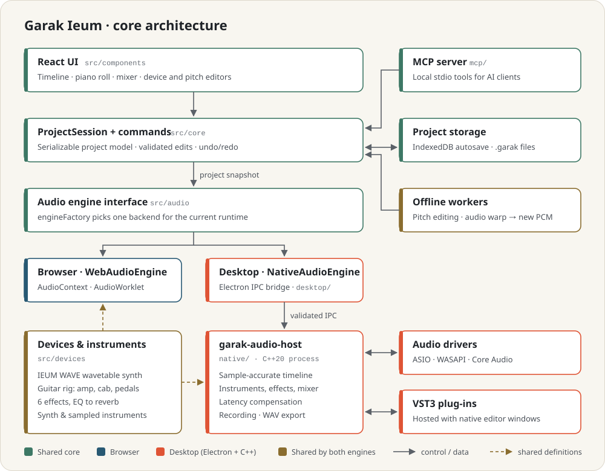

<p align="center">
  <a href="README.md">한국어</a> · <strong>English</strong> · <a href="README.ja.md">日本語</a>
</p>

<p align="center">
  
</p>

<p align="center">
  <a href="https://github.com/songchez/garak-ieum/releases"></a>
  <a href="LICENSE"></a>
  
</p>

<h1 align="center">Garak Ieum · 가락이음</h1>

**Garak Ieum** is an open-source DAW built in Korea. It brings MIDI composition with a piano roll, audio recording, monophonic pitch editing, built-in instruments, effects and a guitar amp, mixing, and WAV export together in one studio. The desktop app runs on its own C++20 audio engine, using ASIO or WASAPI on Windows and Core Audio on macOS, and can host VST3 plug-ins. The project is currently a **developer preview**.

<!-- TODO: replace "homepage" below with a link once the site URL is final, e.g. [homepage](https://...) -->
For a feature tour and step-by-step install and usage guides, visit the **homepage**.

## Download and install

**[Get the latest version from GitHub Releases →](https://github.com/songchez/garak-ieum/releases)**

| OS | Installer | How to install |
| --- | --- | --- |
| Windows 64-bit (x64) | `Garak-Ieum-Setup-<version>-x64.exe` | Run the installer and follow the prompts. |
| macOS on Apple Silicon (M-series) | `Garak-Ieum-Setup-<version>-arm64.dmg` | Open the DMG and drag `가락이음.app` into Applications. |

- Intel Macs and Linux are not supported.
- The installed app does not need Node.js or pnpm.
- Preview builds are not signed with a trusted Windows publisher certificate, nor signed with an Apple Developer ID and notarized. You may see a SmartScreen or Gatekeeper warning on first launch.
- Each release also ships a source ZIP built from the same commit (`Garak-Ieum-Source-…zip`) and SHA-256 checksums. The source ZIP is not an installer.

Platform guides (in Korean): [Windows](docs/DESKTOP.md) · [macOS](docs/MACOS.md) · [AI integration (MCP)](docs/MCP.md)

## Build from source

You need **Node.js 24.x**, **pnpm 11.25.0** and **CMake 3.25+**. On Windows, install the Visual Studio 2022 (or Build Tools) C++ desktop workload and the Windows SDK. On macOS, use an Apple Silicon Mac with the Xcode Command Line Tools.

```bash
git clone https://github.com/songchez/garak-ieum.git
cd garak-ieum
pnpm install --frozen-lockfile

pnpm desktop:dev          # build the native engine and app, then open Electron
pnpm desktop:build        # Windows x64 installer (.exe)
pnpm desktop:build:mac    # macOS arm64 DMG
pnpm dev                  # browser demo only (Web Audio)
```

Test commands, signing and the release process are covered in the [desktop guide](docs/DESKTOP.md#4-소스에서-실행하고-빌드하기) and [release process](docs/RELEASING.md) (in Korean).

## Architecture

<p align="center">
  
</p>

- **One project model** — Edits from the UI (React) and from AI clients (MCP) both go through `ProjectSession` and validated commands in `src/core`. The project is plain serializable data with a shared undo/redo history.
- **Local storage** — Projects and their source audio autosave to IndexedDB and can be exported as `.garak` files to continue on another machine. There is no account or cloud backend.
- **Two audio backends** — `engineFactory` selects `NativeAudioEngine` on desktop and `WebAudioEngine` in the browser. If the native engine is unavailable on desktop, the app reports an error instead of silently falling back to Web Audio.
- **A C++ engine in its own process** — `garak-audio-host` owns the device callback, instruments, effects, the guitar amp, VST3 plug-ins, latency compensation, recording and WAV export. The timeline is converted to sample frames ahead of time, so no audio buffer ever waits on JavaScript or IPC.
- **Offline processing** — Pitch editing (Signalsmith WASM) and audio warp render new PCM assets in Web Workers while keeping the original audio untouched.

More detail (in Korean): [Architecture](docs/ARCHITECTURE.md) · [Native audio](docs/NATIVE_AUDIO.md)

## Documentation

Most documentation is written in Korean.

| Topic | Documents |
| --- | --- |
| Getting started | [GETTING_STARTED](docs/GETTING_STARTED.md) · [Shortcuts](docs/SHORTCUTS.md) |
| Features | [Pitch editor](docs/PITCH_EDITOR.md) · [Guitar amp](docs/GUITAR_RIG.md) · [IEUM WAVE](docs/IEUM_WAVE.md) · [MIDI import](docs/MIDI_IMPORT.md) |
| AI integration | [MCP](docs/MCP.md) |
| Design and status | [Architecture](docs/ARCHITECTURE.md) · [Native audio](docs/NATIVE_AUDIO.md) · [Implementation status](docs/IMPLEMENTATION_STATUS.md) · [Roadmap](docs/ROADMAP.md) |
| Releases and licensing | [Release process](docs/RELEASING.md) · [GPL distribution](docs/LICENSING.md) |

Everything else is in the [`docs/`](docs/) folder. Bug reports and feedback are welcome in [Issues](https://github.com/songchez/garak-ieum/issues).

## License

The application code is licensed under the [GNU GPL v3.0 only (`GPL-3.0-only`)](LICENSE). The [notice](public/licenses/garak-ieum-MIT-notice.txt) for code previously released under MIT is preserved. Third-party assets — including Korean traditional instrument samples from the National Gugak Center, Lucide icons, the Deogon Princess wordmark typeface and Signalsmith DSP — keep their own licenses, listed in [THIRD_PARTY_NOTICES](THIRD_PARTY_NOTICES.md). If you redistribute the installers, see the [GPL distribution guide](docs/LICENSING.md) for how to provide the corresponding source.

<p align="center"><sub>가락이음 · Garak Ieum</sub></p>
