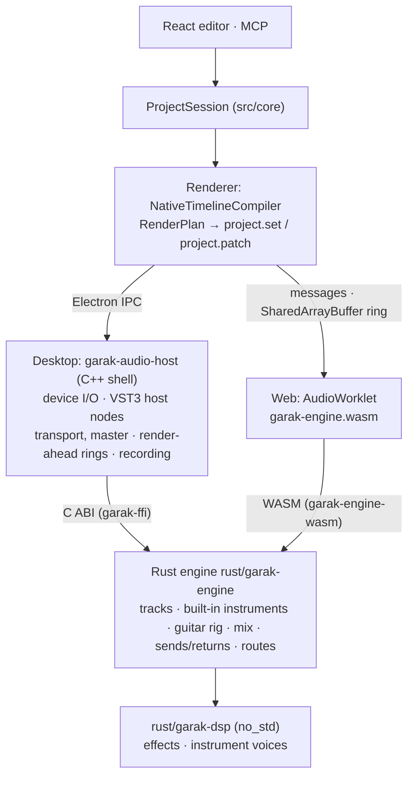

<p align="center">
  <a href="README.md">한국어</a> · <strong>English</strong> · <a href="README.ja.md">日本語</a>
</p>

<p align="center">
  
</p>

<p align="center">
  <a href="https://github.com/songchez/garak-ieum/releases"></a>
  <a href="LICENSE"></a>
  
</p>

<h1 align="center">Garak Ieum · 가락이음</h1>

**Garak Ieum** is an open-source DAW built in Korea. It brings MIDI composition with a piano roll, audio recording, monophonic pitch editing, built-in instruments, effects and a guitar amp, mixing, and WAV export together in one studio. Sound comes from **one Rust audio engine** shared by the desktop app and the browser. The desktop app uses ASIO or WASAPI on Windows and Core Audio on macOS, and can host VST3 plug-ins. The project is currently a **developer preview**.

<!-- TODO: replace "homepage" below with a link once the site URL is final, e.g. [homepage](https://...) -->
For a feature tour and step-by-step install and usage guides, visit the **homepage**.

## Download and install

**[Get the latest version from GitHub Releases →](https://github.com/songchez/garak-ieum/releases)**

| OS | Installer | How to install |
| --- | --- | --- |
| Windows 64-bit (x64) | `Garak-Ieum-Setup-<version>-x64.exe` | Run the installer and follow the prompts. |
| macOS on Apple Silicon (M-series) | `Garak-Ieum-Setup-<version>-arm64.dmg` | Open the DMG and drag `가락이음.app` into Applications. |

- Intel Macs and Linux are not supported.
- The installed app does not need Node.js or pnpm.
- Preview builds are not signed with a trusted Windows publisher certificate, nor signed with an Apple Developer ID and notarized. You may see a SmartScreen or Gatekeeper warning on first launch.
- Each release also ships a source ZIP built from the same commit (`Garak-Ieum-Source-…zip`) and SHA-256 checksums. The source ZIP is not an installer.

Platform guides (in Korean): [Windows](docs/DESKTOP.md) · [macOS](docs/MACOS.md) · [AI integration (MCP)](docs/MCP.md)

## Build from source

You need **Node.js 24.x**, **pnpm 11.25.0**, **CMake 3.25+** and the **Rust toolchain** pinned in `rust/rust-toolchain.toml`. On Windows, install the Visual Studio 2022 (or Build Tools) C++ desktop workload and the Windows SDK. On macOS, use an Apple Silicon Mac with the Xcode Command Line Tools. One script installs Rust (if rustup is already there, it only adds the pinned version).

```bash
git clone https://github.com/songchez/garak-ieum.git
cd garak-ieum
pnpm install --frozen-lockfile

# Rust toolchain (once)
powershell -ExecutionPolicy Bypass -File scripts/setup-rust.ps1   # Windows
sh scripts/setup-rust.sh                                          # macOS / Linux

pnpm desktop:dev          # build the Rust engine, the C++ host and the app, then open Electron
pnpm desktop:build        # Windows x64 installer (.exe)
pnpm desktop:build:mac    # macOS arm64 DMG
pnpm dev                  # run in the browser (the Rust engine in an AudioWorklet)
pnpm build                # web build (includes garak-engine.wasm)
```

- The web app makes sound only through `garak-engine.wasm`, so build it once with `pnpm rust:wasm` before `pnpm dev`. Without it the app shows the engine load error instead of sound (build it and reload).
- Native builds always build and link the Rust engine (`rust/garak-ffi`) with cargo (required since 0.3.3). Install Rust with `scripts/setup-rust.ps1` / `setup-rust.sh`.
- Rust commands (`pnpm rust:test`, `rust:check`, `rust:wasm`, `rust:build`) and the toolchain table are in [Rust audio core](docs/RUST.md) (in Korean).

Test commands, signing and the release process are covered in the [desktop guide](docs/DESKTOP.md#4-소스에서-실행하고-빌드하기) and [release process](docs/RELEASING.md) (in Korean).

## Architecture



- **One project model** — Edits from the UI (React) and from AI clients (MCP) both go through `ProjectSession` and validated commands in `src/core`. The project is plain serializable data with a shared undo/redo history.
- **Local storage** — Projects and their source audio autosave to IndexedDB and can be exported as `.garak` files to continue on another machine. There is no account or cloud backend.
- **One Rust engine, two hosts** — `rust/garak-engine` renders everything from the timeline to the pre-master sum: tracks, built-in instruments, the guitar rig, effects (시김새), sends/returns and track routes. The desktop uses it through a C ABI (`rust/garak-ffi`, headers in `rust/garak-ffi/include`), the browser through WASM (`rust/garak-engine-wasm`). Effects and instrument voices live in `rust/garak-dsp` (`no_std`).
- **Desktop: a thin C++ shell** — the `RenderEngine` in `garak-audio-host` keeps device I/O (ASIO, WASAPI, Core Audio), VST3 (host nodes the engine calls back into), transport, the master bus and metronome, render-ahead rings and recording, and hands track rendering to the Rust engine. Tracks render in parallel on worker threads, one processing level at a time, bit-identical to a single thread. If the native engine is unavailable, the app reports an error instead of silently falling back to Web Audio.
- **Web: an AudioWorklet** — `garak-engine.wasm` runs in an AudioWorklet with a shared meter block and live-event ring (SharedArrayBuffer), input monitoring and recording taps. Exports render offline with the same engine in a Worker. It is the web's only renderer, with no fallback: a browser without AudioWorklet or WebAssembly, or a module that fails to load, gets a clear error, and a project the engine refuses fails to play or export with the reason.
- **Render-diff protocol** — the renderer sends the full plan once (`project.set`) and then only the tracks that changed (`project.patch`). The engine is split into a `Controller` on the control thread and a `Renderer` on the audio thread that talk only through lock-free queues, so the audio thread never allocates or locks and no buffer waits on JavaScript or IPC.
- **Offline processing** — Pitch editing (Signalsmith WASM) and audio warp render new PCM assets in Web Workers while keeping the original audio untouched.

> **Old engines:** 0.3.3 removed the desktop C++ track path, C++ effect DSP and C++ IEUM WAVE synth, and the web's old TS / Web Audio engine with its switches (`garak.rustEngine`, `garak.rustDsp`). Both hosts render only in the Rust engine.

More detail (in Korean): [Architecture](docs/ARCHITECTURE.md) · [Rust render engine](docs/RUST_ENGINE.md) · [Rust audio core](docs/RUST.md) · [Render-diff protocol](docs/RENDER_DIFF_PROTOCOL.md) · [Native audio](docs/NATIVE_AUDIO.md)

## Documentation

Most documentation is written in Korean.

| Topic | Documents |
| --- | --- |
| Getting started | [GETTING_STARTED](docs/GETTING_STARTED.md) · [Shortcuts](docs/SHORTCUTS.md) |
| Features | [Pitch editor](docs/PITCH_EDITOR.md) · [Guitar amp](docs/GUITAR_RIG.md) · [IEUM WAVE](docs/IEUM_WAVE.md) · [MIDI import](docs/MIDI_IMPORT.md) |
| AI integration | [MCP](docs/MCP.md) |
| Design and status | [Architecture](docs/ARCHITECTURE.md) · [Rust render engine](docs/RUST_ENGINE.md) · [Rust audio core](docs/RUST.md) · [Native audio](docs/NATIVE_AUDIO.md) · [Implementation status](docs/IMPLEMENTATION_STATUS.md) · [Roadmap](docs/ROADMAP.md) |
| Releases and licensing | [Release process](docs/RELEASING.md) · [GPL distribution](docs/LICENSING.md) |

Everything else is in the [`docs/`](docs/) folder. Bug reports and feedback are welcome in [Issues](https://github.com/songchez/garak-ieum/issues).

## License

The application code is licensed under the [GNU GPL v3.0 only (`GPL-3.0-only`)](LICENSE). The [notice](public/licenses/garak-ieum-MIT-notice.txt) for code previously released under MIT is preserved. Third-party assets — including Korean traditional instrument samples from the National Gugak Center, Lucide icons, the Deogon Princess wordmark typeface and Signalsmith DSP — keep their own licenses, listed in [THIRD_PARTY_NOTICES](THIRD_PARTY_NOTICES.md). If you redistribute the installers, see the [GPL distribution guide](docs/LICENSING.md) for how to provide the corresponding source.

<p align="center"><sub>가락이음 · Garak Ieum</sub></p>
