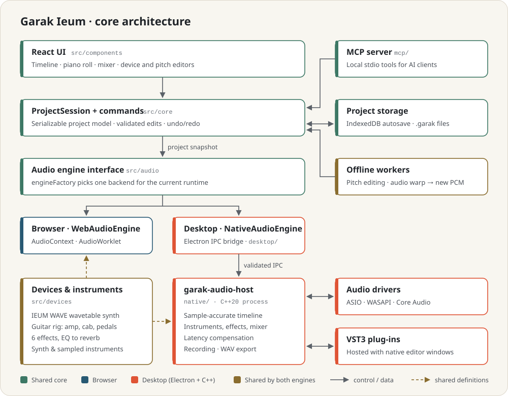

<p align="center">
  <a href="README.md">한국어</a> · <a href="README.en.md">English</a> · <strong>日本語</strong>
</p>

<p align="center">
  
</p>

<p align="center">
  <a href="https://github.com/songchez/garak-ieum/releases"></a>
  <a href="LICENSE"></a>
  
</p>

<h1 align="center">Garak Ieum · 가락이음</h1>

**Garak Ieum(가락이음)** は、韓国で開発しているオープンソースの DAW です。ピアノロールでの MIDI 作曲、オーディオ録音、単旋律のピッチ編集、内蔵の音源・エフェクト・ギターアンプ、ミキシング、WAV 書き出しまでを一つのスタジオで扱えます。デスクトップ版は独自の C++20 オーディオエンジンで動作し、Windows では ASIO・WASAPI、macOS では Core Audio を使用します。VST3 プラグインも読み込めます。現在は **開発プレビュー** 段階です。

<!-- TODO: ホームページの URL が決まったら、下の「ホームページ」をリンクに置き換えてください。例: [ホームページ](https://...) -->
機能紹介や詳しいインストール・使い方のガイドは **ホームページ** をご覧ください。

## ダウンロードとインストール

**[GitHub Releases から最新版をダウンロード →](https://github.com/songchez/garak-ieum/releases)**

| OS | インストーラー | インストール方法 |
| --- | --- | --- |
| Windows 64 ビット (x64) | `Garak-Ieum-Setup-<バージョン>-x64.exe` | インストーラーを実行し、画面の案内に従います。 |
| macOS Apple シリコン (M シリーズ) | `Garak-Ieum-Setup-<バージョン>-arm64.dmg` | DMG を開き、`가락이음.app` をアプリケーションフォルダへドラッグします。 |

- Intel Mac と Linux には対応していません。
- インストールしたアプリの実行に Node.js や pnpm は不要です。
- プレビュー版は、Windows の発行元署名および Apple Developer ID による署名・公証を受けていません。初回起動時に SmartScreen や Gatekeeper の警告が表示されることがあります。
- 各リリースには、同じコミットから作成したソース ZIP(`Garak-Ieum-Source-…zip`)と SHA-256 チェックサムも含まれます。ソース ZIP はインストール用ではありません。

OS 別の詳しいガイド(韓国語):[Windows](docs/DESKTOP.md) · [macOS](docs/MACOS.md) · [AI 連携(MCP)](docs/MCP.md)

## ソースからビルド

**Node.js 24.x**、**pnpm 11.25.0**、**CMake 3.25 以上** が必要です。Windows では Visual Studio 2022(または Build Tools)の「C++ によるデスクトップ開発」と Windows SDK を、macOS では Apple シリコン搭載 Mac と Xcode Command Line Tools を用意してください。

```bash
git clone https://github.com/songchez/garak-ieum.git
cd garak-ieum
pnpm install --frozen-lockfile

pnpm desktop:dev          # ネイティブエンジンとアプリをビルドして Electron を起動
pnpm desktop:build        # Windows x64 インストーラー (.exe)
pnpm desktop:build:mac    # macOS arm64 DMG
pnpm dev                  # ブラウザー版デモのみ (Web Audio)
```

テスト用コマンド、署名、リリース手順は [デスクトップガイド](docs/DESKTOP.md#4-소스에서-실행하고-빌드하기) と [リリース手順](docs/RELEASING.md)(韓国語)を参照してください。

## アーキテクチャ

<p align="center">
  
</p>

- **単一のプロジェクトモデル** — 画面(React)からの編集も AI(MCP)からの編集も、`src/core` の `ProjectSession` と検証済みコマンドを経由します。プロジェクトはシリアライズ可能なデータで、Undo/Redo の履歴を共有します。
- **ローカル保存** — プロジェクトと元のオーディオは IndexedDB に自動保存され、`.garak` ファイルに書き出して別のマシンで作業を続けられます。アカウントやクラウドのバックエンドはありません。
- **2 つのオーディオバックエンド** — `engineFactory` がデスクトップでは `NativeAudioEngine`、ブラウザーでは `WebAudioEngine` を選びます。デスクトップでネイティブエンジンが使えない場合はエラーを表示し、Web Audio へ黙って切り替えることはしません。
- **別プロセスの C++ エンジン** — `garak-audio-host` がデバイスのコールバック、音源・エフェクト・ギターアンプ・VST3、レイテンシー補正、録音、WAV 書き出しを担当します。タイムラインは事前にサンプルフレームへ変換されるため、オーディオバッファーごとに JavaScript や IPC の応答を待つことはありません。
- **オフライン処理** — ピッチ編集(Signalsmith WASM)とオーディオワープは Worker で新しい PCM アセットをレンダリングし、元のオーディオはそのまま保持します。

詳しくは(韓国語):[アーキテクチャ](docs/ARCHITECTURE.md) · [ネイティブオーディオ](docs/NATIVE_AUDIO.md)

## ドキュメント

ドキュメントの大半は韓国語で書かれています。

| トピック | ドキュメント |
| --- | --- |
| はじめに | [GETTING_STARTED](docs/GETTING_STARTED.md) · [ショートカット](docs/SHORTCUTS.md) |
| 機能ガイド | [ピッチエディター](docs/PITCH_EDITOR.md) · [ギターアンプ](docs/GUITAR_RIG.md) · [IEUM WAVE](docs/IEUM_WAVE.md) · [MIDI 読み込み](docs/MIDI_IMPORT.md) |
| AI 連携 | [MCP](docs/MCP.md) |
| 設計と実装状況 | [アーキテクチャ](docs/ARCHITECTURE.md) · [ネイティブオーディオ](docs/NATIVE_AUDIO.md) · [実装状況](docs/IMPLEMENTATION_STATUS.md) · [ロードマップ](docs/ROADMAP.md) |
| リリースとライセンス | [リリース手順](docs/RELEASING.md) · [GPL 配布ガイド](docs/LICENSING.md) |

その他のドキュメントは [`docs/`](docs/) フォルダーにあります。不具合の報告やご意見は [Issues](https://github.com/songchez/garak-ieum/issues) へお寄せください。

## ライセンス

アプリのコードは [GNU GPL v3.0 only(`GPL-3.0-only`)](LICENSE)で提供しています。以前 MIT で公開したコードの[告知](public/licenses/garak-ieum-MIT-notice.txt)は保持しています。韓国国立国楽院の国楽音源、Lucide アイコン、徳温公主体のワードマーク、Signalsmith DSP などのサードパーティ資産はそれぞれのライセンスに従い、[THIRD_PARTY_NOTICES](THIRD_PARTY_NOTICES.md) にまとめています。インストーラーを再配布する場合の対応ソースの提供方法は [GPL 配布ガイド](docs/LICENSING.md) をご確認ください。

<p align="center"><sub>가락이음 · Garak Ieum</sub></p>
