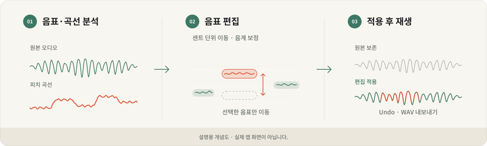
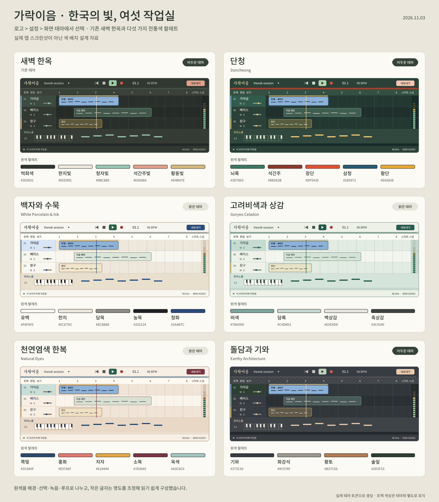

<p align="center">
  
</p>

<p align="center">
  <a href="#development"></a>
  <a href="LICENSE"></a>
  <a href="#pitch-editor"></a>
  <a href="#ai"></a>
</p>

<h1 align="center">가락이음 · Garak Ieum</h1>

<p align="center">
  <strong>우리의 소리와 색을 담은, 100% 국산 DAW.</strong><br>
  MIDI 작곡부터 오디오 녹음, 피치 편집, 믹싱과 WAV 출력까지.<br>
  한국에서 만드는 오픈소스 음악 작업실을 브라우저에서 만나세요.
</p>

<p align="center">
  <a href="#features">주요 기능</a> ·
  <a href="#pitch-editor">피치 편집</a> ·
  <a href="#gugak">국악 프로젝트</a> ·
  <a href="#themes">한국의 색</a> ·
  <a href="#ai">AI 연결</a> ·
  <a href="#quick-start"><strong>시작하기</strong></a>
</p>

---

가야금 한 줄에서 시작한 아이디어를 드럼과 베이스에 얹고, 녹음한 멜로디의 음정을 다듬어 한 곡으로 완성하세요. **가락이음**은 음악을 만들고 고치는 과정을 하나의 작업실로 이어줍니다.

| **15가지 내장 악기** | **6가지 이펙트** | **6가지 한국적 테마** | **3개의 국악 샘플 프로젝트** |
| :---: | :---: | :---: | :---: |
| 합성 악기 6 + 샘플 악기 9 | EQ부터 리버브까지 | 새벽 한옥부터 백자와 수묵까지 | 붐뱁 · 트랩 · 퓨전 국악 |

<a id="pitch-editor"></a>

## 녹음한 멜로디도, 음표처럼 편집하세요

**오디오 피치 편집기를 기본으로 제공합니다.** 보컬과 독주 오디오를 음표와 피치 곡선으로 분석하고, 원하는 음을 골라 음높이를 다듬을 수 있습니다. MIDI를 고치듯 음표를 드래그하거나 센트 값을 입력하고, 음계와 보정 강도로 음정 중심을 조절하세요.

<p align="center">
  
</p>
<p align="center"><sub>피치 편집의 작업 흐름을 설명하는 개념도입니다. 실제 앱 스크린샷이 아닙니다.</sub></p>

| 할 수 있는 일 | 편집 방식 |
| --- | --- |
| **음표와 피치 곡선 분석** | 녹음하거나 가져온 오디오에서 음표 구간과 음높이 흐름을 확인합니다. |
| **반음·센트 단위 이동** | 음표를 위아래로 드래그하거나 값을 입력합니다. 음표별 ±12반음까지 조절합니다. |
| **다중 선택·분할·합치기** | 여러 음을 함께 다듬거나 분석된 음표의 구간을 나눕니다. |
| **음계에 맞춘 보정** | 기준음, 반음계·장음계·자연 단음계, 보정 강도 0~100%를 선택합니다. |
| **원본 보존과 되돌리기** | 편집 적용 후 재생·Undo/Redo·프로젝트 저장·WAV 출력으로 이어지며 원본을 복원할 수 있습니다. |
| **실험적 포먼트 도구** | 피치 이동 시 포먼트 보존, 음표별 포먼트 이동으로 음색을 조절합니다. |

**현재 대상:** 원본 파일 전체가 **60초 이하**인 단선율 보컬·독주, 모노/스테레오. 소리의 변화는 **편집 적용 후** 재생됩니다. 포먼트 보존·이동은 실험 기능이며, 보존은 기본으로 꺼져 있습니다.

[피치 편집기 사용법 →](docs/PITCH_EDITOR.md) · [처음 적용해 보기 →](docs/GETTING_STARTED.md#3-오디오를-음표처럼-피치-편집하기)

<a id="features"></a>

## 아이디어부터 완성된 편곡까지

| 작곡과 편곡 | 녹음과 오디오 |
| --- | --- |
| **피아노롤에서 만드는 멜로디와 리듬**<br>음표 추가·이동·길이·벨로시티 편집, 퀀타이즈와 스윙, 리전 조옮김을 지원합니다. | **마이크와 파일을 작업실로**<br>오디오 파일 가져오기와 드롭, 파형 표시, 마이크 녹음, 녹음 대기와 입력 모니터링을 제공합니다. |
| **리전으로 다듬는 곡의 흐름**<br>다중 선택, 복사·복제, 좌우 트림, 분할·합치기, 반복·뮤트·루프, 사이클과 마커를 사용합니다. | **원본을 보존하는 편집**<br>오디오 리전의 게인·딜레이·페이드와 피치 편집을 적용하고, 프로젝트 편집 이력으로 되돌릴 수 있습니다. |
| **익숙한 DAW 작업 방식**<br>스마트 스냅, 겹침/겹치지 않음, 왼쪽 인스펙터, 트랙 헤더 설정과 96색 팔레트를 제공합니다. | **작업 환경에 맞춘 설정**<br>입력 장치, 브라우저 지원 시 출력 장치, 지연 우선순위, 입력 레벨 테스트와 프로젝트 샘플레이트를 설정합니다. |

### 가야금에서 808까지, 바로 꺼내 쓰는 악기

**15가지 내장 악기**로 멜로디·리듬·베이스를 쌓아보세요. 라이브러리에서 악기를 미리듣고 트랙에 추가할 수 있습니다.

| 악기군 | 구성 |
| --- | --- |
| **국악** | 가야금 · 해금 · 대금 · 사물놀이 — 꽹과리, 징, 장구, 북 |
| **샘플 건반** | 그랜드 피아노 · Wurlitzer 전기 피아노 |
| **샘플 드럼** | 어쿠스틱 · 808 · 로파이 드럼 키트 |
| **합성 악기** | 벨벳 키 · 틴 전기 피아노 · 모노 베이스 · 포켓 드럼 · 클라우드 패드 · 글라스 플럭 |

국악 음원은 **국립국악원** 출처의 샘플을 사용합니다. 악기별 원본 출처와 이용 조건은 [제3자 자산 안내](THIRD_PARTY_NOTICES.md)에서 확인할 수 있습니다.

### 여섯 가지 이펙트로 완성하는 사운드

**EQ · 필터 · 컴프레서 · 드라이브 · 딜레이 · 리버브**를 트랙별 디바이스 체인에 추가하고, 순서를 바꾸거나 바이패스하세요. 여섯 이펙트는 각각의 정의와 오디오 처리를 가진 모듈로 구성되어 있습니다.

믹서에서는 트랙의 **볼륨·팬·뮤트·솔로·Solo Safe**, 마스터 볼륨과 실제 신호 미터를 다룹니다. 최종 편곡은 **스테레오 16-bit PCM WAV**로 내보낼 수 있습니다.

<a id="gugak"></a>

## 첫 곡은, 세 개의 국악 프로젝트에서

빈 화면이 막막할 때는 준비된 편곡을 열어보세요. 세 곡 모두 **트랙·음표·리전·악기·이펙트를 직접 바꿀 수 있는 오리지널 MIDI 프로젝트**입니다. 열 때마다 독립된 새 작업을 만듭니다.

| **마당의 결** | **검은 물결** | **달빛 행렬** |
| --- | --- | --- |
| **국악 붐뱁** | **국악 트랩** | **퓨전 국악** |
| 92 BPM · 40마디 · 10트랙 | 144 BPM · 48마디 · 11트랙 | 118 BPM · 40마디 · 11트랙 |
| 느슨한 스윙 위에 가야금이 말을 걸고 북과 장구가 대답합니다. | 짧게 뜯는 가야금과 묵직한 서브 베이스, 하프타임 클랩과 하이햇 롤을 엮었습니다. | 두 베이스의 엇박 위에서 대금과 해금, 사물 타악과 밴드가 주고받습니다. |

**프로젝트 선택 → 샘플 프로젝트 → 선택한 편곡 열기**로 시작하세요. 내 프로젝트와 샘플은 같은 타일·상세 정보·열기 방식으로 탐색할 수 있습니다.

참고곡의 녹음·멜로디·가사를 복제하지 않고 새로 작성했습니다. [곡별 섹션·악기 역할·참고 자료 →](docs/SAMPLE_PROJECTS.md)

<a id="themes"></a>

## 한국의 색으로 꾸민 여섯 작업실

한옥의 기와, 백자의 유백색, 고려청자의 비색, 한복의 천연염색에서 작업실의 색을 가져왔습니다. **로고 메뉴 → 설정 → 화면 테마**에서 취향에 맞는 분위기를 선택하세요.

<p align="center">
  
</p>
<p align="center"><sub>실제 테마 색상 토큰을 바탕으로 만든 색 배치 설계 자료입니다. 실제 앱 스크린샷이 아닙니다.</sub></p>

| 테마 | 작업실의 분위기 |
| --- | --- |
| **새벽 한옥** | 먹빛 바탕에 한지와 청자빛을 더한 기본 테마 |
| **단청** | 뇌록·석간주·장단·삼청·황단의 깊고 선명한 대비 |
| **백자와 수묵** | 유백과 한지, 농묵과 청화로 정리한 밝은 작업실 |
| **고려비색과 상감** | 청자의 옥빛과 흑백 상감에서 가져온 차분한 색 |
| **천연염색 한복** | 쪽빛·홍화·치자·소목·옥색의 부드러운 조화 |
| **돌담과 기와** | 기와·화강석·황토·솔잎의 따뜻한 중성색 |

작은 삼태극 북 로고, 덕온공주체 워드마크, 기와 형태의 한 줄 헤더와 **Lucide 아이콘**이 가락이음의 모습을 만듭니다. 선택한 테마는 즉시 적용되고 이 브라우저에 저장됩니다.

[테마와 색 배치 자세히 보기 →](docs/THEMES.md) · [브랜드 이야기 →](docs/BRAND.md)

<a id="ai"></a>

## AI에게 설명하고, 편집 가능한 음악으로 받으세요

가락이음은 **로컬 MCP 연결**을 통해 AI가 현재 프로젝트를 읽고, 트랙·리전·믹싱을 편집할 수 있도록 만듭니다. 연결한 MCP 클라이언트에서 이런 작업을 요청할 수 있습니다.

> “가야금 트랙을 만들고, 8마디짜리 MIDI 초안을 넣어 주세요.”
>
> “선택한 트랙의 볼륨을 3dB 낮추고 팬을 왼쪽으로 조금 옮겨 주세요.”
>
> “변경할 내용을 먼저 보여주고, 적용한 뒤 한 번에 되돌릴 수 있게 해 주세요.”

현재 **7개 도구와 19개 편집 명령**을 제공합니다. 프로젝트·선택·악기 조회, MIDI 리전 생성, 트랙·리전·믹서·이펙트 편집, 변경 미리 보기, 일괄 적용과 Undo를 지원합니다. **AI 편집 허용**을 끄면 조회와 미리 보기만 사용할 수 있습니다.

AI는 사용자가 연결한 **외부 로컬 MCP 클라이언트**에서 동작합니다. 현재는 편집 가능한 MIDI와 명령을 다루며, 음원을 듣고 평가하는 기능이나 내장 음악 생성 모델·작곡 코드 실행기는 포함하지 않습니다.

[AI·MCP 연결하기 →](docs/MCP.md) · [작곡 언어 비교 실험 →](docs/COMPOSITION_LANGUAGE_POC.md)

<a id="quick-start"></a>

## 지금 시작하기

**Node.js 24.x 권장 · pnpm 11.25.0 · 데스크톱 브라우저**를 준비하세요. Node.js 22.x를 사용한다면 22.12 이상이 필요합니다.

```bash
git clone https://github.com/songchez/garak-ieum.git
cd garak-ieum
pnpm install --frozen-lockfile
pnpm dev
```

터미널에 표시된 **Local 주소**를 열고 **샘플 프로젝트**에서 한 곡을 고르세요. 편집기의 재생 버튼이나 **Space**로 음악을 시작할 수 있습니다.

<details>
<summary><strong>Windows에서 pnpm을 찾지 못하거나 npm 설치 오류가 난다면</strong></summary>

프로젝트 폴더에서 아래 명령으로 고정된 pnpm 버전을 실행하세요.

```powershell
npx.cmd --yes pnpm@11.25.0 install --frozen-lockfile
npx.cmd --yes pnpm@11.25.0 dev
```

이 저장소는 **pnpm과 pnpm-lock.yaml**로 의존성을 관리합니다. `npm i`의 `workspace:` 오류나 설치 중단 후 `lucide-react` 오류가 보이면 개발 서버를 멈추고 설치를 완료한 뒤 다시 실행하세요.

</details>

[설치부터 첫 편곡까지 전체 가이드 →](docs/GETTING_STARTED.md)

### 내 작업은 프로젝트로, 결과물은 WAV로

프로젝트는 이 브라우저의 **IndexedDB에 자동 저장**됩니다. 기본 주소 `/`에서 작업을 고르고, `/projects/:id`로 해당 프로젝트를 다시 엽니다.

- **계속 편집할 작업:** 원본 오디오를 포함한 `.garak` 프로젝트 파일로 내보내고 다시 가져옵니다.
- **감상·공유할 결과:** 편곡 전체를 스테레오 WAV로 내보냅니다.
- **다른 기기나 브라우저로 이동:** `.garak` 파일을 사용합니다. 프로젝트 URL은 현재 브라우저·사이트의 저장본을 가리킵니다.

중요한 작업은 `.garak` 파일로도 보관해 주세요. 마이크 녹음과 피치 원본 확인에는 **HTTPS 또는 localhost** 환경이 필요합니다.

<a id="docs"></a>

## 더 깊이 알아보기

| 만들고 싶은 것 | 안내 |
| --- | --- |
| 첫 프로젝트와 편곡 | [시작하기](docs/GETTING_STARTED.md) |
| 보컬·독주 음정 편집 | [피치 편집기](docs/PITCH_EDITOR.md) |
| 국악 비트와 샘플 활용 | [샘플 프로젝트](docs/SAMPLE_PROJECTS.md) · [음원 규격](docs/SAMPLES.md) |
| AI와 함께 편집 | [MCP 연결](docs/MCP.md) · [작곡 언어 실험](docs/COMPOSITION_LANGUAGE_POC.md) |
| 빠른 키보드 작업 | [단축키](docs/SHORTCUTS.md) |
| 녹음 장치와 샘플레이트 | [오디오 설정](docs/GETTING_STARTED.md#4-마이크와-오디오-인터페이스-설정하기) |
| 테마와 디자인 | [여섯 테마](docs/THEMES.md) · [브랜드](docs/BRAND.md) |
| 코드와 배포 | [아키텍처](docs/ARCHITECTURE.md) · [배포 안내](docs/DEPLOYMENT.md) |
| 현재 구현과 남은 작업 | [구현 상태](docs/IMPLEMENTATION_STATUS.md) · [상호작용 명세](docs/INTERACTION_SPEC.md) |

<a id="development"></a>

## 함께 완성하는 음악 작업실

가락이음은 **0.1.0 개발 프리뷰**입니다. 실제로 재생·편집할 수 있는 웹 DAW를 만들고 있으며, **1.0은 웹 편집기와 오디오 엔진**, **2.0은 로컬 네이티브 호스트를 통한 플러그인 연결**을 목표로 합니다.

<details>
<summary><strong>현재 지원 범위와 앞으로의 방향</strong></summary>

- **현재:** MIDI 피아노롤, 오디오 녹음·편집, 단선율 피치 편집, 내장 악기와 이펙트, 로컬 프로젝트 저장, 제한된 MCP 편집 명령을 제공합니다.
- **다음 단계:** MIDI 파일 입출력·외부 MIDI 장치, 메트로놈·카운트인, 오토메이션·템포 맵, 작곡 코드 실행과 MCP 범위 확대를 다듬습니다.
- **장기 방향:** 네이티브 VST/AU/CLAP 연결을 위한 로컬 호스트를 연구합니다.
- 다성음 분리, 타이밍·드리프트·비브라토 개별 보정, 실시간 피치 보정은 현재 제공하지 않습니다. 포먼트 도구는 실험 단계입니다.
- 프로젝트 저장은 브라우저 로컬입니다. 클라우드 동기화·실시간 공동 편집·계정 기능은 현재 제공하지 않습니다.
- 브라우저·장치별 오디오 동작과 청감 품질은 검증을 이어가고 있습니다. 정식 배포 수준의 안정성 검증 완료를 뜻하지 않습니다.

정확한 범위와 검증 기록은 [구현 상태](docs/IMPLEMENTATION_STATUS.md)에서 확인할 수 있습니다.

</details>

오류 제보, 사용성 의견, 코드 기여를 환영합니다. [이슈](https://github.com/songchez/garak-ieum/issues)에 **사용한 브라우저·재현 순서·기대한 동작**을 남겨 주세요. 코드 변경에는 다음 명령을 사용합니다.

```bash
pnpm test
pnpm build
pnpm mcp:build
```

기술 구성은 **React · TypeScript · Vite · Web Audio API · IndexedDB**입니다. 직접 작성한 Web Audio 엔진에 모듈형 이펙트를 연결하고, 오디오 피치의 오프라인 처리에는 Worker와 Signalsmith WASM을 사용합니다.

## 라이선스와 크레딧

앱 코드와 오리지널 MIDI 편곡 코드는 [MIT License](LICENSE)로 제공합니다. 아이콘·글꼴·샘플 음원·외부 라이브러리는 각각의 라이선스를 따릅니다.

국립국악원의 국악 음원, Lucide 아이콘, 덕온공주체 워드마크, Signalsmith DSP와 함께 가락이음을 만듭니다. 전체 출처와 사용 조건은 [제3자 자산 안내](THIRD_PARTY_NOTICES.md)에 정리했습니다.

<p align="center"><strong>우리의 가락을, 당신의 음악으로.</strong><br><sub>가락이음 · Garak Ieum</sub></p>
