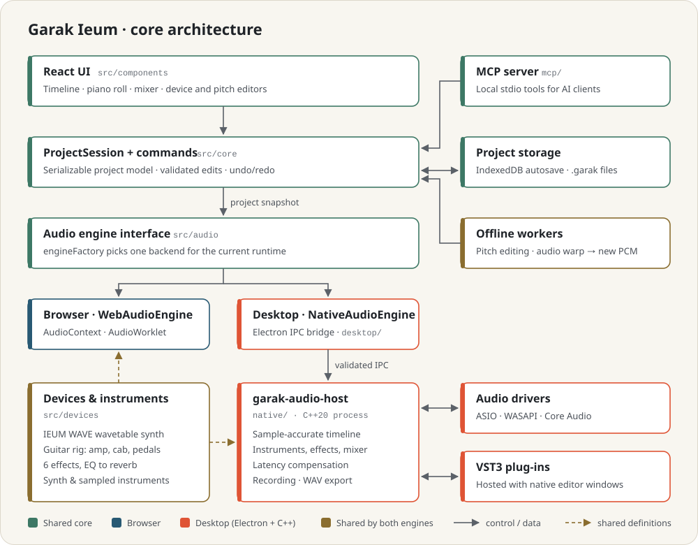

<p align="center">
  <strong>한국어</strong> · <a href="README.en.md">English</a> · <a href="README.ja.md">日本語</a>
</p>

<p align="center">
  
</p>

<p align="center">
  <a href="https://github.com/songchez/garak-ieum/releases"></a>
  <a href="LICENSE"></a>
  
</p>

<h1 align="center">가락이음 · Garak Ieum</h1>

**가락이음**은 한국에서 만드는 오픈소스 DAW입니다. MIDI 작곡과 피아노롤, 오디오 녹음과 단선율 피치 편집, 내장 악기·이펙트·기타 앰프, 믹싱과 WAV 출력을 하나의 작업실에서 다룹니다. 데스크톱 앱은 자체 C++20 오디오 엔진으로 Windows의 ASIO·WASAPI, macOS의 Core Audio에서 동작하며 VST3 플러그인을 불러올 수 있습니다. 현재는 **개발 프리뷰** 단계입니다.

<!-- TODO: 홈페이지 주소가 확정되면 아래 "홈페이지" 문구를 링크로 바꾸세요. 예: [홈페이지](https://...) -->
기능 소개와 자세한 설치·사용 안내는 **홈페이지**에서 확인할 수 있습니다.

## 다운로드와 설치

**[GitHub Releases에서 최신 버전 받기 →](https://github.com/songchez/garak-ieum/releases)**

| 운영체제 | 설치 파일 | 설치 방법 |
| --- | --- | --- |
| Windows 64비트 (x64) | `Garak-Ieum-Setup-<버전>-x64.exe` | 설치 파일을 실행하고 안내를 따릅니다. |
| macOS Apple Silicon (M 시리즈) | `Garak-Ieum-Setup-<버전>-arm64.dmg` | DMG를 열고 `가락이음.app`을 응용 프로그램 폴더로 옮깁니다. |

- Intel Mac과 Linux용 설치 파일은 제공하지 않습니다.
- 설치한 앱을 실행할 때 Node.js나 pnpm은 필요하지 않습니다.
- 프리뷰 빌드는 Windows 배포자 서명과 Apple Developer ID 서명·공증을 받지 않았습니다. 처음 실행할 때 SmartScreen 또는 Gatekeeper 안내가 나타날 수 있습니다.
- 각 릴리스에는 설치 파일과 같은 커밋의 소스 ZIP(`Garak-Ieum-Source-…zip`)과 SHA-256 체크섬이 함께 있습니다. 소스 ZIP은 설치용이 아닙니다.

OS별 상세 안내: [Windows](docs/DESKTOP.md) · [macOS](docs/MACOS.md) · [AI 연결(MCP)](docs/MCP.md)

## 소스에서 빌드하기

**Node.js 24.x**, **pnpm 11.25.0**, **CMake 3.25 이상**이 필요합니다. Windows는 Visual Studio 2022(또는 Build Tools)의 C++ 데스크톱 개발 도구와 Windows SDK, macOS는 Apple Silicon Mac과 Xcode Command Line Tools를 준비합니다.

```bash
git clone https://github.com/songchez/garak-ieum.git
cd garak-ieum
pnpm install --frozen-lockfile

pnpm desktop:dev          # 네이티브 엔진·앱을 빌드하고 Electron 창 실행
pnpm desktop:build        # Windows x64 설치 파일(.exe)
pnpm desktop:build:mac    # macOS arm64 DMG
pnpm dev                  # 브라우저 데모만 실행 (Web Audio)
```

검사 명령과 서명·배포 절차는 [데스크톱 안내](docs/DESKTOP.md#4-소스에서-실행하고-빌드하기)와 [릴리스 절차](docs/RELEASING.md)를 참고하세요.

## 아키텍처

<p align="center">
  
</p>

- **하나의 프로젝트 모델** — 화면(React)과 AI(MCP) 편집 모두 `src/core`의 `ProjectSession`과 검증된 명령을 거칩니다. 프로젝트는 직렬화 가능한 데이터이며 Undo/Redo 이력을 공유합니다.
- **로컬 저장** — 프로젝트와 원본 오디오는 IndexedDB에 자동 저장되고, `.garak` 파일로 내보내 다른 기기에서 이어서 편집할 수 있습니다. 계정·클라우드 백엔드는 없습니다.
- **두 개의 오디오 백엔드** — `engineFactory`가 데스크톱에서는 `NativeAudioEngine`, 브라우저에서는 `WebAudioEngine`을 선택합니다. 데스크톱에서 네이티브 엔진을 쓸 수 없으면 오류를 표시하며 Web Audio로 조용히 대체하지 않습니다.
- **별도 프로세스의 C++ 엔진** — `garak-audio-host`가 장치 callback, 악기·이펙트·기타 앰프·VST3, 지연 보상, 녹음과 WAV 출력을 맡습니다. 타임라인은 미리 샘플 프레임으로 변환되어 매 버퍼가 JavaScript나 IPC 응답을 기다리지 않습니다.
- **오프라인 처리** — 피치 편집(Signalsmith WASM)과 오디오 워프는 Worker에서 새 PCM 자산을 렌더링하고, 원본은 그대로 보존합니다.

자세한 설명: [아키텍처](docs/ARCHITECTURE.md) · [네이티브 오디오](docs/NATIVE_AUDIO.md)

## 문서

| 주제 | 문서 |
| --- | --- |
| 시작하기와 기본 사용법 | [GETTING_STARTED](docs/GETTING_STARTED.md) · [단축키](docs/SHORTCUTS.md) |
| 기능별 안내 | [피치 편집기](docs/PITCH_EDITOR.md) · [기타 앰프](docs/GUITAR_RIG.md) · [이음 웨이브](docs/IEUM_WAVE.md) · [MIDI 가져오기](docs/MIDI_IMPORT.md) |
| AI 연결 | [MCP](docs/MCP.md) |
| 구조와 구현 상태 | [아키텍처](docs/ARCHITECTURE.md) · [네이티브 오디오](docs/NATIVE_AUDIO.md) · [구현 상태](docs/IMPLEMENTATION_STATUS.md) · [로드맵](docs/ROADMAP.md) |
| 배포와 라이선스 | [릴리스 절차](docs/RELEASING.md) · [GPL 배포 안내](docs/LICENSING.md) |

전체 문서는 [`docs/`](docs/) 폴더에 있습니다. 오류 제보와 의견은 [이슈](https://github.com/songchez/garak-ieum/issues)에 남겨 주세요.

## 라이선스

앱 코드는 [GNU GPL v3.0 only (`GPL-3.0-only`)](LICENSE)로 제공합니다. 이전에 MIT로 제공한 코드의 [고지](public/licenses/garak-ieum-MIT-notice.txt)를 보존합니다. 국립국악원 국악 음원, Lucide 아이콘, 덕온공주체 워드마크, Signalsmith DSP 등 제3자 자산은 각각의 원래 라이선스를 따르며 [제3자 자산 안내](THIRD_PARTY_NOTICES.md)에 정리했습니다. 설치 파일을 재배포할 때의 대응 소스 제공 방법은 [GPL 배포 안내](docs/LICENSING.md)를 확인하세요.

<p align="center"><strong>우리의 가락을, 당신의 음악으로.</strong><br><sub>가락이음 · Garak Ieum</sub></p>
