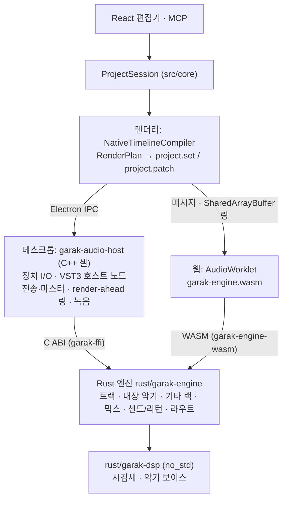

<p align="center">
  <strong>한국어</strong> · <a href="README.en.md">English</a> · <a href="README.ja.md">日本語</a>
</p>

<p align="center">
  
</p>

<p align="center">
  <a href="https://github.com/songchez/garak-ieum/releases"></a>
  <a href="LICENSE"></a>
  
</p>

<h1 align="center">가락이음 · Garak Ieum</h1>

**가락이음**은 한국에서 만드는 오픈소스 DAW입니다. MIDI 작곡과 피아노롤, 오디오 녹음과 단선율 피치 편집, 내장 악기·이펙트·기타 앰프, 믹싱과 WAV 출력을 하나의 작업실에서 다룹니다. 소리는 데스크톱과 브라우저가 함께 쓰는 **하나의 Rust 오디오 엔진**이 만듭니다. 데스크톱 앱은 Windows의 ASIO·WASAPI, macOS의 Core Audio에서 동작하며 VST3 플러그인을 불러올 수 있습니다. 현재는 **개발 프리뷰** 단계입니다.

<!-- TODO: 홈페이지 주소가 확정되면 아래 "홈페이지" 문구를 링크로 바꾸세요. 예: [홈페이지](https://...) -->
기능 소개와 자세한 설치·사용 안내는 **홈페이지**에서 확인할 수 있습니다.

## 다운로드와 설치

**[GitHub Releases에서 최신 버전 받기 →](https://github.com/songchez/garak-ieum/releases)**

| 운영체제 | 설치 파일 | 설치 방법 |
| --- | --- | --- |
| Windows 64비트 (x64) | `Garak-Ieum-Setup-<버전>-x64.exe` | 설치 파일을 실행하고 안내를 따릅니다. |
| macOS Apple Silicon (M 시리즈) | `Garak-Ieum-Setup-<버전>-arm64.dmg` | DMG를 열고 `가락이음.app`을 응용 프로그램 폴더로 옮깁니다. |

- Intel Mac과 Linux용 설치 파일은 제공하지 않습니다.
- 설치한 앱을 실행할 때 Node.js나 pnpm은 필요하지 않습니다.
- 프리뷰 빌드는 Windows 배포자 서명과 Apple Developer ID 서명·공증을 받지 않았습니다. 처음 실행할 때 SmartScreen 또는 Gatekeeper 안내가 나타날 수 있습니다.
- 각 릴리스에는 설치 파일과 같은 커밋의 소스 ZIP(`Garak-Ieum-Source-…zip`)과 SHA-256 체크섬이 함께 있습니다. 소스 ZIP은 설치용이 아닙니다.

OS별 상세 안내: [Windows](docs/DESKTOP.md) · [macOS](docs/MACOS.md) · [AI 연결(MCP)](docs/MCP.md)

## 소스에서 빌드하기

**Node.js 24.x**, **pnpm 11.25.0**, **CMake 3.25 이상**, 그리고 `rust/rust-toolchain.toml`에 고정된 **Rust 툴체인**이 필요합니다. Windows는 Visual Studio 2022(또는 Build Tools)의 C++ 데스크톱 개발 도구와 Windows SDK, macOS는 Apple Silicon Mac과 Xcode Command Line Tools를 준비합니다. Rust는 스크립트 하나로 설치합니다(이미 있으면 고정 버전만 추가).

```bash
git clone https://github.com/songchez/garak-ieum.git
cd garak-ieum
pnpm install --frozen-lockfile

# Rust 툴체인 (한 번만)
powershell -ExecutionPolicy Bypass -File scripts/setup-rust.ps1   # Windows
sh scripts/setup-rust.sh                                          # macOS / Linux

pnpm desktop:dev          # Rust 엔진·C++ 호스트·앱을 빌드하고 Electron 창 실행
pnpm desktop:build        # Windows x64 설치 파일(.exe)
pnpm desktop:build:mac    # macOS arm64 DMG
pnpm dev                  # 브라우저에서 실행 (AudioWorklet의 Rust 엔진)
pnpm build                # 웹 빌드 (garak-engine.wasm 포함)
```

- 웹은 `garak-engine.wasm`으로만 소리를 내므로 `pnpm dev` 전에 `pnpm rust:wasm`으로 한 번 만들어야 합니다. 모듈이 없으면 소리 대신 엔진 로드 오류를 보여 줍니다(만든 뒤 새로고침).
- 네이티브 빌드는 항상 Rust 엔진(`rust/garak-ffi`)을 cargo로 빌드해 링크합니다(0.3.3부터 필수). Rust는 `scripts/setup-rust.ps1`/`setup-rust.sh`로 설치합니다.
- Rust 명령(`pnpm rust:test`, `rust:check`, `rust:wasm`, `rust:build`)과 툴체인 표는 [Rust 오디오 코어](docs/RUST.md)에 있습니다.

검사 명령과 서명·배포 절차는 [데스크톱 안내](docs/DESKTOP.md#4-소스에서-실행하고-빌드하기)와 [릴리스 절차](docs/RELEASING.md)를 참고하세요.

## 아키텍처



- **하나의 프로젝트 모델** — 화면(React)과 AI(MCP) 편집 모두 `src/core`의 `ProjectSession`과 검증된 명령을 거칩니다. 프로젝트는 직렬화 가능한 데이터이며 Undo/Redo 이력을 공유합니다.
- **로컬 저장** — 프로젝트와 원본 오디오는 IndexedDB에 자동 저장되고, `.garak` 파일로 내보내 다른 기기에서 이어서 편집할 수 있습니다. 계정·클라우드 백엔드는 없습니다.
- **하나의 Rust 엔진, 두 호스트** — `rust/garak-engine`이 타임라인부터 트랙·내장 악기·기타 랙·시김새·센드/리턴·트랙 라우트·마스터 앞 합까지 렌더합니다. 데스크톱은 C ABI(`rust/garak-ffi`, 헤더는 `rust/garak-ffi/include`)로, 브라우저는 WASM(`rust/garak-engine-wasm`)으로 같은 코드를 씁니다. 이펙트와 악기 보이스는 `rust/garak-dsp`(`no_std`)에 있습니다.
- **데스크톱: 얇은 C++ 셸** — `garak-audio-host`의 `RenderEngine`은 장치 I/O(ASIO·WASAPI·Core Audio), VST3(엔진이 콜백으로 부르는 호스트 노드), 전송·마스터 버스·메트로놈, render-ahead 링, 녹음을 맡고 트랙 렌더는 Rust 엔진에 맡깁니다. 트랙은 처리 레벨마다 워커 스레드에서 병렬로 렌더되며 결과는 1스레드와 비트 단위로 같습니다. 네이티브 엔진을 쓸 수 없으면 오류를 표시하며 Web Audio로 조용히 대체하지 않습니다.
- **웹: AudioWorklet** — `garak-engine.wasm`이 AudioWorklet에서 돌며 미터 블록·라이브 이벤트 링(SharedArrayBuffer), 입력 모니터링, 녹음 탭을 처리합니다. 내보내기는 Worker에서 같은 엔진으로 오프라인 렌더합니다. 웹의 유일한 렌더러라서 대체 경로가 없습니다: 브라우저가 AudioWorklet·WebAssembly를 지원하지 않거나 모듈을 불러오지 못하면 분명한 오류를 보여 주고, 엔진이 거부하는 프로젝트는 재생·내보내기가 이유와 함께 실패합니다.
- **렌더-diff 프로토콜** — 렌더러가 처음에 전체 계획(`project.set`)을, 그 뒤에는 바뀐 트랙만(`project.patch`) 보냅니다. 엔진은 제어 스레드의 `Controller`와 오디오 스레드의 `Renderer`로 나뉘고 lock-free 큐로만 통신하므로, 오디오 스레드는 할당·잠금 없이 돌고 매 버퍼가 JavaScript나 IPC 응답을 기다리지 않습니다.
- **오프라인 처리** — 피치 편집(Signalsmith WASM)과 오디오 워프는 Worker에서 새 PCM 자산을 렌더링하고, 원본은 그대로 보존합니다.

> **이전 엔진:** 0.3.3에서 데스크톱의 C++ 트랙 경로·C++ 이펙트 DSP·C++ IEUM WAVE 신스와, 웹의 이전 TS·Web Audio 엔진과 그 스위치(`garak.rustEngine`, `garak.rustDsp`)를 삭제했습니다. 두 호스트 모두 Rust 엔진으로만 렌더합니다.

자세한 설명: [아키텍처](docs/ARCHITECTURE.md) · [Rust 렌더 엔진](docs/RUST_ENGINE.md) · [Rust 오디오 코어](docs/RUST.md) · [렌더-diff 프로토콜](docs/RENDER_DIFF_PROTOCOL.md) · [네이티브 오디오](docs/NATIVE_AUDIO.md)

## 문서

| 주제 | 문서 |
| --- | --- |
| 시작하기와 기본 사용법 | [GETTING_STARTED](docs/GETTING_STARTED.md) · [단축키](docs/SHORTCUTS.md) |
| 기능별 안내 | [피치 편집기](docs/PITCH_EDITOR.md) · [기타 앰프](docs/GUITAR_RIG.md) · [이음 웨이브](docs/IEUM_WAVE.md) · [MIDI 가져오기](docs/MIDI_IMPORT.md) · [서스테인 페달](docs/SUSTAIN_PEDAL.md) · [MIDI 컨트롤러](docs/MIDI_CONTROLLERS.md) |
| AI 연결 | [MCP](docs/MCP.md) |
| 구조와 구현 상태 | [아키텍처](docs/ARCHITECTURE.md) · [Rust 렌더 엔진](docs/RUST_ENGINE.md) · [Rust 오디오 코어](docs/RUST.md) · [네이티브 오디오](docs/NATIVE_AUDIO.md) · [구현 상태](docs/IMPLEMENTATION_STATUS.md) · [로드맵](docs/ROADMAP.md) |
| 배포와 라이선스 | [릴리스 절차](docs/RELEASING.md) · [GPL 배포 안내](docs/LICENSING.md) |

전체 문서는 [`docs/`](docs/) 폴더에 있습니다. 오류 제보와 의견은 [이슈](https://github.com/songchez/garak-ieum/issues)에 남겨 주세요.

## 라이선스

앱 코드는 [GNU GPL v3.0 only (`GPL-3.0-only`)](LICENSE)로 제공합니다. 이전에 MIT로 제공한 코드의 [고지](public/licenses/garak-ieum-MIT-notice.txt)를 보존합니다. 국립국악원 국악 음원, Lucide 아이콘, 덕온공주체 워드마크, Signalsmith DSP 등 제3자 자산은 각각의 원래 라이선스를 따르며 [제3자 자산 안내](THIRD_PARTY_NOTICES.md)에 정리했습니다. 설치 파일을 재배포할 때의 대응 소스 제공 방법은 [GPL 배포 안내](docs/LICENSING.md)를 확인하세요.

<p align="center"><strong>우리의 가락을, 당신의 음악으로.</strong><br><sub>가락이음 · Garak Ieum</sub></p>
