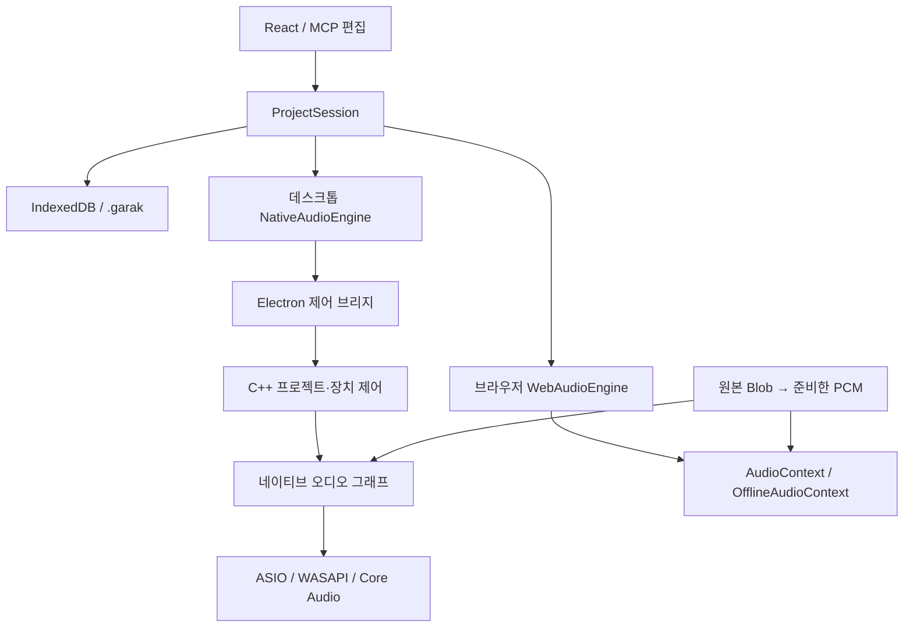

# 가락이음 아키텍처

2026-11-04 기준 소스 구조입니다. 데스크톱의 C++ 네이티브 엔진과 브라우저 데모의 Web Audio 경로를 구분합니다. 실제 장치/청감 검증 상태는 [네이티브 오디오](NATIVE_AUDIO.md)와 [구현 상태](IMPLEMENTATION_STATUS.md)에 따로 기록합니다.

## 1. 현재 실행 구조

`ProjectShell`은 프로젝트 목록과 편집기를 나눕니다. React 화면과 MCP 편집은 같은 `ProjectSession`의 프로젝트·이력을 사용합니다. [engineFactory](../src/audio/engineFactory.ts)는 데스크톱에서 `NativeAudioEngine`, 브라우저에서 `WebAudioEngine`을 선택합니다. 데스크톱에서 native bridge/helper가 없으면 오류를 표시하며 Web Audio로 자동 대체하지 않습니다.



오디오는 사용자 컴퓨터에서 처리합니다. 데스크톱의 `garak-audio-host`는 장치 callback과 DSP·VST3·녹음·WAV 출력을 소유합니다. UI에서 준비한 타임라인과 PCM을 미리 전달하며, 매 오디오 버퍼가 JS/IPC 응답을 기다리지 않습니다. 제어·파일 작업과 callback을 분리하고 상태·미터는 저빈도로 화면에 전달합니다. 로컬 MCP 프로세스는 편집 명령만 전달하며 오디오 엔진을 소유하지 않습니다. 계정·클라우드 저장 백엔드는 없습니다.

### 프로젝트 이동의 보호 범위

이동은 인라인 입력 blur → 진행 상태 → 이전 프로젝트의 최종 저장 → 대상 프로젝트 저장/확인 → URL과 화면 변경 순서다. 브라우저 Back/Forward는 앱이 기록한 방문 인덱스로 현재 작업 주소에 먼저 복귀한 뒤 같은 저장 가드를 적용한다. 이동을 거절하면 기존 방문 항목과 앞으로 가기 목록을 유지한다. 진행 중 추가 이동은 별도 생성 함수를 실행하지 않는다.

앱 밖의 코드가 삽입한 방문 항목은 브라우저가 위치 인덱스를 제공할 때 이를 읽어 복구한다. 인덱스와 앱 메타데이터가 모두 없는 외부 항목은 방향을 추측할 수 없으므로, 이동 거절 시 기존 항목을 교체하지 않고 현재 작업 주소를 새로 추가한다. 이 제한된 경우에는 앞으로 가기 목록이 사라질 수 있다. 페이지 자체를 떠나는 새로고침·탭 닫기에는 동기적인 미저장 상태 확인과 브라우저 종료 경고를 사용한다.

## 2. 모듈 지도

| 파일 | 책임 |
| --- | --- |
| [`src/ProjectShell.tsx`](../src/ProjectShell.tsx) | URL별 목록/편집기 구성, 목록 갱신, 생성·가져오기 후 이동, 편집기의 이탈 보호 연결, 이동 중 진행 화면 |
| [`src/core/projectNavigation.ts`](../src/core/projectNavigation.ts) | 프로젝트 URL 해석·생성, 브라우저 이력과 화면 전환, 비동기 이동 및 이탈 보호 |
| [`src/components/ProjectLauncher.tsx`](../src/components/ProjectLauncher.tsx) | 내 프로젝트·샘플 분류와 검색, 공통 파일 아이콘·요약 정보 타일, 선택 항목의 읽기 전용 상세와 공통 열기, 빈 프로젝트·가져오기 |
| [`src/core/projectLibrary.ts`](../src/core/projectLibrary.ts) | 빈 프로젝트/템플릿을 먼저 저장하고 반환, 가져온 번들을 새 프로젝트 ID로 저장; 오디오 디코딩 없음 |
| [`src/core/projectTemplates.ts`](../src/core/projectTemplates.ts), [`src/core/projectTemplates/`](../src/core/projectTemplates/) | 국악 붐뱁·트랩·퓨전의 메타데이터와 순수 MIDI 팩토리; 호출마다 새 ID와 편집 객체 |
| [`src/App.tsx`](../src/App.tsx) | 지정된 프로젝트 ID 복원, 공통 세션 구독, 선택 상태, 프로젝트별 자동 저장·이탈 전 저장, 엔진 연결, 오디오 파일 가져오기·내보내기, 녹음 UI, 편집기 단축키 |
| [`src/core/input.ts`](../src/core/input.ts), [`src/core/transportShortcuts.ts`](../src/core/transportShortcuts.ts) | 편집 영역별 키맵과 입력 보호, Space 재생 명령의 capture 처리·키 수명 관리 |
| [`src/core/ProjectSession.ts`](../src/core/ProjectSession.ts), [`src/core/commands.ts`](../src/core/commands.ts) | 프로젝트·Undo/Redo·revision, 명령 계약과 검증, 미리 보기·원자적 적용·재시도 중복 방지 |
| [`src/automation/host.ts`](../src/automation/host.ts), [`src/automation/bridgeClient.ts`](../src/automation/bridgeClient.ts) | 범위를 제한한 상태 조회, 편집 허용·작업 중 보호, 명시적인 브리지 연결과 취소·만료 처리 |
| [`mcp/server.ts`](../mcp/server.ts), [`mcp/tools.ts`](../mcp/tools.ts), [`mcp/bridgeServer.ts`](../mcp/bridgeServer.ts) | 공식 SDK stdio 도구, loopback WebSocket 라우팅·인증, 실제 브라우저 응답 대기 |
| [`src/core/types.ts`](../src/core/types.ts) | Project·Track·Clip·MidiNote·AudioAsset 및 AudioEngine 계약 |
| [`src/core/project.ts`](../src/core/project.ts) | 새 프로젝트·트랙, 클립 복제·분할, 외부 프로젝트 유효성 검사. 이전 8마디 데모 팩토리는 호환 테스트용으로 남으며 시작 화면은 새 템플릿 카탈로그를 사용 |
| [`src/core/audioSettings.ts`](../src/core/audioSettings.ts) | 프로젝트 레이트 허용값·기본값, 앱 오디오 설정의 정규화·로컬 저장, 입력 제약 요청과 실제 상태 타입 |
| [`src/core/recordingOffset.ts`](../src/core/recordingOffset.ts) | 수동 녹음 보정의 부호·범위 검증, 리전 배치와 프로젝트 0 경계의 소스 오프셋 계산 |
| [`src/core/instruments.ts`](../src/core/instruments.ts) | 악기 레지스트리: 합성·샘플 악기의 ID, 이름, 분류, 색, 조절기 정의, 샘플 세트 ID, 출처 표기 |
| [`src/core/devices.ts`](../src/core/devices.ts) | 공통 파라미터 값 변환과 이펙트 레지스트리의 호환 export |
| [`src/devices/contracts.ts`](../src/devices/contracts.ts), [`src/devices/effects/registry.ts`](../src/devices/effects/registry.ts) | 실시간 이펙트 계약과 여섯 모듈 등록; 각 모듈이 정의·DSP·잔향 시간을 소유 |
| [`src/devices/pitch-editor/`](../src/devices/pitch-editor/) | 리전 피치/포먼트 UI·음계 보정·세션 초안/도구옵션·원본 분석·Worker 렌더·v2 문서 검증·float WAV 자산 |
| [`src/audio/samples.ts`](../src/audio/samples.ts) | 샘플 세트 로더: 매니페스트 해석, 포맷 선택, 디코딩 캐시, 존 선택, 로딩 상태 알림 |
| [`src/core/storage.ts`](../src/core/storage.ts) | ID별 프로젝트 번들·요약 목록, 기존 latest 이전, IndexedDB 원자적 저장·순서 보장, 원본 Blob 검증, `.garak` 가져오기·내보내기 |
| [`src/audio/engineFactory.ts`](../src/audio/engineFactory.ts), [`src/audio/native/NativeAudioEngine.ts`](../src/audio/native/NativeAudioEngine.ts) | 환경별 엔진 선택, 네이티브 명령·상태·PCM 등록과 비실시간 디코딩 |
| [`src/audio/native/timeline.ts`](../src/audio/native/timeline.ts), [`src/core/nativePlugins.ts`](../src/core/nativePlugins.ts) | 리전 의미를 샘플 프레임 계획으로 변환, schema 6 VST3 식별·파라미터·상태 계약 |
| [`desktop/native-audio.ts`](../desktop/native-audio.ts), [`native/src/host.cpp`](../native/src/host.cpp) | 승인된 IPC·파일·플러그인 카탈로그, 프로세스 수명, 녹음 파일·오프라인 출력 |
| [`native/src/engine.cpp`](../native/src/engine.cpp), [`native/src/dsp.cpp`](../native/src/dsp.cpp) | callback 타임라인·악기·클립·믹싱·DSP·지연 보상·녹음 큐 |
| [`native/src/device.cpp`](../native/src/device.cpp), [`native/src/vst3.cpp`](../native/src/vst3.cpp) | ASIO/WASAPI/Core Audio 장치와 실제 VST3 SDK 호스트·네이티브 창 |
| [`src/audio/WebAudioEngine.ts`](../src/audio/WebAudioEngine.ts) | 브라우저 데모의 컨텍스트·예약·디코딩·출력·스냅숏 |
| [`src/audio/InputCapture.ts`](../src/audio/InputCapture.ts) | 녹음·모니터링 입력 공유, 입력 변경의 준비·확정·복구, 지연된 권한 응답과 장치 종료 처리 |
| [`src/audio/AudioRecording.ts`](../src/audio/AudioRecording.ts), [`src/audio/recordingTransport.ts`](../src/audio/recordingTransport.ts) | 한 번의 녹음과 마지막 데이터 이벤트의 수명, 녹음을 함께 종료하는 재생·정지·자동 종료 연결 |
| [`src/core/recording.ts`](../src/core/recording.ts), [`src/components/RecordingRegion.tsx`](../src/components/RecordingRegion.tsx) | 녹음 시작 위치·임시 리전·최종 추가의 공통 계약, 실제 경과 시간 표시 |
| [`src/audio/AudioDeviceProbe.ts`](../src/audio/AudioDeviceProbe.ts), [`src/audio/OutputTest.ts`](../src/audio/OutputTest.ts) | 설정 창의 임시 입력 권한·레벨 테스트, 취소 가능한 적용 출력 테스트와 각 자원의 정리 |
| [`src/audio/graph.ts`](../src/audio/graph.ts) | 기본 악기, 트랙·마스터 오디오 연결, 효과, 음성 수명 주기, 범위별 음표·오디오 클립 예약 |
| [`src/audio/math.ts`](../src/audio/math.ts) | 박자·시간 변환, 루프 위치, 페이드 계산, 16-bit PCM WAV 인코딩 |
| [`src/components/Timeline.tsx`](../src/components/Timeline.tsx) | 타임라인, 클립 이동·길이 편집, 재생 커서, 트랙·마스터 미터 |
| [`src/components/PianoRoll.tsx`](../src/components/PianoRoll.tsx) | 음표·세기 편집, 음표 단위 단축키, 미리듣기 요청 |
| [`src/components/Mixer.tsx`](../src/components/Mixer.tsx) | 트랙·마스터 믹서 조작 |
| [`src/components/DeviceChain.tsx`](../src/components/DeviceChain.tsx) | 공통 디바이스 카드·노브, 악기 선택, 이펙트 추가·삭제·순서·바이패스 조작 |
| [`src/components/GuitarRig.tsx`](../src/components/GuitarRig.tsx), [`src/devices/guitar-rig`](../src/devices/guitar-rig) | 기타 앰프 전용 편집기, 수치형 설정·프리셋, 컴프·페달·앰프·캐비닛/마이크 모델, causal 마스터. [사용법과 범위](GUITAR_RIG.md) |
| [`src/audio/effectPreparation.ts`](../src/audio/effectPreparation.ts) | 실시간/오프라인 컨텍스트별 효과 프로세서 등록, 중복 준비 합치기와 오류 전달 |
| [`src/components/Waveform.tsx`](../src/components/Waveform.tsx), [`src/core/waveform.ts`](../src/core/waveform.ts) | 원본 구간에 맞춘 파형 표시. 확대 수준과 처리량에 따라 캐시 피크 또는 실제 PCM 사용 |
| [`src/components/AudioSettingsDialog.tsx`](../src/components/AudioSettingsDialog.tsx), [`src/components/useAudioDevices.ts`](../src/components/useAudioDevices.ts) | 장치·녹음·프로젝트·진단 설정 초안, 적용/취소 UI, 수동 권한·장치 목록·테스트 연결 |

## 3. 프로젝트 모델과 편집

`Project`는 직렬화 가능한 편집 데이터입니다. `AudioContext`, DOM 노드, 재생 중인 음성을 포함하지 않습니다. 편집한 프로젝트를 `engine.setProject(project)`로 전달하고, 엔진이 현재 재생 그래프에 반영합니다.

| 값 | 기준 |
| --- | --- |
| `Project.sampleRate` | 실시간 엔진·WAV 출력 처리율(Hz). 44100/48000/88200/96000/176400/192000, 새 프로젝트·누락된 구버전 필드의 기본값은 48000 |
| `Clip.startBeat` | 프로젝트 시작을 기준으로 한 박 위치 |
| `Clip.lengthBeats` | 클립의 박 단위 길이 |
| `MidiNote.start` | MIDI 원본 소스 안의 박 위치. 리전 안의 표시 위치는 `start - (sourceOffsetBeats ?? 0)` |
| `MidiClip.sourceOffsetBeats` | MIDI 원본 소스에서 표시·재생을 시작하는 박 위치; 생략 시 0 |
| `ClipBase.loopLengthBeats` | 리전 시작부터 수동 반복 끝까지의 전체 박 길이; 생략 시 연속 반복 |
| `MidiNote.duration` | 박 단위 음표 길이 |
| `MidiNote.pitch` | MIDI 음높이 번호 |
| `MidiNote.velocity` | 0~1 범위의 세기; 피아노롤은 1~127 값으로 표시 |
| `AudioClip.offsetSeconds` | 원본 또는 동일 길이의 피치 렌더 음원 안에서 재생을 시작할 초 위치 |
| `AudioClip.pitch` | v2 문서: 원본 자산 ID·SHA-256·고정 분석·음표 경계·음표별 피치/포먼트 센트 이동·포먼트 보존·렌더러 버전 |
| `AudioClip.assetId` | 현재 재생 자산; 피치 적용 시 별도 렌더 자산 ID, 원본 복원 시 원본 ID |
| `AudioClip.fadeIn`, `fadeOut` | 초 단위 페이드 길이 |
| 트랙 볼륨·클립 게인 | 선형 배율 |
| `Track.pan` | -1~1 범위 |
| `Track.devices` | 인서트 이펙트의 순서 있는 배열; 활성 항목을 배열 순서대로 처리 |
| `Device.type`, `enabled` | 내장 이펙트 종류와 활성/바이패스 상태 |
| `Device.params` | `EFFECT_DEFS`에 정의한 파라미터의 원래 단위 값; Hz·dB·초·밀리초·배율 등 |

오디오 클립 분할은 원본 파일을 수정하지 않고 새 클립의 시작 위치·길이·원본 오프셋을 계산합니다. MIDI 리전은 원본 음표를 유지하고 `sourceOffsetBeats`와 `lengthBeats`로 표시·재생 범위를 정합니다. 분할한 오른쪽은 독립된 음표 ID와 소스 오프셋을 가지며 양쪽 모두 다시 늘릴 수 있습니다. 피아노롤은 `midiEditorClip`의 보이는 구간을 편집한 뒤 `applyMidiNoteEdits`로 원본에 병합하므로 숨은 음표와 변경하지 않은 앞뒤 길이를 보존합니다. 합치기는 보이는 구간을 새 소스로 만듭니다.

현재 프로젝트 스키마는 **6**입니다. `Track.pluginInstrument`와 `Track.pluginInserts`에 승인 카탈로그의 불투명 `pluginId`, `classId`, normalized parameter와 별도 component/controller 상태를 저장합니다. 각 상태의 디코딩 크기는 16 MiB 이하입니다. 프로젝트 파일이 임의 native 경로를 실행하도록 허용하지 않습니다. `timeSignature`에 분자 1–32와 분모 2·4·8·16을 저장하고, `beatsPerBar`에는 `분자 × 4 / 분모`인 4분음표 단위 마디 길이를 저장합니다. 기존 디바이스·피치 문서, `MidiClip.sourceOffsetBeats`, `ClipBase.loopLengthBeats`도 보존합니다. 스키마 1·2·3·4는 기존 4/4를 유지하고 5는 기존 박자표를 보존하며 6으로 정규화합니다. 플러그인 필드가 없는 이전 프로젝트는 빈 슬롯으로 이전하고, 1의 `track.effects.filter/reverb/delay`는 디바이스 배열로 변환합니다. `.garak` 바깥 번들 버전은 기존 1을 유지합니다. 새 필드를 모르는 구버전 앱은 스키마 검사에서 거절하므로 리전 소스 위치나 박자표를 조용히 잘못 해석하지 않습니다.

박자 변경은 기존 음표·리전·마커·루프·프로젝트 길이의 4분음표 좌표를 이동하거나 늘이지 않습니다. BPM도 4분음표/분 기준을 유지합니다. 타임라인·피아노롤 격자와 마디/박 스냅, 재생 위치 표시, 새 리전 길이와 마디 이동, 루프 길이 선택, 프로젝트 목록·내보내기의 마디 수가 새 박자를 사용합니다. 6/8의 마디는 3 quarter-note beats, 한 박은 0.5 quarter-note beats입니다. 프로젝트 전체의 단일 박자표를 지원하며 곡 중간 박자표 변경 맵은 없습니다.

`loopLengthBeats`는 리전 시작부터의 전체 반복 범위이며 이동·복제 시 함께 이동합니다. 값이 없으면 기존 연속 루프입니다. 재생·고스트 표시·미리보기는 수동 끝/다음 리전/프로젝트 끝 중 가장 이른 위치를 공유하고, 마지막 일부 반복도 같은 규칙으로 자릅니다. 원본 리전 자체는 반복 경계보다 짧게 자르지 않습니다. 파형은 오디오 소스의 `offsetSeconds`·길이를 사용하며, 가까운 확대에서는 읽기 비용 한도 안에서 실제 샘플을 표시합니다.

포먼트 확장은 프로젝트 스키마를 올리지 않고 **내부 피치 문서 버전 2**로 구분합니다. `preserveFormants: boolean`과 음표 ID별 `formantShifts` 맵을 필수로 저장하며, `analysis.version`은 1입니다. v1 문서는 보존 꺼짐·빈 포먼트 맵으로 이전하고 기존 `rendererId`, 피치 이동값, 원본과 렌더 자산을 유지합니다. 이 마이그레이션은 오디오를 다시 만들지 않습니다. v1이라고 선언하면서 새 포먼트 필드를 담은 문서는 거부합니다. v2를 모르는 구버전 앱은 내부 문서 버전 검사에서 거부하므로 새 편집을 조용히 버리지 않습니다.

Undo/Redo는 `ProjectSession`의 프로젝트 스냅숏 이력으로 처리합니다. 일반 편집 시 과거 스냅숏을 최대 50개 유지하고 각 단계의 작업명으로 `undoLabel`/`redoLabel`을 제공합니다. 페이더·팬·노브·네이티브 슬라이더는 명시적인 제스처 시작/끝으로 묶어 드래그 중 멈춰도 한 Undo이며, 별도 드래그는 빠르게 이어도 구분합니다. 제스처를 취소하거나 시작 값으로 되돌아오면 이전 Undo/Redo와 작업명을 복원합니다. 제스처가 없는 연속 입력만 기존 450ms 병합을 사용합니다. 피아노롤과 타임라인의 포인터 이동은 임시 화면 상태로 표시한 뒤 드래그 종료 시 프로젝트에 반영합니다. 이력은 현재 앱 세션의 메모리에 있으며 `.garak`이나 IndexedDB에 함께 저장하지 않습니다.

MCP 편집은 `projectId`·`expectedRevision`·`operationId`와 명시적인 명령 배열을 받습니다. 모든 명령을 검증한 뒤 Undo 하나로 적용하고, UI 입력과 병합하지 않습니다. 성공 요청은 최근 256개를 세션 안에서 기억하며 동일 요청 재시도는 원래 결과를 반환합니다. 프로젝트를 다시 열면 캐시를 비우고 revision을 증가시킵니다. 조회 결과의 revision과 원래 요청 결과의 revision을 구분하고, 저장 완료는 별도 `persistence`로 확인합니다. 자세한 수명·범위는 [MCP 연결 안내](MCP.md)에 있습니다.

프로젝트 샘플레이트의 명시적 변경도 프로젝트 이력에 포함합니다. 레이트를 바꾸는 Undo/Redo는 녹음·녹음 준비 중 차단합니다. 입력/출력 장치 ID·지연 요청·모니터링·수동 녹음 보정 등의 앱 환경은 `localStorage`의 `garak-ieum:audio-settings:v1`에 별도로 보관하며 프로젝트 파일·편집 이력에 넣지 않습니다.

### 키보드 입력 경계

일반 편집 명령은 `input.ts`의 포커스 범위와 수정키 규칙을 따릅니다. Space 재생 명령은 `transportShortcuts.ts`가 `window`의 capture 단계에서 먼저 처리합니다. 일반 화면의 버튼·드롭다운·체크박스·라디오·숫자 입력·슬라이더/노브·팝오버/메뉴·body에서도 Space는 재생/일시 정지, Shift+Space는 선택 리전부터 재생입니다. 편집 가능한 텍스트 입력·textarea·contenteditable·IME 조합과 열린 모달은 기존 입력을 우선합니다.

재생 명령이 소유한 Space는 누름 상태를 React 렌더 사이에도 유지하여 길게 누른 반복과 대응하는 keyup을 소비합니다. 이로써 기본 스크롤이나 버튼의 keyup 활성화가 함께 발생하지 않게 합니다. 일반 버튼과 메뉴는 Enter를 사용하고, 일반 화면의 네이티브 체크박스·라디오에는 Enter 활성화를 제공합니다. 일반 컨트롤의 Enter·방향키 등은 유지하고, 나머지 앱 명령은 마지막 활성 편집기로 전달합니다. 접힌 편집기는 타임라인으로 돌아갑니다. 피아노롤 스냅은 피아노롤 명령 핸들로 전달합니다. 상세 키맵과 검증 범위는 [단축키](SHORTCUTS.md)를 따릅니다.

피아노롤의 포인터 시간 편집과 키보드 이동은 서로 다른 단위를 사용합니다. 기본 마우스 스냅은 0이며 생성·이동·좌우 리사이즈에 격자 양자화와 경계 자석 스냅을 적용하지 않습니다. 사용자가 스냅을 명시적으로 선택하면 포인터에만 그 단위를 적용합니다. 좌우 방향키는 항상 화면에 사용한 `musicalGrid.stepBeats` 한 칸을 상대 이동하고, 위아래 방향키는 반음 또는 드럼 패드 한 행을 이동합니다. 기존 Alt 방향키와 Shift 선택 확장도 유지합니다. 이 동작은 프로젝트 저장 형식을 변경하지 않습니다.

## 4. 오디오 엔진의 실제 범위

데스크톱은 자체 C++20 엔진, 브라우저 데모는 `WebAudioEngine`을 사용합니다. openDAW·Tracktion·JUCE 엔진을 도입하지 않았습니다. 공통 편집 모델과 `core/playback.ts`의 리전 변환 의미를 유지하고, desktop timeline은 이벤트를 미리 샘플 프레임으로 변환합니다.

### 데스크톱 장치와 그래프

`NativeAudioEngine.configure` → Electron 검증 → native `DeviceHost`가 backend/device/rate/buffer와 물리 입력 offset을 적용합니다. Windows는 ASIO 또는 WASAPI, Mac은 arm64 Core Audio입니다. 요청한 장치가 사라지거나 초기화에 실패하면 명시적으로 오류를 표시합니다. ASIO는 정확한 요청 레이트/지원 블록을 요구하고, WASAPI/Core Audio는 실제 블록·레이트와 리샘플링 여부를 보고합니다. 장치 변경·플러그인 상태 IO·그래프 준비는 callback 밖에서 합니다.

장치 callback 안에서 내장 합성·샘플·오디오 리전 → 내장/VST3 인서트 → 팬·볼륨·미터 → 트랙별 지연 보상·마스터 → 출력으로 처리합니다. 기타 앰프와 라이브 입력도 같은 경로입니다. 프로젝트 그래프는 제어 스레드에서 준비하며 소유한 버퍼·큐를 callback 전에 할당합니다. 라이브 모니터링은 낮은 지연 정책에 따라 다른 트랙에 맞추기 위한 추가 보상을 피할 수 있습니다. 플러그인 자체 latency와 물리 장치 지연은 없어지지 않습니다.

VST3 module 생성·bus 협상·controller 연결·state·활성화는 제어 스레드에서 수행합니다. 샘플 offset을 가진 MIDI/parameter와 BPM·박자·재생/루프 context를 processor에 전달합니다. 플러그인이 bus/latency 변경을 요구하면 callback 안에서 재생성하지 않고 정지·재로드를 요구합니다. 자체 창은 Windows HWND/macOS NSView에 attach합니다. 외부 플러그인 crash는 오디오 프로세스 전체에 영향을 줄 수 있습니다. [구현·검증 상세](NATIVE_AUDIO.md)

### 브라우저 데모의 호환 경로

브라우저의 시계는 `AudioContext.currentTime`이며 JavaScript 타이머가 이벤트를 미리 예약합니다. 브라우저 기본 노드와 기타 앰프 AudioWorklet을 사용하고, 여섯 효과는 `src/devices/effects/` registry에서 생성합니다. `Track.devices`의 활성 효과는 배열 순서로 직렬 연결하고 dry/wet은 각 효과 내부에서 섞습니다. 이는 데스크톱 callback 구현과 구분되는 브라우저용 DSP입니다.

브라우저의 `latencyHint`/`renderSizeHint`는 요청값이고 실제 장치 I/O 버퍼 제어와 같지 않습니다. `InputCapture`·`AudioDeviceProbe`·Web Audio 기반 출력 테스트도 브라우저용입니다. 데스크톱 설정은 별도 `NativeAudioSettingsDialog`와 native 장치 API를 사용합니다. GUI·프로젝트·파라미터 정의를 공유하더라도 두 DSP의 출력이 비트 단위로 일치한다고 보장하지 않습니다.

### 리전 피치 처리

피치 편집기는 `src/devices/pitch-editor/`에 분리한 리전 처리 기능이며, 오디오 소스 카드의 **피치 편집 열기** 또는 하단 피치 탭으로 엽니다. 실시간 인서트 배열에 넣는 대신 오디오 리전의 렌더 자산을 생성하고 이후 일반 트랙 이펙트 체인을 통과시킵니다.

1. 원본 Blob은 그대로 두고 SHA-256과 원본 ID를 저장합니다. Worker의 YIN 분석으로 얻은 음표·피치 곡선은 원본 초 단위 좌표로 고정합니다.
2. 편집 음표 경계와 피치/포먼트 이동 맵을 분석과 분리합니다. 트림된 리전의 경계 음표를 나누고 두 이동값을 상속하여 보이는 부분을 독립적으로 편집합니다. 음표 수 한도로 경계를 나눌 수 없으면 그 경계 음표를 읽기 전용으로 두어 숨겨진 구간의 변경을 막습니다. 합치기는 피치와 포먼트 이동값이 모두 같은 인접 음표만 허용합니다. 기존 분석을 편집 결과로 덮어쓰지 않습니다.
3. 적용 시 원본 PCM과 두 이동 맵·보존 설정을 Worker에 복사해 전달하고, 고정 버전 Signalsmith WASM과 재합성 정책으로 같은 프레임 수의 PCM을 만듭니다. 작업 취소는 Worker를 종료합니다.
4. 피치 또는 포먼트 이동이 하나라도 있으면 결과를 별도 32-bit float WAV Blob으로 디코딩하여 새 자산으로 등록한 뒤 `AudioClip.assetId`와 `pitch`를 하나의 프로젝트 편집으로 확정합니다. 피치 없이 포먼트만 바꾼 경우도 같은 경로를 사용합니다. 두 맵의 이동값이 모두 0이면 원본 자산을 유지하며, 보존 토글만으로 별도 음원을 만들지 않습니다. 재생과 일반 16-bit WAV 출력이 현재 자산을 공유합니다.
5. 적용 직전 원본 해시·프로젝트 세션·revision·리전 객체·원본 자산을 다시 확인합니다. 렌더 후 디코딩 중의 취소도 확인하여 오래된 결과가 프로젝트를 덮어쓰지 않게 합니다.

초안과 적용 결과의 수명은 다릅니다. 미적용 초안과 로컬 Undo는 현재 세션 메모리에만 존재합니다. 적용 후에는 프로젝트 Undo/Redo·자동 저장·`.garak`에 분석과 편집 명세, 원본과 렌더 Blob이 포함됩니다. 프로젝트 파일 내보내기·WAV 출력·새 프로젝트·가져오기 전에 미적용 초안을 안내하며, 초안/분석/렌더 중 MCP 변경은 차단합니다.

선택 음표의 음정 중심 보정은 `correction.ts`가 담당합니다. 현재 중심음(`note.midi + pitchCents / 100`)에서 가장 가까운 반음계·장음계·자연 단음계 음을 고르고, 같은 거리면 낮은 음을 선택합니다. 강도 0–100%는 현재 위치와 목표 사이의 선형 보간입니다. 50%를 다시 실행하면 남은 차이의 절반을 좁히며, 최종 피치 이동은 원본 기준 ±1200 ct로 제한합니다. 기본으로 검출 신뢰도 0.75 미만을 제외하되 사용자가 해제할 수 있습니다. 이는 검출 휴리스틱이며 교정 정확도의 확률이 아닙니다. 원본 곡선·음표 길이·포먼트 값은 변경하지 않습니다.

기준음·음계·강도·불확실 음표 제외는 `projectId`별 세션 도구옵션입니다. 리전과 탭을 바꾸어도 같은 프로젝트에서 기억하지만 피치 문서·프로젝트 파일·Undo에는 포함하지 않습니다. 옵션만 바꾸면 음정은 그대로이며, **선택 음표 보정**을 실행해야 현재 화면 안의 선택 음표를 변경합니다. 포먼트 보존과 음표별 이동값은 이 도구옵션과 달리 실제 편집 문서에 저장합니다.

렌더러는 중립 피치로 시간 길이를 조절한 뒤 원하는 피치 비율로 재샘플링합니다. 포먼트는 재샘플링 전에 스펙트럼 포락선을 이동하며, 내부 이동값은 `formantCents - (preserveFormants ? pitchCents : 0)`입니다. 피치와 포먼트의 사용자 입력 범위는 각각 ±1200 ct이고, **내부 이동값도 ±1200 ct를 벗어나면 적용을 거부**합니다. UI는 보이지 않는 원본 구간까지 포함한 전체 문서를 검사하며, Worker 렌더러도 같은 제한을 검증합니다. 새 분석의 보존 기본값은 꺼짐입니다. 이 실험적 음색 보정은 큰 이동에서 음색·음량이 달라질 수 있으며, 실제 보컬 청음 품질을 보장하지 않습니다.

재로드한 AudioBuffer가 분석 당시와 다른 샘플레이트로 디코딩될 수 있습니다. 음표 좌표는 초 단위로 유지하고, 원본 해시와 물리적 길이를 확인합니다. 길이 비교는 낮은 샘플레이트 기준 두 프레임의 반올림 오차만 허용합니다. 피치 원본이 누락되거나, 편집 명세와 렌더 자산 참조가 모순되면 프로젝트 검증에서 거부합니다.

현재 범위는 원본 60초 이하·1~2채널·단선율 분석·음표별 ±12반음과 위의 실험적 포먼트 처리입니다. 타이밍·비브라토/드리프트 개별 편집·다성음 분리·실시간 보정·피치 MCP 명령은 포함하지 않습니다. 사용법과 정확한 경계는 [피치 편집기](PITCH_EDITOR.md), 확장 설계는 [피치 디바이스 설계](PITCH_DEVICE_DESIGN.md)에 있습니다.

### 샘플 악기

악기는 `src/core/instruments.ts`의 레지스트리 `INSTRUMENTS`에 정의합니다. 각 항목은 고정 ID(저장 파일이 참조), 표시 이름, 분류(신스·피아노·건반·드럼·국악), 합성/샘플 종류, 킷 여부, 조절기 정의를 가집니다. `Track.instrument`는 이 ID 문자열이며, `validateProject`는 레지스트리에 없는 ID를 거부합니다. 합성 악기(`drums`, `bass`, `keys`, `pad`, `pluck`, `rhodes`)는 브라우저에서 `graph.ts`, 데스크톱에서 `native/src/engine.cpp`·`dsp.cpp`가 생성하고, 샘플 악기는 `set` 필드가 가리키는 `public/samples/<set>/` 폴더의 음원을 씁니다. 매니페스트 규격은 [`SAMPLES.md`](SAMPLES.md)를 따릅니다.

`src/audio/samples.ts`의 `SampleLibrary`는 브라우저와 데스크톱에서 자산 로딩 규격을 공유합니다. 데스크톱은 `OfflineAudioContext`로 압축 파일을 한 번 디코딩해 Float32 PCM과 존 설정을 native host에 등록합니다. 매 callback에서 JS로 재생하거나 디코딩하지 않습니다. 다음의 예약 설명은 브라우저용 경로입니다. 브라우저에서는 `WebAudioEngine.samples`로 접근합니다. `load(setId, context)`는 `manifest.json`을 읽고, 브라우저가 지원하는 포맷(Opus/webm 우선, 아니면 AAC/m4a)을 고른 뒤 모든 존 파일을 동시 6개 이하로 받아 `decodeAudioData`로 디코딩합니다. 세트별로 진행 중인 Promise를 캐시하므로 동시 요청은 한 번만 내려받고, 디코딩된 `AudioBuffer`는 컨텍스트에 묶이지 않아 그래프 재생성과 `OfflineAudioContext` 내보내기에서 그대로 재사용합니다. m4a는 AAC 인코더 지연만큼(44 ms) 재생 시작 위치를 건너뜁니다.

재생 중 아직 준비되지 않은 세트의 음표는 건너뛰고 로드를 시작합니다. 세트가 준비되면 엔진이 현재 박에서 다시 예약하므로 짧은 끊김이 한 번 생길 수 있습니다. 트랙 추가나 악기 변경으로 새 샘플 악기가 프로젝트에 들어오면 `setProject`에서 미리 로드를 시작하고, WAV 내보내기는 프로젝트가 쓰는 모든 세트를 기다린 뒤 렌더링합니다. UI는 `AudioEngine.sampleStatus`·`subscribeSamples`로 로딩·오류 상태를 트랙 헤더에 표시하고, `sampleAttribution`으로 로드된 세트의 출처를 디바이스 카드에 보여 줍니다.

존 선택(`pickZone`)은 음높이 범위 `[lo, hi]`와 세기 레이어 `[vlo, vhi)`로 고르며 가장 센 레이어는 `vhi`를 포함합니다. 킷은 `root`가 음표 번호와 같은 존만 씁니다. 음높이 악기는 `playbackRate`로 `root`와의 차이를 보정하고 어택·릴리즈 포락선과 루프 구간을 적용하며, 킷은 샘플을 끝까지 재생하되 `decay` 조절기로 줄일 수 있고 같은 `choke` 그룹의 이전 소리를 끊습니다.

### UI 갱신

`getSnapshot()`은 캐시된 transport 스냅숏을 반환하고 `subscribe()`로 변경을 알립니다. React는 `useSyncExternalStore`로 이를 읽습니다. 재생 커서는 `requestAnimationFrame`에서 DOM 위치를 갱신하고, 미터는 Canvas에 그립니다. 매 오디오 샘플이나 전체 파형을 React 상태에 넣지 않습니다.

이는 UI와 재생 책임을 분리한 초기 구조입니다. 프로젝트 비교·재예약, 노드 수, 전체 버퍼 메모리에는 여전히 규모에 따른 비용이 있으므로 수백 트랙 처리 성능을 입증한 설계로 표현하지 않습니다.

## 5. 가져오기와 녹음

오디오 파일 가져오기는 원본 Blob을 보관하고 전체 디코딩한 PCM을 자산으로 등록합니다. 화면의 `AudioBuffer`·파형 피크는 편집 도구를 위한 표현이며, 데스크톱에서는 Float32 PCM을 native host에 준비해 재생합니다. 프로젝트 목록은 원본 Blob과 요약만 읽고 오디오 장치를 열지 않습니다. 편집기를 열 때 자산을 준비합니다.

데스크톱 입력은 `DeviceHost`의 선택 채널을 사용합니다. 장치 callback이 녹음 링 버퍼에 PCM을 넣고 파일 스레드가 Float32 WAV를 기록합니다. `NativeRecording`이 실제 녹음 시작 frame·rate·수신 frame 수·파일 결과를 받아 기존 임시 리전/최종 자산 흐름에 연결합니다. 큐 포화·디스크 오류·프로세스 종료는 성공한 녹음으로 보고하지 않습니다. 브라우저에서는 기존 `InputCapture`의 `getUserMedia()`와 `AudioRecording`/`MediaRecorder` 경로를 유지합니다.

입력 권한 대기와 취소·종료는 take 소유권으로 관리합니다. Space·정지·재생 끝에서 녹음을 확정하며, 임시 리전의 길이는 수신 프레임/경과 시간으로 표시합니다. 최종 오디오 자산과 리전을 한 번 반영하고 새 트랙이 필요하면 같은 Undo에 묶습니다. 실제 PCM의 시작 위치를 사용하므로 UI 메시지 도착 시간을 음원의 시작 시각으로 사용하지 않습니다.

네이티브 호스트는 raw 시작 frame과 드라이버가 보고한 입력/출력 지연 및 그래프 지연을 분리해 보고하고 녹음 위치 보정에 적용합니다. 드라이버 미보고 값은 실측한 0으로 취급하지 않으며 `compensationKnown`으로 구분합니다. 사용자의 `recordingOffsetMs`(-1000~1000ms)는 별도 수동 보정입니다. 0 이전 구간은 소스 offset으로 제외합니다. 자동 물리 루프백 측정, USB MIDI 녹음, 여러 입력 트랙의 동시 녹음은 제공하지 않습니다.

## 6. 보관과 교환 형식

### URL과 작업 수명

기본 `/`는 `ProjectLauncher`를 열고 `/projects/:id`는 해당 ID의 저장본만 엽니다. URL에 있는 프로젝트가 없으면 명시적인 복원 오류를 표시하며, 최근 프로젝트나 기본 데모로 대체하지 않습니다. 편집기에서는 헤더 폴더 버튼 또는 로고 메뉴의 **프로젝트 목록**으로 돌아올 수 있고, 번들 가져오기는 목록과 로고 메뉴 모두에서 진입합니다. 이 URL은 현재 브라우저·사이트의 IndexedDB를 가리키며 원격 공유 주소가 아닙니다.

선택 화면은 내 프로젝트와 샘플을 같은 크기의 타일로 표시합니다. 타일은 공통 파일 아이콘과 이름·BPM·트랙 수·길이 요약을 사용하며 실제 MIDI 편곡을 그리지 않습니다. 클릭/Space는 선택 상태만 바꾸고 Enter/더블 클릭/하단 열기로 해당 열기 콜백을 실행합니다. 접이식 상세 영역은 선택한 항목의 읽기 전용 정보를 보여 주며 오디오 장치나 프로젝트 설정을 변경하지 않습니다.

`createLocalProject()`는 빈 프로젝트 또는 템플릿을 만들고 `saveStoredProject()` 완료 뒤 반환합니다. `importAsNewLocalProject()`는 `importProjectBundle()`의 검증 결과에 새 프로젝트 ID를 부여하여 저장합니다. 내부 트랙·리전·오디오 자산의 연결은 유지하므로 같은 원본 ID의 파일을 여러 번 가져와도 기존 작업을 덮어쓰지 않습니다. 이 단계는 원본 Blob만 다루고 오디오 장치를 열지 않습니다. `ProjectShell`은 저장이 성공한 ID로 이동합니다.

편집기는 목록·새 프로젝트·가져오기·프로젝트 이동 전에 이탈 보호를 통해 마지막 편집 스냅숏과 자산을 저장합니다. 녹음·파일 처리·진행 중 드래그와 미적용 피치 작업은 이동을 막고, 저장 실패도 현재 편집기를 유지합니다. 전환 중에는 이전 화면을 `inert`로 두고 진행 대화상자를 보여주어 저장 스냅숏 뒤의 입력을 차단합니다. 기존 자동 저장과 마지막 저장의 순서를 맞추고, 저장 도중 revision이나 자산이 달라지면 이동하지 않습니다.

### IndexedDB

데이터베이스 이름은 `noct-studio`, 버전은 **2**입니다. `project-bundles`는 프로젝트 ID를 키로 Project와 원본 Blob 배열을 보관하고, `project-summaries`는 이름·BPM·박자표·마디 길이·트랙 수·프로젝트 길이·생성/수정 시각을 보관합니다. 목록 조회는 요약 저장소만 읽어 오디오를 로드하거나 디코딩하지 않습니다. 번들과 요약은 같은 읽기·쓰기 트랜잭션에서 함께 갱신합니다. 저장 호출은 순서대로 처리하고, 변경 시각은 같은 밀리초 또는 뒤로 간 시스템 시각에서도 순서가 유지되도록 증가시킵니다. `AudioBuffer`와 미터 값은 저장하지 않습니다.

버전 1의 `projects` 저장소 `latest`와 `audio-assets` 원본은 업그레이드 트랜잭션 안에서 새 번들·요약으로 함께 이전합니다. 기존 저장소는 삭제하거나 덮어쓰지 않습니다. 데이터 검증 또는 쓰기가 실패하면 업그레이드를 롤백하고 원본을 유지합니다. 명시적인 ID를 준 `loadProject(id)`는 다른 저장본을 반환하지 않으며, 인수 없는 호환 호출만 가장 최근 수정본을 조회합니다. 기본 URL은 이 호환 호출로 자동 복원하지 않습니다.

프로젝트를 가져올 때 버전·수치 범위·중복 식별자·오디오 참조를 검증합니다. 참조하는 원본 파일이 없으면 완료된 저장이나 완전한 복원으로 처리하지 않습니다.

`.garak`의 최상위 구조는 다음과 같습니다. 이전 `.garak` 파일과 형식이 같으며, 호환성을 위해 `format` 값은 `noct-studio`를 유지합니다.

```json
{
  "format": "noct-studio",
  "schemaVersion": 1,
  "project": { "schemaVersion": 6, "sampleRate": 48000, "timeSignature": { "numerator": 4, "denominator": 4 }, "beatsPerBar": 4 },
  "assets": [
    {
      "id": "asset-id",
      "name": "recording.wav",
      "mimeType": "audio/wav",
      "byteLength": 1234,
      "dataBase64": "..."
    }
  ]
}
```

위 예시의 `project`와 오디오 데이터는 구조 설명용으로 생략했습니다. 이 예시 자체는 유효한 프로젝트 파일이 아닙니다. 실제 파일은 전체 Project와 원본 바이트를 담으며, 가져올 때 원본 길이와 참조 관계를 검사합니다.

현재 형식은 압축 컨테이너나 스트리밍 형식이 아닙니다. 큰 파일에서는 base64 문자열·JSON·디코딩 버퍼가 동시에 메모리를 점유할 수 있습니다. IndexedDB는 여러 프로젝트의 현재 저장본을 보관하지만 프로젝트별 과거 버전 백업은 제공하지 않습니다. 다른 브라우저·기기로 옮기거나 별도로 보관하려면 `.garak` 파일을 사용합니다.

피치 렌더 자산은 Undo/Redo가 참조할 수 있도록 원본과 함께 유지합니다. 현재 자산 맵의 이전 렌더도 번들에 포함될 수 있어 반복 적용은 메모리와 파일 크기를 늘립니다. 자산 참조 집계와 캐시 정리는 후속 작업입니다.

## 7. WAV 출력

데스크톱은 같은 C++ 타임라인·DSP 그래프와 새 VST3 인스턴스를 오프라인 모드로 실행합니다. 실시간 callback을 정지한 뒤 플러그인 상태를 읽고 프로젝트 레이트로 렌더합니다. 플러그인/내장 이펙트 tail을 포함하되 전체 tail은 30초로 제한하며, 트랙 보상용 앞부분은 파일에서 제거합니다. 출력은 블록 단위로 기록하는 스테레오 PCM 16-bit WAV입니다.

브라우저는 `OfflineAudioContext`와 브라우저 실시간용 그래프 함수를 공유합니다. 이 경로는 전체 렌더 결과를 RAM에 만들며 기존 길이 제한을 적용합니다. 피치 편집으로 만들어진 PCM 자산은 두 환경 모두의 출력에 반영합니다. 오프라인 WAV는 물리 장치의 음질이나 왕복 지연을 측정하는 검사가 아닙니다.

## 8. 검증 경계

| 테스트 | 다루는 범위 |
| --- | --- |
| `native/tests/engine_test.cpp` | 실제 C++ 프레임·DSP·믹싱·입력·플러그인 지연 보상 회귀 |
| `native/tests/vst3_test.cpp` | 실제 SDK/fixture 모듈 탐색·effect/instrument·MIDI/parameter offset·state·reset |
| `native/tests/vst3_device_test.cpp` | ASIO PCM endian·유효 비트·clipping·비정상 값 변환 |
| `scripts/native-smoke.mjs` | 실제 native helper의 IPC·승인 경계·녹음·오프라인 WAV·VST3 상태 왕복 |
| `src/audio/native/*.test.ts` | timeline 번역, 네이티브 명령/상태·take 소유권, 실패 시 Web Audio fallback 차단 |
| `src/core/project.test.ts` | 이전 데모 호환, 비파괴 클립 편집, 가져온 프로젝트 검증 |
| `src/core/projectTemplates.test.ts` | 세 샘플의 유효성·독립 ID·편곡 경계·실제 샘플 존과 파일·조성·그루브·섹션 변형 |
| `src/core/projectLibrary.test.ts` | 저장 완료 후 생성/가져오기, 같은 템플릿의 수정 격리, 같은 원본 ID 파일의 새 저장본과 Blob 보존, 오류 시 기존 목록 유지 |
| `src/core/projectLibraryStorage.test.ts` | fake-indexeddb를 통한 다중 프로젝트·요약 목록·저장 순서·원자적 실패·기존 latest 이전 및 원본 보존 |
| `src/core/storage.test.ts` | `.garak` 원본 바이트·참조 왕복, 손상·누락·중복 검출, 저장소 사용 불가 처리 |
| `src/audio/math.test.ts` | 루프·재생 위치, 페이드, WAV 헤더·채널·PCM 값 |
| `src/core/instruments.test.ts` | 악기 레지스트리 일관성, 알 수 없는 ID 처리, 샘플 악기 트랙 생성·검증 |
| `src/audio/samples.test.ts` | 존·레이어 선택, 매니페스트 해석, 로더의 요청·캐시·상태·오류 처리(네트워크와 디코딩은 모의) |
| `src/core/audioSettings.test.ts`, `src/core/recordingOffset.test.ts` | 로컬 설정·입력 요청·수동 녹음 정렬과 0 경계 |
| `src/audio/InputCapture.test.ts`, `src/audio/AudioDeviceProbe.test.ts` | 입력 준비·권한·취소·전환과 테스트 자원 수명 |
| `src/audio/WebAudioEngine.test.ts`, `src/audio/OutputTest.test.ts` | 컨텍스트 교체·복구·프로젝트 레이트·WAV·출력 장치 오류와 테스트음 취소 |

이 테스트들은 실제 브라우저의 오디오 장치, 마이크 지연, 모든 타사 네이티브 플러그인의 호환성, 장시간 재생 성능을 측정하지 않습니다. 실제 fixture를 사용하는 검사는 별도로 위 표에 표시했습니다. fake-indexeddb 저장소 검사와 실제 브라우저의 IndexedDB 실행도 구분합니다. 실제 화면에서의 URL 직접 열기·뒤로/앞으로·새로고침·저장 복원·녹음·내보내기와 세 샘플의 청음·최종 음량 확인은 별도 검증 항목입니다.

## 9. 네이티브 배포와 남은 검증

Windows x64와 Apple Silicon arm64 배포는 실제 VST3 SDK와 장치 어댑터를 요구합니다. Windows의 ASIO SDK는 사용자가 선택한 GPLv3 경로를 사용하며 앱 코드는 GPL-3.0-only입니다. [고정 manifest](../native/dependencies.lock.json)는 ASIO 2.3.4, miniaudio 0.11.26, JSON 3.11.3 및 VST3 3.8.1의 필요한 하위 소스 전체를 URL/SHA-256으로 고정합니다. 대응 소스 ZIP은 같은 8개 archive를 포함합니다.

`pnpm native:build`는 네이티브 빌드/CTest/설치를, `pnpm native:test`는 실제 프로세스와 VST3 fixture 스모크를 수행합니다. 새 Windows/macOS CI 결과와 실제 장치·권한·플러그인 창·긴 세션·왕복 지연은 해당 환경에서 확인해야 합니다. Linux 실제 SDK/fixture 통과와 Windows 소스 문법 검사 결과를 물리 장치 검증으로 해석하지 않습니다. 상세 한도·빌드 방법은 [NATIVE_AUDIO](NATIVE_AUDIO.md)를 따릅니다.
