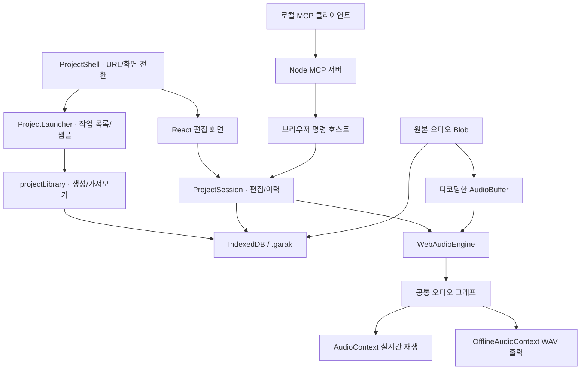

# 가락이음 아키텍처

이 문서는 0.1.0의 실제 구현을 설명합니다. 현재 웹 엔진과 향후 네이티브 호스트 설계를 구분하며, 이름과 인터페이스만 존재하는 기능을 구현 완료로 취급하지 않습니다.

## 1. 현재 실행 구조

`ProjectShell`은 기본 `/`의 프로젝트 선택 화면과 `/projects/:id`의 편집기를 나눕니다. 편집기의 React 화면은 `ProjectSession`의 프로젝트·이력을 구독하며, 화면 조작과 MCP 편집이 같은 세션을 변경합니다. `WebAudioEngine`은 편집기 안의 재렌더링 수명 주기 밖에서 유지되는 서비스이며, 브라우저의 `AudioContext`와 오디오 그래프를 소유합니다. 프로젝트 저장과 원본 음원 보관은 별도 저장 모듈이 담당합니다.



오디오 계산을 서버로 보내지 않습니다. 웹 파일을 호스팅하더라도 각 사용자의 브라우저가 재생·렌더링을 수행합니다. 선택적으로 실행하는 로컬 MCP 프로세스는 명령과 결과를 전달하며 오디오 엔진을 소유하지 않습니다. 계정·클라우드 저장 백엔드는 현재 구성에 없습니다.

### 프로젝트 이동의 보호 범위

이동은 인라인 입력 blur → 진행 상태 → 이전 프로젝트의 최종 저장 → 대상 프로젝트 저장/확인 → URL과 화면 변경 순서다. 브라우저 Back/Forward는 앱이 기록한 방문 인덱스로 현재 작업 주소에 먼저 복귀한 뒤 같은 저장 가드를 적용한다. 이동을 거절하면 기존 방문 항목과 앞으로 가기 목록을 유지한다. 진행 중 추가 이동은 별도 생성 함수를 실행하지 않는다.

앱 밖의 코드가 삽입한 방문 항목은 브라우저가 위치 인덱스를 제공할 때 이를 읽어 복구한다. 인덱스와 앱 메타데이터가 모두 없는 외부 항목은 방향을 추측할 수 없으므로, 이동 거절 시 기존 항목을 교체하지 않고 현재 작업 주소를 새로 추가한다. 이 제한된 경우에는 앞으로 가기 목록이 사라질 수 있다. 페이지 자체를 떠나는 새로고침·탭 닫기에는 동기적인 미저장 상태 확인과 브라우저 종료 경고를 사용한다.

## 2. 모듈 지도

| 파일 | 책임 |
| --- | --- |
| [`src/ProjectShell.tsx`](../src/ProjectShell.tsx) | URL별 목록/편집기 구성, 목록 갱신, 생성·가져오기 후 이동, 편집기의 이탈 보호 연결, 이동 중 진행 화면 |
| [`src/core/projectNavigation.ts`](../src/core/projectNavigation.ts) | 프로젝트 URL 해석·생성, 브라우저 이력과 화면 전환, 비동기 이동 및 이탈 보호 |
| [`src/components/ProjectLauncher.tsx`](../src/components/ProjectLauncher.tsx) | 내 프로젝트·샘플 분류와 검색, 공통 파일 아이콘·요약 정보 타일, 선택 항목의 읽기 전용 상세와 공통 열기, 빈 프로젝트·가져오기 |
| [`src/core/projectLibrary.ts`](../src/core/projectLibrary.ts) | 빈 프로젝트/템플릿을 먼저 저장하고 반환, 가져온 번들을 새 프로젝트 ID로 저장; 오디오 디코딩 없음 |
| [`src/core/projectTemplates.ts`](../src/core/projectTemplates.ts), [`src/core/projectTemplates/`](../src/core/projectTemplates/) | 국악 붐뱁·트랩·퓨전의 메타데이터와 순수 MIDI 팩토리; 호출마다 새 ID와 편집 객체 |
| [`src/App.tsx`](../src/App.tsx) | 지정된 프로젝트 ID 복원, 공통 세션 구독, 선택 상태, 프로젝트별 자동 저장·이탈 전 저장, 엔진 연결, 오디오 파일 가져오기·내보내기, 녹음 UI, 편집기 단축키 |
| [`src/core/input.ts`](../src/core/input.ts), [`src/core/transportShortcuts.ts`](../src/core/transportShortcuts.ts) | 편집 영역별 키맵과 입력 보호, Space 재생 명령의 capture 처리·키 수명 관리 |
| [`src/core/ProjectSession.ts`](../src/core/ProjectSession.ts), [`src/core/commands.ts`](../src/core/commands.ts) | 프로젝트·Undo/Redo·revision, 명령 계약과 검증, 미리 보기·원자적 적용·재시도 중복 방지 |
| [`src/automation/host.ts`](../src/automation/host.ts), [`src/automation/bridgeClient.ts`](../src/automation/bridgeClient.ts) | 범위를 제한한 상태 조회, 편집 허용·작업 중 보호, 명시적인 브리지 연결과 취소·만료 처리 |
| [`mcp/server.ts`](../mcp/server.ts), [`mcp/tools.ts`](../mcp/tools.ts), [`mcp/bridgeServer.ts`](../mcp/bridgeServer.ts) | 공식 SDK stdio 도구, loopback WebSocket 라우팅·인증, 실제 브라우저 응답 대기 |
| [`src/core/types.ts`](../src/core/types.ts) | Project·Track·Clip·MidiNote·AudioAsset 및 AudioEngine 계약 |
| [`src/core/project.ts`](../src/core/project.ts) | 새 프로젝트·트랙, 클립 복제·분할, 외부 프로젝트 유효성 검사. 이전 8마디 데모 팩토리는 호환 테스트용으로 남으며 시작 화면은 새 템플릿 카탈로그를 사용 |
| [`src/core/audioSettings.ts`](../src/core/audioSettings.ts) | 프로젝트 레이트 허용값·기본값, 앱 오디오 설정의 정규화·로컬 저장, 입력 제약 요청과 실제 상태 타입 |
| [`src/core/recordingOffset.ts`](../src/core/recordingOffset.ts) | 수동 녹음 보정의 부호·범위 검증, 리전 배치와 프로젝트 0 경계의 소스 오프셋 계산 |
| [`src/core/instruments.ts`](../src/core/instruments.ts) | 악기 레지스트리: 합성·샘플 악기의 ID, 이름, 분류, 색, 조절기 정의, 샘플 세트 ID, 출처 표기 |
| [`src/core/devices.ts`](../src/core/devices.ts) | 공통 파라미터 값 변환과 이펙트 레지스트리의 호환 export |
| [`src/devices/contracts.ts`](../src/devices/contracts.ts), [`src/devices/effects/registry.ts`](../src/devices/effects/registry.ts) | 실시간 이펙트 계약과 여섯 모듈 등록; 각 모듈이 정의·DSP·잔향 시간을 소유 |
| [`src/devices/pitch-editor/`](../src/devices/pitch-editor/) | 리전 피치/포먼트 UI·음계 보정·세션 초안/도구옵션·원본 분석·Worker 렌더·v2 문서 검증·float WAV 자산 |
| [`src/audio/samples.ts`](../src/audio/samples.ts) | 샘플 세트 로더: 매니페스트 해석, 포맷 선택, 디코딩 캐시, 존 선택, 로딩 상태 알림 |
| [`src/core/storage.ts`](../src/core/storage.ts) | ID별 프로젝트 번들·요약 목록, 기존 latest 이전, IndexedDB 원자적 저장·순서 보장, 원본 Blob 검증, `.garak` 가져오기·내보내기 |
| [`src/audio/WebAudioEngine.ts`](../src/audio/WebAudioEngine.ts) | 오디오 컨텍스트 수명 주기, 재생 위치·루프·예약, 파일 디코딩, 오프라인 출력, UI에 제공하는 스냅숏과 레벨 |
| [`src/audio/InputCapture.ts`](../src/audio/InputCapture.ts) | 녹음·모니터링 입력 공유, 입력 변경의 준비·확정·복구, 지연된 권한 응답과 장치 종료 처리 |
| [`src/audio/AudioDeviceProbe.ts`](../src/audio/AudioDeviceProbe.ts), [`src/audio/OutputTest.ts`](../src/audio/OutputTest.ts) | 설정 창의 임시 입력 권한·레벨 테스트, 취소 가능한 적용 출력 테스트와 각 자원의 정리 |
| [`src/audio/graph.ts`](../src/audio/graph.ts) | 기본 악기, 트랙·마스터 오디오 연결, 효과, 음성 수명 주기, 범위별 음표·오디오 클립 예약 |
| [`src/audio/math.ts`](../src/audio/math.ts) | 박자·시간 변환, 루프 위치, 페이드 계산, 16-bit PCM WAV 인코딩 |
| [`src/components/Timeline.tsx`](../src/components/Timeline.tsx) | 타임라인, 클립 이동·길이 편집, 재생 커서, 트랙·마스터 미터 |
| [`src/components/PianoRoll.tsx`](../src/components/PianoRoll.tsx) | 음표·세기 편집, 음표 단위 단축키, 미리듣기 요청 |
| [`src/components/Mixer.tsx`](../src/components/Mixer.tsx) | 트랙·마스터 믹서 조작 |
| [`src/components/DeviceChain.tsx`](../src/components/DeviceChain.tsx) | 공통 디바이스 카드·노브, 악기 선택, 이펙트 추가·삭제·순서·바이패스 조작 |
| [`src/components/Waveform.tsx`](../src/components/Waveform.tsx), [`src/core/waveform.ts`](../src/core/waveform.ts) | 원본 구간에 맞춘 파형 표시. 확대 수준과 처리량에 따라 캐시 피크 또는 실제 PCM 사용 |
| [`src/components/AudioSettingsDialog.tsx`](../src/components/AudioSettingsDialog.tsx), [`src/components/useAudioDevices.ts`](../src/components/useAudioDevices.ts) | 장치·녹음·프로젝트·진단 설정 초안, 적용/취소 UI, 수동 권한·장치 목록·테스트 연결 |

## 3. 프로젝트 모델과 편집

`Project`는 직렬화 가능한 편집 데이터입니다. `AudioContext`, DOM 노드, 재생 중인 음성을 포함하지 않습니다. 편집한 프로젝트를 `engine.setProject(project)`로 전달하고, 엔진이 현재 재생 그래프에 반영합니다.

| 값 | 기준 |
| --- | --- |
| `Project.sampleRate` | 실시간 엔진·WAV 출력 처리율(Hz). 44100/48000/88200/96000/176400/192000, 새 프로젝트·누락된 구버전 필드의 기본값은 48000 |
| `Clip.startBeat` | 프로젝트 시작을 기준으로 한 박 위치 |
| `Clip.lengthBeats` | 클립의 박 단위 길이 |
| `MidiNote.start` | MIDI 원본 소스 안의 박 위치. 리전 안의 표시 위치는 `start - (sourceOffsetBeats ?? 0)` |
| `MidiClip.sourceOffsetBeats` | MIDI 원본 소스에서 표시·재생을 시작하는 박 위치; 생략 시 0 |
| `ClipBase.loopLengthBeats` | 리전 시작부터 수동 반복 끝까지의 전체 박 길이; 생략 시 연속 반복 |
| `MidiNote.duration` | 박 단위 음표 길이 |
| `MidiNote.pitch` | MIDI 음높이 번호 |
| `MidiNote.velocity` | 0~1 범위의 세기; 피아노롤은 1~127 값으로 표시 |
| `AudioClip.offsetSeconds` | 원본 또는 동일 길이의 피치 렌더 음원 안에서 재생을 시작할 초 위치 |
| `AudioClip.pitch` | v2 문서: 원본 자산 ID·SHA-256·고정 분석·음표 경계·음표별 피치/포먼트 센트 이동·포먼트 보존·렌더러 버전 |
| `AudioClip.assetId` | 현재 재생 자산; 피치 적용 시 별도 렌더 자산 ID, 원본 복원 시 원본 ID |
| `AudioClip.fadeIn`, `fadeOut` | 초 단위 페이드 길이 |
| 트랙 볼륨·클립 게인 | 선형 배율 |
| `Track.pan` | -1~1 범위 |
| `Track.devices` | 인서트 이펙트의 순서 있는 배열; 활성 항목을 배열 순서대로 처리 |
| `Device.type`, `enabled` | 내장 이펙트 종류와 활성/바이패스 상태 |
| `Device.params` | `EFFECT_DEFS`에 정의한 파라미터의 원래 단위 값; Hz·dB·초·밀리초·배율 등 |

오디오 클립 분할은 원본 파일을 수정하지 않고 새 클립의 시작 위치·길이·원본 오프셋을 계산합니다. MIDI 리전은 원본 음표를 유지하고 `sourceOffsetBeats`와 `lengthBeats`로 표시·재생 범위를 정합니다. 분할한 오른쪽은 독립된 음표 ID와 소스 오프셋을 가지며 양쪽 모두 다시 늘릴 수 있습니다. 피아노롤은 `midiEditorClip`의 보이는 구간을 편집한 뒤 `applyMidiNoteEdits`로 원본에 병합하므로 숨은 음표와 변경하지 않은 앞뒤 길이를 보존합니다. 합치기는 보이는 구간을 새 소스로 만듭니다.

현재 프로젝트 스키마는 **4**입니다. 기존 디바이스·피치 문서와 함께 `MidiClip.sourceOffsetBeats`, `ClipBase.loopLengthBeats`를 저장합니다. 스키마 1·2·3은 4로 정규화하며, 1의 `track.effects.filter/reverb/delay`는 디바이스 배열로 변환합니다. `.garak` 바깥 번들 버전은 기존 1을 유지합니다. 새 필드를 모르는 구버전 앱은 스키마 검사에서 거절하므로 리전 소스 위치를 조용히 잘못 해석하지 않습니다.

`loopLengthBeats`는 리전 시작부터의 전체 반복 범위이며 이동·복제 시 함께 이동합니다. 값이 없으면 기존 연속 루프입니다. 재생·고스트 표시·미리보기는 수동 끝/다음 리전/프로젝트 끝 중 가장 이른 위치를 공유하고, 마지막 일부 반복도 같은 규칙으로 자릅니다. 원본 리전 자체는 반복 경계보다 짧게 자르지 않습니다. 파형은 오디오 소스의 `offsetSeconds`·길이를 사용하며, 가까운 확대에서는 읽기 비용 한도 안에서 실제 샘플을 표시합니다.

포먼트 확장은 프로젝트 스키마를 올리지 않고 **내부 피치 문서 버전 2**로 구분합니다. `preserveFormants: boolean`과 음표 ID별 `formantShifts` 맵을 필수로 저장하며, `analysis.version`은 1입니다. v1 문서는 보존 꺼짐·빈 포먼트 맵으로 이전하고 기존 `rendererId`, 피치 이동값, 원본과 렌더 자산을 유지합니다. 이 마이그레이션은 오디오를 다시 만들지 않습니다. v1이라고 선언하면서 새 포먼트 필드를 담은 문서는 거부합니다. v2를 모르는 구버전 앱은 내부 문서 버전 검사에서 거부하므로 새 편집을 조용히 버리지 않습니다.

Undo/Redo는 `ProjectSession`의 프로젝트 스냅숏 이력으로 처리합니다. 일반 편집 시 과거 스냅숏을 최대 50개 유지하고 각 단계의 작업명으로 `undoLabel`/`redoLabel`을 제공합니다. 페이더·팬·노브·네이티브 슬라이더는 명시적인 제스처 시작/끝으로 묶어 드래그 중 멈춰도 한 Undo이며, 별도 드래그는 빠르게 이어도 구분합니다. 제스처를 취소하거나 시작 값으로 되돌아오면 이전 Undo/Redo와 작업명을 복원합니다. 제스처가 없는 연속 입력만 기존 450ms 병합을 사용합니다. 피아노롤과 타임라인의 포인터 이동은 임시 화면 상태로 표시한 뒤 드래그 종료 시 프로젝트에 반영합니다. 이력은 현재 앱 세션의 메모리에 있으며 `.garak`이나 IndexedDB에 함께 저장하지 않습니다.

MCP 편집은 `projectId`·`expectedRevision`·`operationId`와 명시적인 명령 배열을 받습니다. 모든 명령을 검증한 뒤 Undo 하나로 적용하고, UI 입력과 병합하지 않습니다. 성공 요청은 최근 256개를 세션 안에서 기억하며 동일 요청 재시도는 원래 결과를 반환합니다. 프로젝트를 다시 열면 캐시를 비우고 revision을 증가시킵니다. 조회 결과의 revision과 원래 요청 결과의 revision을 구분하고, 저장 완료는 별도 `persistence`로 확인합니다. 자세한 수명·범위는 [MCP 연결 안내](MCP.md)에 있습니다.

프로젝트 샘플레이트의 명시적 변경도 프로젝트 이력에 포함합니다. 레이트를 바꾸는 Undo/Redo는 녹음·녹음 준비 중 차단합니다. 입력/출력 장치 ID·지연 요청·모니터링·수동 녹음 보정 등의 앱 환경은 `localStorage`의 `garak-ieum:audio-settings:v1`에 별도로 보관하며 프로젝트 파일·편집 이력에 넣지 않습니다.

### 키보드 입력 경계

일반 편집 명령은 `input.ts`의 포커스 범위와 수정키 규칙을 따릅니다. Space 재생 명령은 `transportShortcuts.ts`가 `window`의 capture 단계에서 먼저 처리합니다. 일반 화면의 버튼·드롭다운·체크박스·라디오·숫자 입력·슬라이더/노브·팝오버/메뉴·body에서도 Space는 재생/일시 정지, Shift+Space는 선택 리전부터 재생입니다. 편집 가능한 텍스트 입력·textarea·contenteditable·IME 조합과 열린 모달은 기존 입력을 우선합니다.

재생 명령이 소유한 Space는 누름 상태를 React 렌더 사이에도 유지하여 길게 누른 반복과 대응하는 keyup을 소비합니다. 이로써 기본 스크롤이나 버튼의 keyup 활성화가 함께 발생하지 않게 합니다. 일반 버튼과 메뉴는 Enter를 사용하고, 일반 화면의 네이티브 체크박스·라디오에는 Enter 활성화를 제공합니다. 일반 컨트롤의 Enter·방향키 등은 유지하고, 나머지 앱 명령은 마지막 활성 편집기로 전달합니다. 접힌 편집기는 타임라인으로 돌아갑니다. 피아노롤 스냅은 피아노롤 명령 핸들로 전달합니다. 상세 키맵과 검증 범위는 [단축키](SHORTCUTS.md)를 따릅니다.

피아노롤의 포인터 시간 편집과 키보드 이동은 서로 다른 단위를 사용합니다. 기본 마우스 스냅은 0이며 생성·이동·좌우 리사이즈에 격자 양자화와 경계 자석 스냅을 적용하지 않습니다. 사용자가 스냅을 명시적으로 선택하면 포인터에만 그 단위를 적용합니다. 좌우 방향키는 항상 화면에 사용한 `musicalGrid.stepBeats` 한 칸을 상대 이동하고, 위아래 방향키는 반음 또는 드럼 패드 한 행을 이동합니다. 기존 Alt 방향키와 Shift 선택 확장도 유지합니다. 이 동작은 프로젝트 저장 형식을 변경하지 않습니다.

## 4. 오디오 엔진의 실제 범위

현재 백엔드는 직접 작성한 `WebAudioEngine` 하나입니다. `AudioEngine.kind`에 `'native'`라는 미래 구분값이 있지만, 네이티브 구현·브리지·플러그인 호스트는 존재하지 않습니다. openDAW 또는 Tracktion Engine을 가져온 코드도 아닙니다.

### 오디오 장치 설정

`App`은 설정 적용 시 재생을 일시 정지하고, 활성 모니터링에 필요한 입력 변경을 먼저 준비한 뒤 `engine.configure(settings, sampleRate)`를 호출합니다. 엔진은 후보 컨텍스트의 레이트·출력·실행 상태를 확인한 뒤 교체하며 실패한 후보는 기존 엔진을 대체하지 않습니다. 입력 확정까지 성공하면 로컬 설정과 프로젝트 레이트를 반영하고, 중간 실패 시 준비 입력을 정리하고 엔진 복구를 시도합니다. 녹음·녹음 준비·파일 처리 중 적용은 차단합니다.

`latencyHint`와 지원 시 `renderSizeHint`는 요청입니다. `getAudioState()`/`subscribeAudioState()`는 실제 엔진 레이트·블록·지연·출력·오류를 별도 스냅숏으로 제공합니다. 렌더 블록은 하드웨어 I/O 버퍼가 아니며, 보고된 지연은 왕복 실측값이 아닙니다. `AudioContext`의 레이트도 물리 인터페이스 클럭을 제어했다는 뜻은 아닙니다. 지원 범위와 공식 근거는 [오디오 설정 벤치마크](AUDIO_SETTINGS_BENCHMARK.md)에 있습니다.

브라우저가 출력 변경·오류를 보고하면 엔진은 선택된 특정 출력의 ID와 현재 경로를 확인합니다. 확인할 수 없거나 다른 출력으로 바뀌었으면 재생·모니터링 출력을 막고 선택값을 유지합니다. 정상 재생으로 돌아가려면 사용자가 장치·권한을 확인해 재적용하거나 기본 출력을 직접 선택해야 합니다. 장치 목록이 제한된 상태를 물리 분리라고 단정하지 않습니다.

### 재생 예약

시계의 기준은 `AudioContext.currentTime`입니다. JavaScript 타이머는 약 25ms 간격으로 앞으로 120ms 범위의 이벤트를 미리 예약합니다. 악기와 클립에는 오디오 시계에 맞춘 시작·종료 시각을 전달합니다. 타이머가 각 오디오 샘플을 직접 계산하는 구조는 아닙니다.

실제 신호 처리는 `OscillatorNode`, `AudioBufferSourceNode`, `GainNode`, `BiquadFilterNode`, `ConvolverNode`, `DelayNode` 등 브라우저 기본 노드가 수행합니다. 현재 사용자 정의 AudioWorklet, WebAssembly, 별도 오디오 Worker는 사용하지 않습니다.

노트와 배치를 바꾸거나 재생 위치를 이동하면 새 예약·그래프로 전환합니다. 볼륨·팬·효과 값은 오디오 파라미터를 짧게 보간해 적용합니다. 지연된 타이머가 오래된 음표를 한꺼번에 발음하지 않도록 현재 오디오 시계에서 다시 이어 가는 처리가 있지만, 백그라운드 탭·CPU 과부하에서 연속 재생을 보장하는 것은 아닙니다.

### 신호 경로

트랙 입력 뒤에는 `Track.devices`의 활성 이펙트를 **배열 순서대로 직렬 연결**합니다. 예를 들어 EQ → 드라이브 → 리버브를 넣으면 EQ 출력 전체가 드라이브로 들어가고, 드라이브 출력 전체가 리버브로 들어갑니다. 디바이스 순서를 바꾸면 이 연결 순서도 바뀝니다. 비활성 디바이스는 그래프를 만들지 않고 건너뛰며, 활성 이펙트가 없으면 트랙 입력에서 팬으로 바로 연결합니다. 실제 구성은 [`createGraph`](../src/audio/graph.ts)가 담당합니다.

| 단계 | 실제 처리 |
| --- | --- |
| 트랙 입력 | 악기 음성·오디오 클립 신호 또는 지정된 라이브 모니터링 입력을 받음 |
| 인서트 체인 | 활성 `Track.devices` 각각의 input/output을 순서대로 연결 |
| 트랙 출력 | 팬 → 트랙 볼륨 → 트랙 미터 → 마스터 합산 |
| 마스터 출력 | 마스터 볼륨 → 컴프레서 → gate → 마스터 미터 → 출력 장치 |

Dry/wet 분기는 **각 이펙트 내부**에 있습니다. 드라이브는 원음과 처리음을 `mix`로 섞고, 딜레이는 원음에 피드백 딜레이의 wet 출력을 더하며, 리버브는 원음에 컨볼루션의 wet 출력을 더합니다. 이 결과가 다음 디바이스로 전달됩니다. 모든 트랙에 필터·리버브·딜레이가 고정으로 달리거나, 트랙 팬 단계에서 세 효과를 병렬 합산하는 구조는 아닙니다.

마스터에는 기본 `DynamicsCompressorNode`가 있습니다. 이를 별도로 검증된 마스터링 리미터로 간주하지 않습니다. 합성 악기와 리버브에 쓰는 노이즈·임펄스는 코드에서 생성하며, 외부 상용 음원 라이브러리를 필요로 하지 않습니다.

### 디바이스 모듈 경계

여섯 내장 이펙트는 `src/devices/effects/`의 독립 파일로 분리했습니다. 각 모듈은 `RealtimeEffectModule` 계약의 `definition`, `create`, `tailSeconds`와 생성한 그래프의 `update`를 소유합니다. `registry.ts`가 표시 순서와 지원 목록을 제공하며 랙 UI·저장 검증·MCP 카탈로그가 같은 정의를 사용합니다. 레지스트리 import 자체는 오디오 컨텍스트나 노드를 만들지 않아 Node MCP에서도 사용할 수 있습니다.

`audio/graph.ts`는 이펙트의 구체 DSP 대신 등록된 모듈을 호출해 트랙 체인을 구성합니다. 노드 연결·해제는 호스트가 관리하고 실시간과 오프라인 출력에서 같은 모듈을 사용합니다. 기존 `Device.type/params` 형식과 이펙트 순서는 유지합니다.

합성 악기는 아직 `graph.ts`의 분기를 사용하고 샘플 악기는 별도 레지스트리를 사용합니다. 모든 악기를 독립 모듈로 분리하거나 외부 VST/AU/CLAP을 불러오는 구조는 아직 아닙니다. 사용자 정의 디바이스 UI를 자동 등록하는 범용 플러그인 계약도 후속 작업입니다.

### 리전 피치 처리

피치 편집기는 `src/devices/pitch-editor/`에 분리한 리전 처리 기능이며, 오디오 소스 카드의 **피치 편집 열기** 또는 하단 피치 탭으로 엽니다. 실시간 인서트 배열에 넣는 대신 오디오 리전의 렌더 자산을 생성하고 이후 일반 트랙 이펙트 체인을 통과시킵니다.

1. 원본 Blob은 그대로 두고 SHA-256과 원본 ID를 저장합니다. Worker의 YIN 분석으로 얻은 음표·피치 곡선은 원본 초 단위 좌표로 고정합니다.
2. 편집 음표 경계와 피치/포먼트 이동 맵을 분석과 분리합니다. 트림된 리전의 경계 음표를 나누고 두 이동값을 상속하여 보이는 부분을 독립적으로 편집합니다. 음표 수 한도로 경계를 나눌 수 없으면 그 경계 음표를 읽기 전용으로 두어 숨겨진 구간의 변경을 막습니다. 합치기는 피치와 포먼트 이동값이 모두 같은 인접 음표만 허용합니다. 기존 분석을 편집 결과로 덮어쓰지 않습니다.
3. 적용 시 원본 PCM과 두 이동 맵·보존 설정을 Worker에 복사해 전달하고, 고정 버전 Signalsmith WASM과 재합성 정책으로 같은 프레임 수의 PCM을 만듭니다. 작업 취소는 Worker를 종료합니다.
4. 피치 또는 포먼트 이동이 하나라도 있으면 결과를 별도 32-bit float WAV Blob으로 디코딩하여 새 자산으로 등록한 뒤 `AudioClip.assetId`와 `pitch`를 하나의 프로젝트 편집으로 확정합니다. 피치 없이 포먼트만 바꾼 경우도 같은 경로를 사용합니다. 두 맵의 이동값이 모두 0이면 원본 자산을 유지하며, 보존 토글만으로 별도 음원을 만들지 않습니다. 재생과 일반 16-bit WAV 출력이 현재 자산을 공유합니다.
5. 적용 직전 원본 해시·프로젝트 세션·revision·리전 객체·원본 자산을 다시 확인합니다. 렌더 후 디코딩 중의 취소도 확인하여 오래된 결과가 프로젝트를 덮어쓰지 않게 합니다.

초안과 적용 결과의 수명은 다릅니다. 미적용 초안과 로컬 Undo는 현재 세션 메모리에만 존재합니다. 적용 후에는 프로젝트 Undo/Redo·자동 저장·`.garak`에 분석과 편집 명세, 원본과 렌더 Blob이 포함됩니다. 프로젝트 파일 내보내기·WAV 출력·새 프로젝트·가져오기 전에 미적용 초안을 안내하며, 초안/분석/렌더 중 MCP 변경은 차단합니다.

선택 음표의 음정 중심 보정은 `correction.ts`가 담당합니다. 현재 중심음(`note.midi + pitchCents / 100`)에서 가장 가까운 반음계·장음계·자연 단음계 음을 고르고, 같은 거리면 낮은 음을 선택합니다. 강도 0–100%는 현재 위치와 목표 사이의 선형 보간입니다. 50%를 다시 실행하면 남은 차이의 절반을 좁히며, 최종 피치 이동은 원본 기준 ±1200 ct로 제한합니다. 기본으로 검출 신뢰도 0.75 미만을 제외하되 사용자가 해제할 수 있습니다. 이는 검출 휴리스틱이며 교정 정확도의 확률이 아닙니다. 원본 곡선·음표 길이·포먼트 값은 변경하지 않습니다.

기준음·음계·강도·불확실 음표 제외는 `projectId`별 세션 도구옵션입니다. 리전과 탭을 바꾸어도 같은 프로젝트에서 기억하지만 피치 문서·프로젝트 파일·Undo에는 포함하지 않습니다. 옵션만 바꾸면 음정은 그대로이며, **선택 음표 보정**을 실행해야 현재 화면 안의 선택 음표를 변경합니다. 포먼트 보존과 음표별 이동값은 이 도구옵션과 달리 실제 편집 문서에 저장합니다.

렌더러는 중립 피치로 시간 길이를 조절한 뒤 원하는 피치 비율로 재샘플링합니다. 포먼트는 재샘플링 전에 스펙트럼 포락선을 이동하며, 내부 이동값은 `formantCents - (preserveFormants ? pitchCents : 0)`입니다. 피치와 포먼트의 사용자 입력 범위는 각각 ±1200 ct이고, **내부 이동값도 ±1200 ct를 벗어나면 적용을 거부**합니다. UI는 보이지 않는 원본 구간까지 포함한 전체 문서를 검사하며, Worker 렌더러도 같은 제한을 검증합니다. 새 분석의 보존 기본값은 꺼짐입니다. 이 실험적 음색 보정은 큰 이동에서 음색·음량이 달라질 수 있으며, 실제 보컬 청음 품질을 보장하지 않습니다.

재로드한 AudioBuffer가 분석 당시와 다른 샘플레이트로 디코딩될 수 있습니다. 음표 좌표는 초 단위로 유지하고, 원본 해시와 물리적 길이를 확인합니다. 길이 비교는 낮은 샘플레이트 기준 두 프레임의 반올림 오차만 허용합니다. 피치 원본이 누락되거나, 편집 명세와 렌더 자산 참조가 모순되면 프로젝트 검증에서 거부합니다.

현재 범위는 원본 60초 이하·1~2채널·단선율 분석·음표별 ±12반음과 위의 실험적 포먼트 처리입니다. 타이밍·비브라토/드리프트 개별 편집·다성음 분리·실시간 보정·피치 MCP 명령은 포함하지 않습니다. 사용법과 정확한 경계는 [피치 편집기](PITCH_EDITOR.md), 확장 설계는 [피치 디바이스 설계](PITCH_DEVICE_DESIGN.md)에 있습니다.

### 샘플 악기

악기는 `src/core/instruments.ts`의 레지스트리 `INSTRUMENTS`에 정의합니다. 각 항목은 고정 ID(저장 파일이 참조), 표시 이름, 분류(신스·피아노·건반·드럼·국악), 합성/샘플 종류, 킷 여부, 조절기 정의를 가집니다. `Track.instrument`는 이 ID 문자열이며, `validateProject`는 레지스트리에 없는 ID를 거부합니다. 합성 악기(`drums`, `bass`, `keys`, `pad`, `pluck`, `rhodes`)는 `graph.ts`의 `scheduleInstrument`가 오실레이터로 만들고, 샘플 악기는 `set` 필드가 가리키는 `public/samples/<set>/` 폴더의 음원을 씁니다. 매니페스트 규격은 [`SAMPLES.md`](SAMPLES.md)를 따릅니다.

`src/audio/samples.ts`의 `SampleLibrary`는 엔진당 하나이며 `WebAudioEngine.samples`로 접근합니다. `load(setId, context)`는 `manifest.json`을 읽고, 브라우저가 지원하는 포맷(Opus/webm 우선, 아니면 AAC/m4a)을 고른 뒤 모든 존 파일을 동시 6개 이하로 받아 `decodeAudioData`로 디코딩합니다. 세트별로 진행 중인 Promise를 캐시하므로 동시 요청은 한 번만 내려받고, 디코딩된 `AudioBuffer`는 컨텍스트에 묶이지 않아 그래프 재생성과 `OfflineAudioContext` 내보내기에서 그대로 재사용합니다. m4a는 AAC 인코더 지연만큼(44 ms) 재생 시작 위치를 건너뜁니다.

재생 중 아직 준비되지 않은 세트의 음표는 건너뛰고 로드를 시작합니다. 세트가 준비되면 엔진이 현재 박에서 다시 예약하므로 짧은 끊김이 한 번 생길 수 있습니다. 트랙 추가나 악기 변경으로 새 샘플 악기가 프로젝트에 들어오면 `setProject`에서 미리 로드를 시작하고, WAV 내보내기는 프로젝트가 쓰는 모든 세트를 기다린 뒤 렌더링합니다. UI는 `AudioEngine.sampleStatus`·`subscribeSamples`로 로딩·오류 상태를 트랙 헤더에 표시하고, `sampleAttribution`으로 로드된 세트의 출처를 디바이스 카드에 보여 줍니다.

존 선택(`pickZone`)은 음높이 범위 `[lo, hi]`와 세기 레이어 `[vlo, vhi)`로 고르며 가장 센 레이어는 `vhi`를 포함합니다. 킷은 `root`가 음표 번호와 같은 존만 씁니다. 음높이 악기는 `playbackRate`로 `root`와의 차이를 보정하고 어택·릴리즈 포락선과 루프 구간을 적용하며, 킷은 샘플을 끝까지 재생하되 `decay` 조절기로 줄일 수 있고 같은 `choke` 그룹의 이전 소리를 끊습니다.

### UI 갱신

`getSnapshot()`은 캐시된 transport 스냅숏을 반환하고 `subscribe()`로 변경을 알립니다. React는 `useSyncExternalStore`로 이를 읽습니다. 재생 커서는 `requestAnimationFrame`에서 DOM 위치를 갱신하고, 미터는 Canvas에 그립니다. 매 오디오 샘플이나 전체 파형을 React 상태에 넣지 않습니다.

이는 UI와 재생 책임을 분리한 초기 구조입니다. 프로젝트 비교·재예약, 노드 수, 전체 버퍼 메모리에는 여전히 규모에 따른 비용이 있으므로 수백 트랙 처리 성능을 입증한 설계로 표현하지 않습니다.

## 5. 가져오기와 녹음

편집기의 **오디오 파일 가져오기**는 `decodeAudioData()`로 전체 디코딩합니다. `AudioAsset`에는 원본 `Blob`, 재생용 `AudioBuffer`, 파형 표시용 피크가 함께 존재합니다. 원본은 그대로 보관하고, 피크는 채널을 살펴 최대 320개 지점으로 요약합니다. 확대 수준별 파형 캐시나 부분 디코딩은 없습니다. **프로젝트 번들 가져오기**는 별도로 `projectLibrary.ts`가 검증한 Project와 원본 Blob을 먼저 저장하며, 목록 화면에서 오디오를 디코딩하지 않습니다. 저장 후 편집기를 열 때 해당 프로젝트의 샘플레이트로 원본을 디코딩합니다.

마이크 입력은 `InputCapture`가 녹음·모니터링의 사용 요구와 `getUserMedia()` 스트림을 관리하고, `App`이 `MediaRecorder`로 녹음합니다. 특정 입력 ID는 `exact`로 고정하며 채널 수·샘플레이트·AEC/NS/AGC는 독립적인 요청으로 전달합니다. 모노/스테레오 채널 수 요청은 인터페이스의 물리 포트 선택이 아닙니다. 현재 입력 값은 트랙의 `getSettings()`에서 읽습니다.

사용 가능한 MIME 형식(WebM/Opus, MP4, Ogg/Opus 등) 중 하나를 선택하고 받은 청크를 하나의 Blob으로 합칩니다. 녹음을 끝내면 같은 디코딩 경로를 거쳐 오디오 클립으로 추가합니다. 프로젝트 레이트 선택이 녹음 원본의 코덱이나 비트 깊이 선택을 제공하지는 않습니다. 24-bit·32-bit float PCM 원본 녹음·다중 입력 녹음은 지원하지 않습니다.

클립 위치는 녹음 시작 시 transport 위치와 그때 적용된 `recordingOffsetMs`(-1000~1000ms 정수)를 사용합니다. 양수는 뒤로, 음수는 앞으로 배치합니다. 0 이전 구간은 원본을 재작성하지 않고 소스 오프셋으로 제외하며, 전체가 0 이전이면 리전을 만들지 않고 알립니다. 입력 장치·녹음 인코더·재생 시작 지연을 자동 측정하여 보상하는 단계는 아직 없습니다. 이 수동 정렬은 샘플 단위로 정렬된 다중 트랙 레코더의 보상을 뜻하지 않습니다.

## 6. 보관과 교환 형식

### URL과 작업 수명

기본 `/`는 `ProjectLauncher`를 열고 `/projects/:id`는 해당 ID의 저장본만 엽니다. URL에 있는 프로젝트가 없으면 명시적인 복원 오류를 표시하며, 최근 프로젝트나 기본 데모로 대체하지 않습니다. 편집기에서는 헤더 폴더 버튼 또는 로고 메뉴의 **프로젝트 목록**으로 돌아올 수 있고, 번들 가져오기는 목록과 로고 메뉴 모두에서 진입합니다. 이 URL은 현재 브라우저·사이트의 IndexedDB를 가리키며 원격 공유 주소가 아닙니다.

선택 화면은 내 프로젝트와 샘플을 같은 크기의 타일로 표시합니다. 타일은 공통 파일 아이콘과 이름·BPM·트랙 수·길이 요약을 사용하며 실제 MIDI 편곡을 그리지 않습니다. 클릭/Space는 선택 상태만 바꾸고 Enter/더블 클릭/하단 열기로 해당 열기 콜백을 실행합니다. 접이식 상세 영역은 선택한 항목의 읽기 전용 정보를 보여 주며 오디오 장치나 프로젝트 설정을 변경하지 않습니다.

`createLocalProject()`는 빈 프로젝트 또는 템플릿을 만들고 `saveStoredProject()` 완료 뒤 반환합니다. `importAsNewLocalProject()`는 `importProjectBundle()`의 검증 결과에 새 프로젝트 ID를 부여하여 저장합니다. 내부 트랙·리전·오디오 자산의 연결은 유지하므로 같은 원본 ID의 파일을 여러 번 가져와도 기존 작업을 덮어쓰지 않습니다. 이 단계는 원본 Blob만 다루고 오디오 장치를 열지 않습니다. `ProjectShell`은 저장이 성공한 ID로 이동합니다.

편집기는 목록·새 프로젝트·가져오기·프로젝트 이동 전에 이탈 보호를 통해 마지막 편집 스냅숏과 자산을 저장합니다. 녹음·파일 처리·진행 중 드래그와 미적용 피치 작업은 이동을 막고, 저장 실패도 현재 편집기를 유지합니다. 전환 중에는 이전 화면을 `inert`로 두고 진행 대화상자를 보여주어 저장 스냅숏 뒤의 입력을 차단합니다. 기존 자동 저장과 마지막 저장의 순서를 맞추고, 저장 도중 revision이나 자산이 달라지면 이동하지 않습니다.

### IndexedDB

데이터베이스 이름은 `noct-studio`, 버전은 **2**입니다. `project-bundles`는 프로젝트 ID를 키로 Project와 원본 Blob 배열을 보관하고, `project-summaries`는 이름·BPM·트랙 수·길이·생성/수정 시각만 보관합니다. 목록 조회는 요약 저장소만 읽어 오디오를 로드하거나 디코딩하지 않습니다. 번들과 요약은 같은 읽기·쓰기 트랜잭션에서 함께 갱신합니다. 저장 호출은 순서대로 처리하고, 변경 시각은 같은 밀리초 또는 뒤로 간 시스템 시각에서도 순서가 유지되도록 증가시킵니다. `AudioBuffer`와 미터 값은 저장하지 않습니다.

버전 1의 `projects` 저장소 `latest`와 `audio-assets` 원본은 업그레이드 트랜잭션 안에서 새 번들·요약으로 함께 이전합니다. 기존 저장소는 삭제하거나 덮어쓰지 않습니다. 데이터 검증 또는 쓰기가 실패하면 업그레이드를 롤백하고 원본을 유지합니다. 명시적인 ID를 준 `loadProject(id)`는 다른 저장본을 반환하지 않으며, 인수 없는 호환 호출만 가장 최근 수정본을 조회합니다. 기본 URL은 이 호환 호출로 자동 복원하지 않습니다.

프로젝트를 가져올 때 버전·수치 범위·중복 식별자·오디오 참조를 검증합니다. 참조하는 원본 파일이 없으면 완료된 저장이나 완전한 복원으로 처리하지 않습니다.

`.garak`의 최상위 구조는 다음과 같습니다. 이전 `.garak` 파일과 형식이 같으며, 호환성을 위해 `format` 값은 `noct-studio`를 유지합니다.

```json
{
  "format": "noct-studio",
  "schemaVersion": 1,
  "project": { "schemaVersion": 4, "sampleRate": 48000 },
  "assets": [
    {
      "id": "asset-id",
      "name": "recording.wav",
      "mimeType": "audio/wav",
      "byteLength": 1234,
      "dataBase64": "..."
    }
  ]
}
```

위 예시의 `project`와 오디오 데이터는 구조 설명용으로 생략했습니다. 이 예시 자체는 유효한 프로젝트 파일이 아닙니다. 실제 파일은 전체 Project와 원본 바이트를 담으며, 가져올 때 원본 길이와 참조 관계를 검사합니다.

현재 형식은 압축 컨테이너나 스트리밍 형식이 아닙니다. 큰 파일에서는 base64 문자열·JSON·디코딩 버퍼가 동시에 메모리를 점유할 수 있습니다. IndexedDB는 여러 프로젝트의 현재 저장본을 보관하지만 프로젝트별 과거 버전 백업은 제공하지 않습니다. 다른 브라우저·기기로 옮기거나 별도로 보관하려면 `.garak` 파일을 사용합니다.

피치 렌더 자산은 Undo/Redo가 참조할 수 있도록 원본과 함께 유지합니다. 현재 자산 맵의 이전 렌더도 번들에 포함될 수 있어 반복 적용은 메모리와 파일 크기를 늘립니다. 자산 참조 집계와 캐시 정리는 후속 작업입니다.

## 7. WAV 출력

실시간 재생과 `OfflineAudioContext`는 같은 그래프 생성·범위 예약 함수를 사용합니다. 출력은 프로젝트 시작부터 끝까지 한 번 렌더링하고, 사용 중인 효과에 맞춘 잔향 시간을 더합니다. 반복 재생용 루프는 파일 길이에 적용하지 않습니다.

출력은 2채널 16-bit PCM WAV입니다. 샘플레이트는 **`Project.sampleRate`**로 결정하며, 열린 실시간 컨텍스트의 값이나 유무에 의존하지 않습니다. 오프라인 렌더링과 WAV 헤더에 같은 레이트를 사용하고 최종 PCM 인코딩에서 표현 범위를 벗어나는 값은 제한합니다.

현재 구현은 렌더 결과 전체를 RAM에 만들기 때문에 잔향을 포함한 15분 상한을 둡니다. 트랙별 스템, 범위 지정 출력, 스트리밍 인코딩, 다른 비트 깊이·코덱 선택은 아직 제공하지 않습니다.

## 8. 검증 경계

| 테스트 | 다루는 범위 |
| --- | --- |
| `src/core/project.test.ts` | 이전 데모 호환, 비파괴 클립 편집, 가져온 프로젝트 검증 |
| `src/core/projectTemplates.test.ts` | 세 샘플의 유효성·독립 ID·편곡 경계·실제 샘플 존과 파일·조성·그루브·섹션 변형 |
| `src/core/projectLibrary.test.ts` | 저장 완료 후 생성/가져오기, 같은 템플릿의 수정 격리, 같은 원본 ID 파일의 새 저장본과 Blob 보존, 오류 시 기존 목록 유지 |
| `src/core/projectLibraryStorage.test.ts` | fake-indexeddb를 통한 다중 프로젝트·요약 목록·저장 순서·원자적 실패·기존 latest 이전 및 원본 보존 |
| `src/core/storage.test.ts` | `.garak` 원본 바이트·참조 왕복, 손상·누락·중복 검출, 저장소 사용 불가 처리 |
| `src/audio/math.test.ts` | 루프·재생 위치, 페이드, WAV 헤더·채널·PCM 값 |
| `src/core/instruments.test.ts` | 악기 레지스트리 일관성, 알 수 없는 ID 처리, 샘플 악기 트랙 생성·검증 |
| `src/audio/samples.test.ts` | 존·레이어 선택, 매니페스트 해석, 로더의 요청·캐시·상태·오류 처리(네트워크와 디코딩은 모의) |
| `src/core/audioSettings.test.ts`, `src/core/recordingOffset.test.ts` | 로컬 설정·입력 요청·수동 녹음 정렬과 0 경계 |
| `src/audio/InputCapture.test.ts`, `src/audio/AudioDeviceProbe.test.ts` | 입력 준비·권한·취소·전환과 테스트 자원 수명 |
| `src/audio/WebAudioEngine.test.ts`, `src/audio/OutputTest.test.ts` | 컨텍스트 교체·복구·프로젝트 레이트·WAV·출력 장치 오류와 테스트음 취소 |

이 테스트들은 실제 브라우저의 오디오 장치, 마이크 지연, 네이티브 플러그인 호환성, 장시간 재생 성능을 측정하지 않습니다. fake-indexeddb 저장소 검사와 실제 브라우저의 IndexedDB 실행도 구분합니다. 실제 화면에서의 URL 직접 열기·뒤로/앞으로·새로고침·저장 복원·녹음·내보내기와 세 샘플의 청음·최종 음량 확인은 별도 검증 항목입니다.

## 9. 2.0 네이티브 호스트 경계

향후 React UI를 유지하면서 로컬 네이티브 오디오 그래프와 연결할 수 있도록 엔진 계약을 둡니다. 하지만 지금의 `AudioEngine`을 구현한 클래스 이름만 바꾸면 VST가 지원되는 상태는 아닙니다. 현재 `AudioAsset`이 브라우저 `AudioBuffer`를 직접 포함하는 부분도 네이티브 파일·자산 모델에 맞게 나눠야 합니다.

2.0에서는 플러그인 스캔·생성·상태 복원, MIDI 이벤트와 자동화 타임스탬프, 오디오 버스, 플러그인 지연 보상, 오프라인 렌더링, 프로세스 수명 주기를 함께 설계합니다. UI에는 명령·상태·미터를 전달하고, 매 오디오 버퍼가 React 렌더링이나 일반 UI 메시지 처리에 의존하지 않도록 합니다.

기존 플러그인의 자체 GUI는 로컬 네이티브 창으로 표시하는 것을 초기 방향으로 둡니다. Electron은 배포·창·프로세스를 묶을 수 있는 후보이며, Electron만 추가하면 플러그인 호스트가 생기는 것은 아닙니다. 네이티브 엔진의 선택·라이선스·지원 플랫폼은 아직 확정된 구현이 아닙니다.
