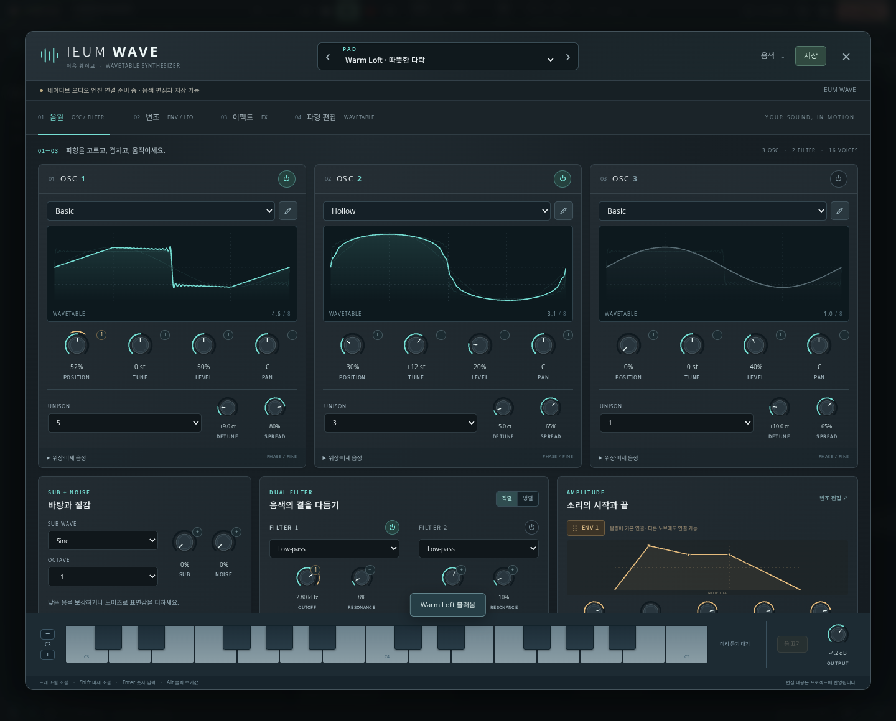
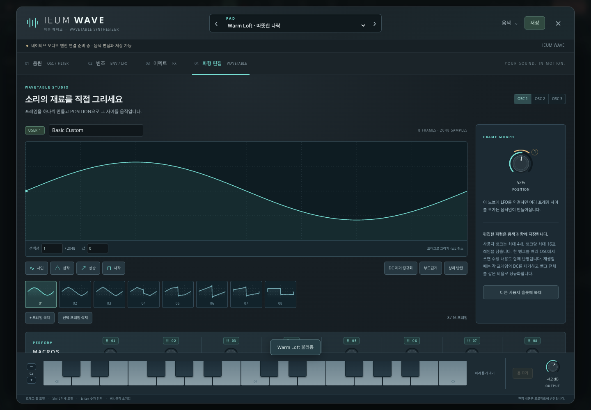
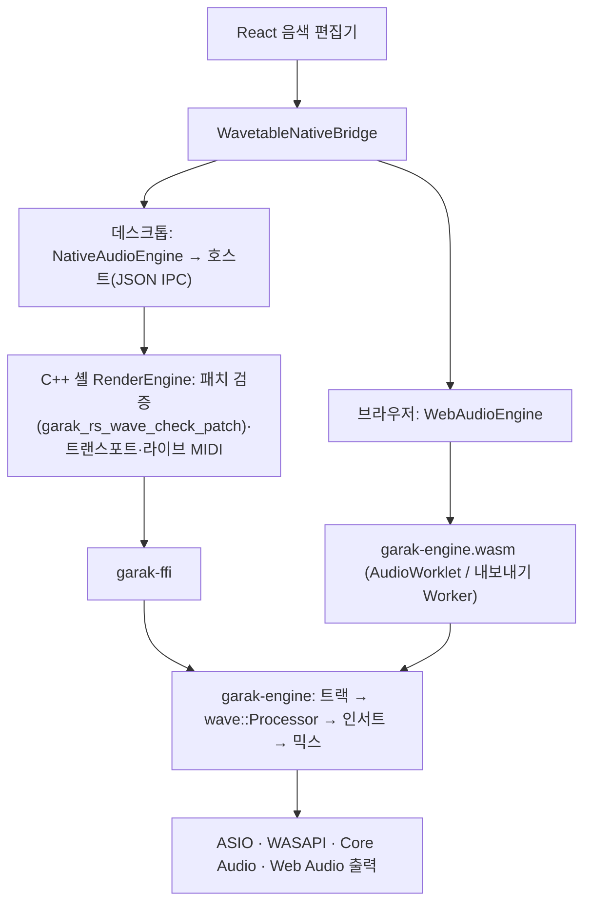

# IEUM WAVE · 이음 웨이브

가락이음의 독립적인 웨이브테이블 신디사이저입니다. React 편집기, 프로젝트에 저장되는 음색, 통합 Rust 엔진의 음원(`rust/garak-engine/src/wave/`)으로 이루어집니다. 악기 ID는 `wavetable`입니다.

**현재 단계 (0.3.3):** IEUM WAVE는 **데스크톱과 브라우저 모두 통합 Rust 엔진에서만** 렌더합니다. 데스크톱은 C++ 셸(`RenderEngine`)이 garak-ffi로 Rust 그래프에 타임라인·라이브 MIDI·미리 듣기를 넘기고, 브라우저는 AudioWorklet의 garak-engine.wasm이 같은 코드를 돌립니다. 편집기 미리 듣기, 타임라인 재생, 프리셋·패치 변경(사용자 파형 교체 시 20 ms 테이블 크로스페이드), WAV 내보내기가 두 곳에서 같습니다. 원래의 C++ 신스(`native/devices/wavetable-synth`)와 그 호스트 래퍼(`native/src/wavetable.cpp`)는 0.3.3에서 삭제했습니다. Rust 신스는 그 C++ 신스의 비트 동일 포팅이고, 삭제 전에 C++ 신스로 렌더한 골든 데이터와 계속 비교합니다([골든 패리티](#골든-패리티)). Windows의 WASAPI(기본값)·ASIO와 macOS의 Core Audio가 같은 경로로 재생합니다. [RUST_ENGINE 6장](RUST_ENGINE.md#6-악기보이스-인벤토리와-지원-현황)

WAVE의 패치와 음표는 프로젝트·타임라인에 보존합니다. 데스크톱 앱은 장치를 열기 전에 네이티브 호스트의 WAVE 프로토콜과 스키마를 확인하고(모든 네이티브 빌드가 Rust 엔진을 링크하므로 호스트는 항상 `wavetable` capability를 알립니다), 브라우저는 garak-engine.wasm을 불러올 수 있는지로 판단합니다. 편집기는 현재 패치가 엔진에 적용된 응답을 받은 뒤 건반을 활성화합니다. 엔진이 없거나(구버전 호스트, WASM 모듈 없음) 프로젝트를 거부하면 이유를 표시하며 지원을 가장하지 않습니다. 같은 트랙에 VST3 악기를 지정하면 해당 VST3가 실제 음원이며 WAVE 패치는 프로젝트에 보관됩니다.

[구현·검증 기록](IEUM_WAVE_VALIDATION.md) · [Rust 엔진](RUST_ENGINE.md)



## 사용하기

1. 새 MIDI 트랙을 만들고 **IEUM WAVE · 이음 웨이브**를 선택합니다.
2. 아래 **시김새 체인** 패널의 악기 카드에서 **IEUM WAVE 열기**를 누릅니다.
3. 기본 프리셋을 선택하거나 음원·변조·이펙트·파형 편집 화면에서 음색을 만듭니다.
4. 프로젝트 저장으로 파형과 변조 설정까지 보관합니다. 패치 내보내기/가져오기로 음색만 옮길 수도 있습니다.

Windows에서는 **설정 → 오디오 장치 → WASAPI**와 출력 장치를 선택합니다. 현재 앱은 WASAPI 공유 모드로 장치를 엽니다. WAVE 지원 샘플레이트는 22.05–192 kHz이며, 앱 설정에서는 제공되는 프로젝트 레이트를 선택합니다. ASIO나 Core Audio로 전환해도 악기와 프로젝트는 같은 경로로 재생됩니다. 브라우저에서는 편집기를 열 때 오디오를 시작하고(건반 미리 듣기용), 재생·내보내기는 Rust 엔진(AudioWorklet·Worker)이 맡습니다. 엔진이 프로젝트를 거부해 Web Audio 엔진으로 넘어가는 경우 WAVE 트랙은 소리 낼 수 없으므로 재생을 거부하고 이유를 보여 줍니다.

노브는 드래그, 방향키, 휠과 숫자 입력으로 편집합니다. Shift는 미세 조절에 사용합니다. 변조 소스를 파라미터에 연결한 뒤 Matrix에서 깊이·극성·보조 소스·곡선을 조정할 수 있습니다. 프로젝트의 실행 취소·다시 실행이 프리셋 변경과 파형 편집에도 적용됩니다. 텍스트와 숫자를 입력하는 동안에는 입력 칸의 기본 편집 키가 유지됩니다.

키보드의 미리 듣기는 엔진이 연결되고 현재 패치의 적용을 확인한 뒤 활성화됩니다. 기존 음을 누른 채 파라미터를 수정할 수 있도록 패치 변경 중에도 note-off를 전달합니다. 연결 해제, 창 닫기, 포커스 상실 시 미리 듣기 음을 정리합니다.

## 이 단계의 구성

| 영역 | 구성 |
| --- | --- |
| 음원 | 웨이브테이블 OSC 3개, 서브, 노이즈 |
| 보이스 | 최대 16음, OSC당 최대 7 유니즌 |
| 웨이브테이블 | 공장 뱅크 4개 × 8프레임; 사용자 뱅크 최대 4개 × 16프레임; 프레임당 2,048샘플 |
| 필터 | 독립적인 스테레오 SVF 2개, 직렬/병렬 배치 |
| 엔벌로프 | AHDSR 4개 |
| LFO | 4개, 128개 지점으로 직접 그리는 주기 곡선 |
| 변조 | 최대 16연결, 소스·대상·양·양극성·보조 소스·곡선 |
| 매크로 | 8개 |
| 내부 이펙트 | Drive, Chorus, Delay |
| 프리셋 | 원본 프리셋 10개, 사용자 패치 파일 |
| 연주 이벤트 | 샘플 오프셋이 있는 note-on/off, 파라미터, 채널별 pitch bend, sustain, all-notes-off, all-sound-off |

샘플러·멀티샘플·그레뉼러·스펙트럴 합성, 웨이브테이블 오디오 파일 분석 가져오기, FM/워프, MPE/노트 익스프레션, 아르페지에이터/클립 시퀀서, 컨볼루션/리버브/멀티밴드 컴프레서는 이 버전에 포함되지 않습니다. 특정 상용 신디사이저의 소스·그래픽·프리셋·웨이브테이블을 사용하지 않습니다.



## 합성 세부

(0.3.2까지 `native/devices/wavetable-synth/README.md`에 있던 내용입니다. Rust 신스가 같은 연산 순서로 그대로 따릅니다.)

**테이블 준비와 앨리어싱.** 그래프를 만들 때(오디오 스레드 밖) 각 프레임의 DC를 제거하고, **뱅크 전체에 하나의 피크 정규화 게인**을 적용해 프레임 사이의 음량 관계를 보존합니다. radix-2 FFT로 배음 제한 레벨 10개(1,023·511·255·127·63·31·15·7·3·1 배음)를 만들고, 제로 패딩으로 한 주기 4,096 샘플을 씁니다. 재생은 위상 3차 보간, 인접 프레임 선형 보간, 인접 밉 레벨 크로스페이드입니다. 가장 풍부한 레벨의 최상위 배음이 `0.46 × sampleRate`에 닿기 전에 밉을 바꾸고, 그 이상은 접히지 않게 페이드아웃합니다. 서브 오실레이터도 같은 방식입니다. 공장 테이블 세트(서브 포함)는 5,574,640바이트, 16프레임 사용자 뱅크 4개를 더하면 16,068,080바이트이며, 교체 중에는 두 세트가 함께 살아 있습니다. 빠른 피치·프레임 변조나 비선형 처리에서 앨리어싱이 전혀 없다고 보장하지는 않습니다.

**변조.** 소스는 ENV1–4, LFO1–4, Macro1–8, 노트 벨로시티, MIDI 키(`note / 127`), 노트마다 하나의 결정적 난수입니다. 각 연결은 (1) [0,1] 소스를 읽고 필요하면 [-1,1]로 바꾸고, (2) `sign(x) × abs(x) ^ (2 ^ (2 × curve))`를 적용하고, (3) 보조 소스(0..1)와 양을 곱하고, (4) 대상별로 더한 뒤 정규화 영역에서 한 번 자릅니다. 컷오프는 로그 영역, 나머지는 선형 범위입니다. 대상은 오실레이터별 위치·레벨·팬·튠, 필터별 컷오프·레조넌스, 서브·노이즈 레벨이며 이펙트는 전역입니다. 변조는 보이스마다 16샘플마다 계산해 샘플 단위로 램프합니다. 연속 컨트롤 편집은 약 12 ms, 피치 벤드는 약 5 ms, 편집한 LFO 곡선은 약 20 ms로 스무딩합니다. AHDSR 시간 편집은 다음 구간이나 다음 노트부터 적용하고, 서스테인 레벨은 서스테인 구간에서 스무딩합니다. LFO `Division`은 quarter-note 박 단위(`.125 … 16`)이고 동기 속도는 `bpm / (60 × Division)`입니다. 전역 동기 LFO는 재생 중 트랜스포트 박을 따르고, 리트리거 LFO는 노트마다 0에서 시작합니다.

**이벤트.** 노트 채널 0..15, 노트 0..127, NoteOn 값 0..2(벨로시티 × 클립 gain; 벨로시티 변조 소스는 [0,1]로 자름), 0이면 NoteOff입니다. `noteId != 0`이면 같은 채널의 그 ID를, 0이면 가장 오래된 같은 음을 놓습니다. 페달로 잡힌 음은 서스테인이 풀릴 때 놓고, all-notes-off는 채널의 음과 서스테인을 정리합니다. 한 블록에 최대 4,096 이벤트를 받고, 범위를 벗어나거나 잘못된 이벤트는 무시한 수로 셉니다. 보이스는 16개이고, 스틸 중에는 128샘플 페이드 보이스를 최대 16개 더 씁니다.

**한계.** 웨이브테이블 워프 모드, FM/PM, 샘플·그레뉼러·스펙트럴·멀티샘플 오실레이터, 상용 팩토리 라이브러리, 오디오→웨이브테이블 분석, 오버샘플링 비선형 필터는 없습니다. 드라이브는 1차 antiderivative antialiasing(오버샘플링 아님)이고, 최종 출력은 0.94까지 투명하고 0.98에 다가가는 소프트 세이프티 실링입니다(룩어헤드 리미터나 라우드니스 정규화가 아님).

## 프로젝트와 편집 이력

`Track.instrumentParams`는 스칼라 파라미터를 보관하는 유일한 위치입니다. 파라미터 ID와 단위는 공통 스키마에 정의됩니다. `Track.instrumentState`에는 `version: 1`, 사용자 파형 뱅크, LFO 곡선, 변조 연결, 음색 이름·작성자·설명이 들어갑니다. 편집기의 `WavetablePatch`는 이 두 필드를 합친 뷰입니다.

- 프리셋 적용은 두 필드를 하나의 프로젝트 편집으로 교체합니다.
- 트랙 복제는 사용자 프레임과 변조 배열까지 복사합니다. 복제본 수정이 원본에 전파되지 않습니다.
- 다른 악기로 변경하면 이전 악기의 구조 데이터를 제거합니다. 실행 취소로 복원할 수 있습니다.
- 불러오기는 버전, 유한한 수, 파라미터 범위와 열거 값, 배열 크기, 변조 대상, 사용자 뱅크 참조를 검증합니다.
- 프로젝트 스키마는 5를 유지합니다. 악기 상태가 자체 버전을 갖습니다. `wavetable`을 모르는 구버전 앱은 기존의 알려진 악기 ID 검증에서 파일을 거부하므로 사용자 파형만 누락한 채 열지 않습니다.

MCP의 `instrument.setParam`은 카탈로그에 있는 실제 단위의 값을 수정하고 같은 프로젝트 이력을 사용합니다. 예를 들어 `filter1Cutoff`는 Hz, `osc1Fine`은 cent 단위입니다. `get_state`의 트랙 응답은 노브 값과 `instrumentStateSummary`를 제공하며 대용량 프레임 배열은 반환하지 않습니다. 음색 편집 권한과 실제 오디오 호스트의 사용 가능 여부는 별개입니다.

## 엔진 구조

신스는 `rust/garak-engine/src/wave/` 하나뿐입니다. `schema.rs`(생성됨), `patch.rs`(IEWAVE01 디코더·검증), `tables.rs`(FFT 밉맵 테이블 준비), `synth.rs`·`dsp.rs`(보이스·필터·이펙트), `processor.rs`(엔진 래퍼: 호스트 이벤트, CC7/CC11 출력 게인, 리셋, 트랙 재구성 시 신스 승계와 테이블 크로스페이드)로 나뉩니다. `wave::host`는 호스트용 공개 API입니다(handshake 상수, 패치 검증과 꼬리 길이, 기본 패치).



1. **제어 스레드:** 패치 디코드·검증, 파형 준비(FFT 밉맵), 딜레이선 할당을 그래프를 만들 때 합니다. 사용자 뱅크가 같은 패치끼리는 준비된 테이블 세트를 공유하고(`WaveCache`), 노브만 바뀌면 FFT를 다시 하지 않습니다. 데스크톱 셸은 그래프를 바꾸기 전에 `garak_rs_wave_check_patch`로 패치를 검증해(잘못된 패치는 프로젝트를 바꾸지 않고 거부) 내보내기 꼬리 길이를 얻습니다.
2. **오디오 스레드:** 블록 경계에서 준비된 그래프를 적용하고, 음표·컨트롤러를 샘플 오프셋 순으로 신스에 넣습니다. 할당·잠금·해제가 없습니다(`native-wavetable-host`와 `realtime_instruments.rs`가 검사).
3. **패치 변경:** 같은 패치의 트랙 재구성(음표 편집 등)은 실행 중인 프로세서를 넘겨받습니다. 패치가 바뀌면 새 그래프가 되고, 실행 중인 신스가 새 테이블 세트로 20 ms 크로스페이드합니다(뱅크 선택 변경은 128샘플). 크로스페이드 중에는 다음 그래프 교체가 끝날 때까지 기다리고, 데스크톱 셸도 자기 그래프 명령을 같이 기다려(`garak_rs_engine_settled`) 두 그래프가 같은 블록에 바뀝니다. 끝난 테이블 세트는 제어 스레드에서 해제합니다.
4. **클록:** BPM, 블록 시작의 quarter-note beat, 재생 상태는 엔진 트랜스포트(데스크톱은 셸)에서 옵니다. UI 타이머로 오디오 시간을 만들지 않습니다.
5. **트랙 동기화:** `AudioEngine.setProject(project)`는 열려 있지 않은 편집기의 트랙까지 반영합니다. `compileNativeTimeline()`의 `native-wavetable` 소스는 검증·복사된 전체 `patch`를 보관하고, 엔진에 보낼 때 `patchData`(base64 `IEWAVE01`)로 바꿉니다(데스크톱 `NativeAudioEngine`, 브라우저 `RustWebAudioEngine.wireWave`).
6. **제어 응답:** 데스크톱의 `engine.capabilities`는 장치를 열지 않고 호스트의 `hello.wavetable`(`protocolVersion: 1`, `schemaFingerprint`, 22,050–192,000 Hz)을 확인합니다. Rust 엔진이 없는 호스트는 이 항목을 `null`로 보냅니다. `project.set { awaitApplied: true }`는 그래프가 오디오 콜백에 적용된 뒤 revision을 응답합니다. WAVE 패치가 바뀌면 렌더러는 항상 `project.set`을 보냅니다([RENDER_DIFF_PROTOCOL.md](RENDER_DIFF_PROTOCOL.md)). 브라우저의 `applyPatch`는 그 패치를 담은 프로젝트가 엔진에 동기화·수락되면 응답합니다. 편집기는 오래된 응답·변경된 프로젝트·장치 재설정 전 응답으로 건반을 다시 활성화하지 않습니다.

미리 듣기 음은 엔진이 타임라인과 다른 note 공간(audition)으로 추적합니다. 브리지의 `allNotesOff(trackId)`는 그 트랙의 편집기·라이브 음만 해제하고 같은 트랙의 타임라인 음표와 다른 트랙은 그대로 둡니다. 타임라인의 velocity는 리전 gain을 포함한 0..2이며 신스도 그 음량을 보존합니다. 미리 듣기 velocity는 0..1입니다.

### 공통 스키마와 전송 형식

`src/devices/wavetable-synth/schema.json`에서 TypeScript 정의(`schema.generated.ts`)와 Rust의 `rust/garak-engine/src/wave/schema.rs`를 생성합니다(rustfmt 형식 그대로, `cargo fmt --check` 통과). 손으로 생성 파일을 수정하지 않습니다. 스키마 fingerprint는 manifest 텍스트의 FNV-1a라서, schema.json을 바꾸면 저장된 패치의 호환성이 바뀝니다.

```sh
node src/devices/wavetable-synth/generate-schema.mjs
pnpm wavetable:schema
```

`bridge.ts`의 `encodeWavetablePatch()`는 `IEWAVE01` 헤더와 버전, 스키마 fingerprint, 길이가 제한된 little-endian float32 데이터를 만듭니다. 사람이 읽는 패치 JSON과 메타데이터는 프로젝트/제어 영역에 남습니다. 디코더(`patch.rs`)는 알 수 없는 fingerprint·버전, 잘못된 열거 값, 유한하지 않은 값, 범위를 벗어난 샘플·컨트롤, 선택했는데 없는 사용자 뱅크, 중복 슬롯, 과대 개수, 잘린·남는 데이터를 거부합니다.

## 골든 패리티

C++ 신스를 삭제하기 전(0.3.2 기준) C++ `RenderEngine`으로 WAVE 테스트 프로젝트(`testkit::instruments::WAVE`: 사용자 뱅크·유니즌 3·세 오실레이터·서브·노이즈·필터 두 개·LFO/엔벨로프/벨로시티 루트·드라이브·코러스·딜레이 패치와 기본 패치, 리버브 리턴)를 렌더해 `rust/garak-engine/tests/golden/ieum-wave/`에 저장했습니다. 캡처할 때 Rust 엔진이 C++과 비트 동일함을 같은 프로그램에서 확인했습니다.

| 경우 | 길이 | 레이트 / 블록 |
| --- | --- | --- |
| 오프라인 내보내기 | 4 s + 꼬리 | 48 kHz / 4096 |
| 오프라인 내보내기 | 3 s + 꼬리 | 48 kHz / 128 |
| 오프라인 내보내기 | 3 s + 꼬리 | 44.1 kHz / 512 |
| 라이브 엔진(사이클 1–4 s): 재생 위치에 걸친 음표 삭제·추가, 믹스, 탐색, 라이브 MIDI(벨로시티 1.5·CC7·벤드·페달·미리 듣기·트랙 패닉), 패치 변경(20 ms 크로스페이드) 직후 템포 편집, 일시정지·정지·재생 | 6 s | 48 kHz / 128 |

파일(`.iwgold`)에는 전체 float32 렌더의 FNV-1a 해시와, 4프레임마다의 스테레오 샘플을 24비트(단위당 2^22, 양자화 -138 dBFS)로 담습니다. 판정:

- `native-rust-wave-golden`(ctest, garak-ffi): Windows x86-64(MSVC·MinGW)는 **비트 동일**(해시), 그 밖의 플랫폼은 ≤ -90 dBFS. 지연·길이·편집 분류도 같아야 합니다.
- `cargo test -p garak-engine --test wave_golden`: 오프라인 세 경우가 ≤ -90 dBFS(이 PC에서 양자화 바닥 -138.5 dBFS).
- `src/audio/rust/wave.test.ts`: garak-engine.wasm(브라우저 빌드)이 오프라인 세 경우에서 ≤ -90 dBFS(이 PC -137.9 dBFS), 렌더러 경로의 프리셋 변경, 사용자 파형 교체의 20 ms 크로스페이드.

## 빌드와 테스트

```sh
pnpm native:build          # 데스크톱 호스트(GARAK_RUST=ON) + ctest
pnpm native:test           # Electron 서비스 ↔ 호스트 스모크(WAVE capability·렌더·검증·미리 듣기·재설정)
cd rust && cargo test --workspace
pnpm rust:wasm && pnpm exec vitest run src/audio/rust
pnpm rust:engine-smoke     # Chromium: WAVE 재생·프리셋 변경·편집기 미리 듣기·내보내기가 엔진에서
pnpm wavetable:smoke       # Chromium: 편집기 작업 흐름(엔진 적용 확인, 저장·다시 열기, 화면 크기)
```

`native-wavetable-host`(ctest)는 `RenderEngine`을 셸로 두고 22.05–192 kHz의 정확한 시작 샘플, 콜백 분할·오프라인 일치, render-ahead, 1을 넘는 벨로시티, 오디션 음 소유, 정지 상태 미리 듣기, 누른 음의 패치 변경, 빠른 사용자 파형 교체와 그래프 회수, 프로젝트 끝 꼬리, 결정적 정지·탐색, 패치·레이트 검증, 동시 준비 중 콜백 할당, MIDI 컨트롤러를 검사합니다. 기준은 garak_engine.h로 직접 돌린 Rust 엔진입니다. 데스크톱 스모크는 명시적인 테스트 클록을 쓰므로 물리 WASAPI·ASIO·Core Audio 출력이나 실제 지연 측정은 별도로 해야 합니다.

`pnpm wavetable:smoke`와 `pnpm rust:engine-smoke`는 Playwright Chromium을 씁니다. 설치된 브라우저를 쓸 때는 `GARAK_CHROMIUM_EXECUTABLE`, 필요하면 JSON 배열의 `GARAK_CHROMIUM_ARGS`를 지정합니다.

## 성능 결과를 해석할 때

오프라인 WAV 렌더링, 콜백 내 할당 검사, 일반 개발 머신의 처리 시간은 실제 ASIO 입출력 지연 측정과 다릅니다. 블록 크기 64샘플/48kHz의 한 블록 시간은 약 1.33ms이지만, 최종 연주 지연에는 장치의 버퍼링·드라이버·오디오 인터페이스가 더해집니다. 유니즌 수, 동시에 누르는 음 수, 파형 교체, 변조와 이펙트를 포함한 최대 부하를 실제 대상 장치에서 검사해야 합니다.

이 브랜치의 검증 결과와 사용한 조건은 PR에 기록합니다. 실제 대상 장치에서는 44.1/48/96kHz, 64/128/256샘플 버퍼, 패치 교체, 프로젝트 재열기, 타임라인 재생·내보내기, 장치 연결 해제를 확인합니다. 하드웨어 MIDI 입력 기능과 WAVE 내부 note 이벤트 지원은 구분합니다.
