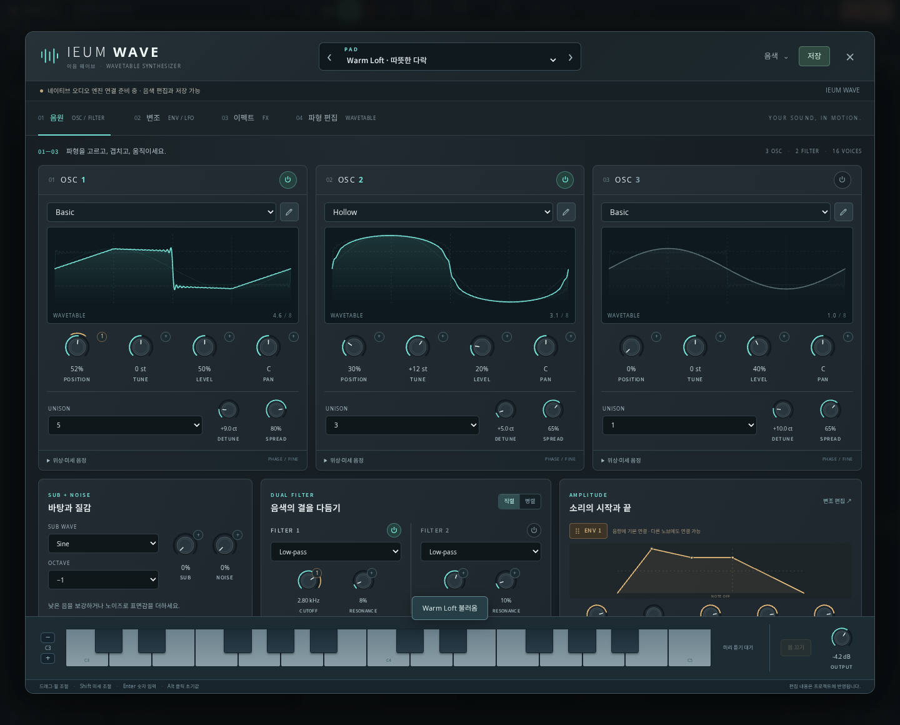
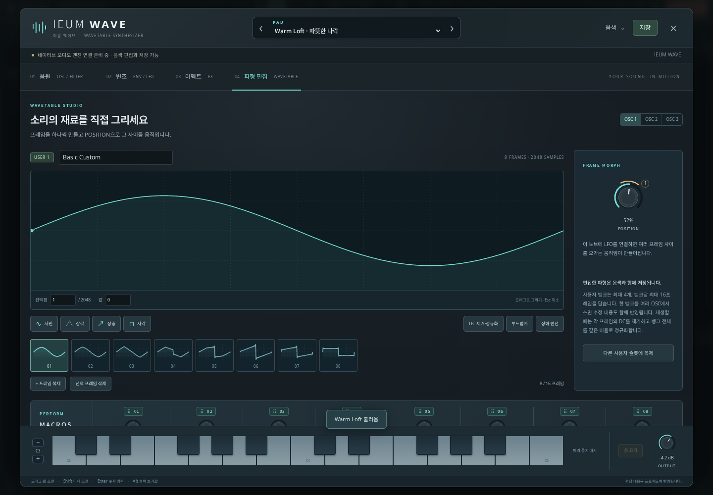
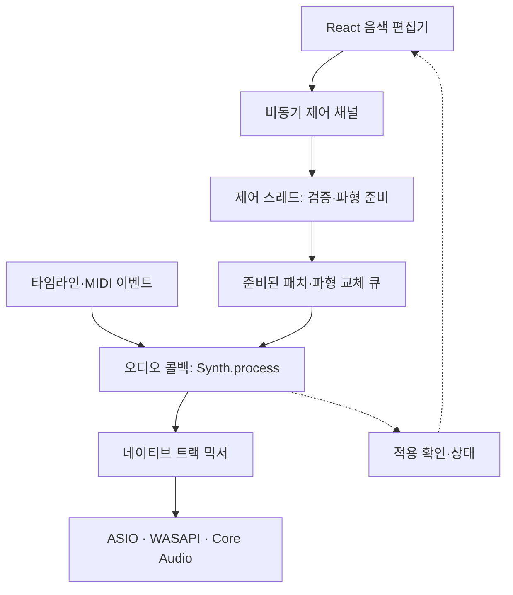

# IEUM WAVE · 이음 웨이브

가락이음의 독립적인 웨이브테이블 신디사이저입니다. React 편집기, 프로젝트에 저장되는 음색, C++17 음원 모듈을 함께 제공합니다. 악기 ID는 `wavetable`입니다.

**현재 단계:** 데스크톱의 `NativeAudioEngine`과 C++ 공통 `RenderEngine`에 연결되어 편집기 미리 듣기, 타임라인 음표 재생, WAV 출력을 지원합니다. Windows의 WASAPI(기본값)·ASIO와 macOS의 Core Audio가 같은 WAVE DSP를 사용합니다. 별도 ASIO 드라이버 없이 WASAPI 출력 장치로 사용할 수 있습니다. 브라우저 데모는 음색 편집·저장을 지원하며 `WebAudioEngine`에서 WAVE를 합성하지 않습니다.

WAVE의 패치와 음표는 프로젝트·타임라인에 보존합니다. 앱은 장치를 열기 전에 실행 중인 네이티브 호스트의 WAVE 프로토콜과 스키마를 확인하고, 편집기는 현재 패치가 오디오 블록에 적용된 응답을 받은 뒤 건반을 활성화합니다. 모듈이 없는 구버전 호스트나 연결 실패에서는 이유를 표시하며 지원을 가장하지 않습니다. 같은 트랙에 VST3 악기를 지정하면 해당 VST3가 실제 음원이며 WAVE 패치는 프로젝트에 보관됩니다.

[구현·검증 기록](IEUM_WAVE_VALIDATION.md) · [C++ 호스트 API](../native/devices/wavetable-synth/README.md)



## 사용하기

1. 새 MIDI 트랙을 만들고 **IEUM WAVE · 이음 웨이브**를 선택합니다.
2. 아래 **디바이스** 패널에서 **IEUM WAVE 열기**를 누릅니다.
3. 기본 프리셋을 선택하거나 음원·변조·이펙트·파형 편집 화면에서 음색을 만듭니다.
4. 프로젝트 저장으로 파형과 변조 설정까지 보관합니다. 패치 내보내기/가져오기로 음색만 옮길 수도 있습니다.

Windows에서는 **설정 → 오디오 장치 → WASAPI**와 출력 장치를 선택합니다. 현재 앱은 WASAPI 공유 모드로 장치를 엽니다. WAVE 지원 샘플레이트는 22.05–192 kHz이며, 앱 설정에서는 제공되는 프로젝트 레이트를 선택합니다. ASIO나 Core Audio로 전환해도 악기와 프로젝트는 같은 경로로 재생됩니다.

노브는 드래그, 방향키, 휠과 숫자 입력으로 편집합니다. Shift는 미세 조절에 사용합니다. 변조 소스를 파라미터에 연결한 뒤 Matrix에서 깊이·극성·보조 소스·곡선을 조정할 수 있습니다. 프로젝트의 실행 취소·다시 실행이 프리셋 변경과 파형 편집에도 적용됩니다. 텍스트와 숫자를 입력하는 동안에는 입력 칸의 기본 편집 키가 유지됩니다.

키보드의 미리 듣기는 호스트가 연결되고 현재 패치의 적용을 확인한 뒤 활성화됩니다. 기존 음을 누른 채 파라미터를 수정할 수 있도록 패치 변경 중에도 note-off를 전달합니다. 연결 해제, 창 닫기, 포커스 상실 시 미리 듣기 음을 정리합니다.

## 이 단계의 구성

| 영역 | 구성 |
| --- | --- |
| 음원 | 웨이브테이블 OSC 3개, 서브, 노이즈 |
| 보이스 | 최대 16음, OSC당 최대 7 유니즌 |
| 웨이브테이블 | 공장 뱅크 4개 × 8프레임; 사용자 뱅크 최대 4개 × 16프레임; 프레임당 2,048샘플 |
| 필터 | 독립적인 스테레오 SVF 2개, 직렬/병렬 배치 |
| 엔벌로프 | AHDSR 4개 |
| LFO | 4개, 128개 지점으로 직접 그리는 주기 곡선 |
| 변조 | 최대 16연결, 소스·대상·양·양극성·보조 소스·곡선 |
| 매크로 | 8개 |
| 내부 이펙트 | Drive, Chorus, Delay |
| 프리셋 | 원본 프리셋 10개, 사용자 패치 파일 |
| 연주 이벤트 | 샘플 오프셋이 있는 note-on/off, 파라미터, 채널별 pitch bend, sustain, all-notes-off, all-sound-off |

샘플러·멀티샘플·그레뉼러·스펙트럴 합성, 웨이브테이블 오디오 파일 분석 가져오기, FM/워프, MPE/노트 익스프레션, 아르페지에이터/클립 시퀀서, 컨볼루션/리버브/멀티밴드 컴프레서는 이 버전에 포함되지 않습니다. 특정 상용 신디사이저의 소스·그래픽·프리셋·웨이브테이블을 사용하지 않습니다.



## 프로젝트와 편집 이력

`Track.instrumentParams`는 스칼라 파라미터를 보관하는 유일한 위치입니다. 파라미터 ID와 단위는 공통 스키마에 정의됩니다. `Track.instrumentState`에는 `version: 1`, 사용자 파형 뱅크, LFO 곡선, 변조 연결, 음색 이름·작성자·설명이 들어갑니다. 편집기의 `WavetablePatch`는 이 두 필드를 합친 뷰입니다.

- 프리셋 적용은 두 필드를 하나의 프로젝트 편집으로 교체합니다.
- 트랙 복제는 사용자 프레임과 변조 배열까지 복사합니다. 복제본 수정이 원본에 전파되지 않습니다.
- 다른 악기로 변경하면 이전 악기의 구조 데이터를 제거합니다. 실행 취소로 복원할 수 있습니다.
- 불러오기는 버전, 유한한 수, 파라미터 범위와 열거 값, 배열 크기, 변조 대상, 사용자 뱅크 참조를 검증합니다.
- 프로젝트 스키마는 5를 유지합니다. 악기 상태가 자체 버전을 갖습니다. `wavetable`을 모르는 구버전 앱은 기존의 알려진 악기 ID 검증에서 파일을 거부하므로 사용자 파형만 누락한 채 열지 않습니다.

MCP의 `instrument.setParam`은 카탈로그에 있는 실제 단위의 값을 수정하고 같은 프로젝트 이력을 사용합니다. 예를 들어 `filter1Cutoff`는 Hz, `osc1Fine`은 cent 단위입니다. `get_state`의 트랙 응답은 노브 값과 `instrumentStateSummary`를 제공하며 대용량 프레임 배열은 반환하지 않습니다. 음색 편집 권한과 실제 오디오 호스트의 사용 가능 여부는 별개입니다.

## 네이티브 엔진 연결 구조

엔진은 `native/devices/wavetable-synth`의 C++ 라이브러리를 링크합니다. 이 라이브러리는 장치를 열거나 Electron IPC를 직접 사용하지 않습니다.



호스트가 지켜야 할 경계는 다음과 같습니다.

1. **제어 스레드:** 패치 검증·바이너리 해석·파형 준비·메모리 할당을 수행합니다. 프로젝트를 열거나 MIDI 트랙을 복제했을 때도 이 경로를 사용합니다.
2. **오디오 스레드:** 블록 경계에서 준비된 파라미터/뱅크를 적용합니다. 이벤트를 `sampleOffset` 순서로 공급하고, 미리 할당한 평면 스테레오 버퍼로 `Synth.process()`를 호출합니다.
3. **수명 관리:** DSP에 전달한 파형은 변경하지 않습니다. 파형 교체 중 이전 뱅크의 수명도 보장하고, 사용이 끝난 뱅크의 메모리 해제는 제어 스레드에서 수행합니다.
4. **클록:** BPM, 블록 시작의 quarter-note beat, 재생 상태는 네이티브 호스트에서 제공합니다. UI 타이머나 `requestAnimationFrame`으로 오디오 시간을 만들지 않습니다.
5. **트랙 동기화:** `AudioEngine.setProject(project)`는 열려 있지 않은 편집기의 트랙까지 반영합니다. `compileNativeTimeline()`의 `native-wavetable` 소스는 검증·복사된 전체 `patch`를 보관하며, 전송 시 `patchData`의 base64 `IEWAVE01` 바이너리로 바꿉니다. 공통 호스트의 `WavetableProcessor`가 이를 실제 WAVE DSP로 렌더링합니다.
6. **제어 응답:** `engine.capabilities`는 장치를 열지 않고 호스트의 `hello.wavetable`을 확인합니다. `project.set { awaitApplied: true }`는 제출한 그래프가 실제 오디오 콜백에 적용된 뒤 revision을 응답합니다. 편집기는 오래된 응답·변경된 프로젝트·장치 재설정 전 응답으로 건반을 다시 활성화하지 않습니다.

스칼라 노브만 바뀌면 준비된 파형 뱅크를 재사용하고 파라미터만 갱신합니다. 노브를 움직일 때마다 FFT 준비를 반복하지 않습니다. 사용자 프레임 내용이 달라질 때에만 제어 스레드에서 새 뱅크를 만들고, `applyPreparedPatch()`로 패치와 뱅크를 원자적으로 바꿉니다. 교차 전환이 끝난 이전 뱅크는 `takeRetiredWavetables()`로 회수해 오디오 스레드 밖에서 해제합니다.

미리 듣기 음은 호스트가 별도의 note ID로 추적합니다. 브리지의 `allNotesOff(trackId)`는 편집기에서 낸 음만 해제하고 같은 트랙의 타임라인 음표를 중단하지 않아야 합니다. 타임라인의 velocity는 리전 gain을 포함한 0..2이며 DSP도 그 음량을 보존합니다. 미리 듣기 velocity는 0..1입니다.

동일한 `Synth` 객체의 변경과 `process()` 호출은 호스트가 직렬화합니다. UI/제어 스레드에서 DSP 객체를 동시에 수정하면 안 됩니다. 콜백 안에서 JSON 처리, 파일 접근, IPC 응답 대기, 잠금, 동적 메모리 할당을 하지 않습니다. 파일 기록과 플러그인 외부 장치 관리는 이 모듈 밖에 둡니다.

### 공통 스키마와 전송 형식

`src/devices/wavetable-synth/schema.json`에서 TypeScript 정의와 C++의 `generated/patch_schema.hpp`를 생성합니다. 손으로 생성 파일을 수정하지 않습니다.

```sh
node src/devices/wavetable-synth/generate-schema.mjs
pnpm wavetable:schema
```

`bridge.ts`의 `encodeWavetablePatch()`는 `IEWAVE01` 헤더와 버전, 스키마 fingerprint, 길이가 제한된 little-endian float32 데이터를 만듭니다. 사람이 읽는 패치 JSON과 메타데이터는 프로젝트/제어 영역에 남습니다. 전송 바이트를 해석하는 작업 역시 오디오 콜백 밖에서 수행합니다.

## 빌드와 실제 렌더링

데스크톱 호스트는 C++20 컴파일러와 CMake가 필요합니다. 일반 네이티브 빌드가 WAVE 라이브러리와 공통 호스트 테스트를 함께 빌드합니다.

```sh
pnpm native:build
pnpm native:test
```

`native:test`는 실제 Electron 서비스와 C++ 호스트 사이에서 capability 확인, 바이너리 패치, 44.1/48/96 kHz WAV 출력, 사용자 뱅크, 정지 상태 미리 듣기, held voice 패치 변경과 장치 재설정을 검사합니다. 명시적인 테스트 클록을 사용하므로 물리 WASAPI·ASIO·Core Audio 출력이나 실제 지연 측정은 별도로 수행해야 합니다. DSP만 따로 검증할 때는 C++17로 아래 명령을 사용할 수 있습니다.

```sh
pnpm wavetable:build
pnpm wavetable:test
pnpm wavetable:fixtures
build/native/wavetable-synth/ieum-wave-render --patch build/native/wavetable-synth/fixtures/warm-loft.iewave --out build/native/wavetable-synth/warm-loft.wav --sample-rate 48000 --seconds 6 --note-seconds 3 --notes 60,64,67
```

Windows의 다중 구성 CMake 생성기에서는 실행 파일이 `build/native/wavetable-synth/Release/ieum-wave-render.exe`에 만들어집니다. 렌더러는 스테레오 float32 WAV와 처리 통계를 출력합니다. fixture 생성은 실제 편집기의 TypeScript 패치와 바이너리 인코더를 사용하므로 C++ 쪽에 비슷한 프리셋을 따로 만들어 비교하지 않습니다.

`pnpm wavetable:smoke`는 Playwright Chromium에서 트랙 추가, 편집, 저장, 재열기와 화면 크기를 검사합니다. 설치된 브라우저를 사용할 때는 `GARAK_CHROMIUM_EXECUTABLE`, 필요하다면 JSON 배열의 `GARAK_CHROMIUM_ARGS`를 지정합니다.

## 성능 결과를 해석할 때

오프라인 WAV 렌더링, 콜백 내 할당 검사, 일반 개발 머신의 처리 시간은 실제 ASIO 입출력 지연 측정과 다릅니다. 블록 크기 64샘플/48kHz의 한 블록 시간은 약 1.33ms이지만, 최종 연주 지연에는 장치의 버퍼링·드라이버·오디오 인터페이스가 더해집니다. 유니즌 수, 동시에 누르는 음 수, 파형 교체, 변조와 이펙트를 포함한 최대 부하를 실제 대상 장치에서 검사해야 합니다.

이 브랜치의 검증 결과와 사용한 조건은 PR에 기록합니다. 실제 대상 장치에서는 44.1/48/96kHz, 64/128/256샘플 버퍼, 패치 교체, 프로젝트 재열기, 타임라인 재생·내보내기, 장치 연결 해제를 확인합니다. 하드웨어 MIDI 입력 기능과 WAVE 내부 note 이벤트 지원은 구분합니다.
