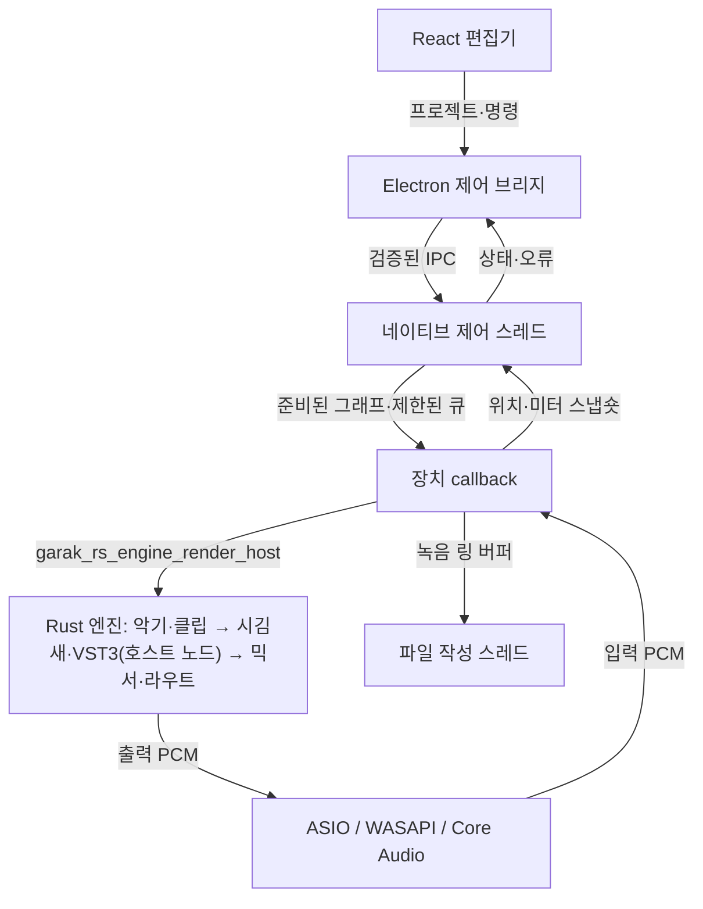

# 네이티브 오디오 엔진

2026-11-17 (0.3.3) · 구현 및 검증 상태

데스크톱은 별도 `garak-audio-host` 프로세스에서 오디오를 처리합니다. Windows는 **ASIO 또는 WASAPI**, Apple Silicon macOS는 **Core Audio**를 사용합니다. 트랙 렌더는 웹과 같은 **통합 Rust 엔진**(`rust/garak-engine`, C ABI `rust/garak-ffi`)이 맡고(0.3.2 기본, 0.3.3부터 유일한 경로), C++20 `RenderEngine`은 그 엔진을 감싼 얇은 셸입니다. 셸은 장치 I/O, 전송·카운트인 타이밍, 라이브 MIDI 전달, VST3 호스트 노드(엔진이 콜백으로 부름), IEUM WAVE 패치 검증, 워커 풀과 render-ahead 링, 녹음, 스냅숏을 맡고, Rust 엔진이 트랙·내장 악기(IEUM WAVE 포함)·기타 랙·시김새·믹스·센드/리턴·트랙 라우트와 마스터 버스·메트로놈을 렌더합니다. Electron/React는 편집과 제어를 맡습니다. [셸](../native/include/garak/engine.hpp) · [Rust 엔진 C ABI](../rust/garak-ffi/include/garak_engine.h) · [장치 어댑터](../native/src/device.cpp) · [렌더러 연결](../src/audio/native/NativeAudioEngine.ts) · [Rust 렌더 엔진 10장](RUST_ENGINE.md#10-데스크톱-호스트-경로-셸--rust-그래프)

> **0.3.3:** 이전 C++ 트랙 경로·C++ 이펙트 DSP와 스위치(`GARAK_RUST_ENGINE`, `GARAK_RUST_EFFECTS`, Rust 없는 `GARAK_RUST=0` 빌드)를 삭제했습니다. 호스트 `hello`의 `rustEngine`은 진단용으로 항상 `{available: true, requested: true}`, `engine.snapshot`·`render.wav`의 `rustEngine`은 Rust 그래프가 렌더했는지를 알려 줍니다.

이 문서의 구현 여부와 실제 하드웨어 검증은 구분합니다. **Linux의 실제 VST3 SDK 빌드·실행 검사와 Windows MSVC·macOS arm64의 설치물 CI가 통과**했습니다. CI에서 실제 네이티브 호스트와 VST3 테스트 모듈을 검사하고, Windows 설치 파일과 Mac DMG를 설치한 뒤 앱 화면의 네이티브 연결을 검사했습니다. CI는 명시적인 테스트 클록을 사용하므로 실제 인터페이스의 입출력·왕복 지연·타사 플러그인 창은 별도 실기 확인 대상입니다. [Windows CI](https://github.com/songchez/garak-ieum/actions/runs/41785545281) · [macOS CI](https://github.com/songchez/garak-ieum/actions/runs/41785545268) — 검사 대상 PR head `3075f9993ba3dcdf7e6d1f6872d7cf3e670e19ce`.

## 1. 오디오가 흐르는 경로



프로젝트 타임라인은 미리 샘플 프레임으로 변환합니다. 네이티브 장치 시계가 음표·리전과 처리 블록 안의 이벤트 위치를 결정합니다. 오디오 버퍼마다 Electron IPC나 JavaScript 응답을 기다리지 않습니다. IPC에는 재생·정지·탐색·파라미터 명령, 준비된 프로젝트와 자산 등록, 저빈도 상태 정보가 지나갑니다. 파일 등록·디코딩·플러그인 생성·상태 직렬화·그래프 준비는 callback 밖에서 실행합니다. [타임라인 변환](../src/audio/native/timeline.ts) · [제어 서비스](../desktop/native-audio.ts) · [호스트 프로토콜](../native/src/host.cpp)

편집은 프로젝트 전체를 다시 보내지 않습니다. 처음에만 전체 계획(`project.set`)을 보내고, 그 뒤에는 바뀐 트랙만(`project.patch`) 보내며 음표·컨트롤러 배열은 바이너리 프레임으로 전달합니다. 엔진은 믹서·센드·라이브 이펙트 파라미터를 제자리 명령으로, 음표·체인 편집을 트랙 하나의 교체로 적용하고 재생 중인 음성과 이펙트 꼬리를 이어 갑니다. [RenderPlan/Diff 프로토콜](RENDER_DIFF_PROTOCOL.md)

호스트가 소유한 callback 자료구조는 미리 할당하며 파일 I/O, JSON 파싱, 블로킹 잠금과 그래프 파괴를 callback에서 하지 않습니다. 외부 VST3의 내부 구현까지 실시간 안전하다고 보증하지는 않습니다. 화면의 버튼 입력과 파라미터 명령에는 UI/IPC 전달 시간이 있을 수 있지만, 이미 재생 중인 오디오와 소프트웨어 모니터링의 매 버퍼가 그 시간을 추가로 거치지는 않습니다.

## 2. 남아 있는 Web Audio의 용도

브라우저는 같은 Rust 엔진을 AudioWorklet(`garak-engine.wasm`)에서 쓰고, 엔진이 거부한 프로젝트만 `WebAudioEngine`의 Web Audio 그래프로 대체합니다([RUST_ENGINE 5장](RUST_ENGINE.md#5-wasm-호스트-audioworklet--5단계-웹-호스트)). 데스크톱의 `NativeAudioEngine`은 `OfflineAudioContext`를 **압축 파일의 일회성 디코딩 도구**로 사용하며, 만든 Float32 PCM 자산을 네이티브 엔진에 등록합니다. 파형·피치 분석과 기존 Signalsmith WASM 피치 편집은 비실시간 작업으로 유지하고 결과 PCM을 같은 네이티브 그래프에서 재생합니다. 데스크톱 실시간 출력·녹음·모니터링·WAV 렌더링을 Web Audio에 넘기는 경로는 사용하지 않습니다. 네이티브 호스트가 없거나 실패하면 오류를 보여 주며 브라우저 엔진으로 조용히 전환하지 않습니다.

이는 Opus/WebM·AAC/M4A 샘플을 miniaudio가 직접 디코딩한다고 가정하지 않는 구성입니다. 원본 Blob, 자산 ID, 샘플레이트, 채널 수, 길이와 소스 오프셋을 보존합니다. `.garak`와 피치 편집 문서의 원본·렌더 자산도 유지합니다. 데스크톱과 브라우저는 같은 Rust 엔진 코드를 쓰지만(WASM ↔ 네이티브 패리티 -144.5 dBFS), Web Audio 대체 경로의 출력은 비트 단위로 같다고 보장하지 않습니다. [피치 편집기](PITCH_EDITOR.md) · [샘플 규격](SAMPLES.md)

## 3. 장치 설정과 지연

| 대상 | 구현 | 실제 값과 실패 처리 |
| --- | --- | --- |
| Windows ASIO | Steinberg ASIO SDK의 `IASIO`로 드라이버 생성, rate/buffer/channel 설정, 두 버퍼 callback, PCM 변환과 teardown | 입력·출력은 같은 ASIO 드라이버와 시계를 사용. 지원하지 않는 레이트는 `SAMPLE_RATE_UNSUPPORTED`로 거절하고, 버퍼는 가장 가까운 허용값으로 맞춤(`bufferAdjusted`). reset·버퍼 변경·rate 변경·resync 요청은 같은 설정으로 자동 재연결(제어판에서 바꾼 권장 버퍼를 따름) |
| Windows WASAPI | miniaudio의 WASAPI backend만 명시적으로 초기화 | 기본 장치 또는 선택한 endpoint 사용. 공유 모드 등에서 실제 블록과 물리 장치 레이트가 요청과 다르면 실제 값·리샘플링 여부 보고 |
| Apple Silicon Core Audio | miniaudio의 Core Audio backend만 명시적으로 초기화 | 선택한 장치와 입력 채널을 사용. 중단·경로 변경 시 자동 재연결 |

입력은 설정의 **입출력 채널**에서 켠 물리 채널 목록(`inputChannelList`, 최대 32개)이고, 출력은 선택한 스테레오 쌍입니다. 장치 callback은 켠 채널을 목록 순서대로 인터리브해 넘기고, 엔진이 트랙마다 고른 물리 채널(`Track.input`)을 그 위치로 찾습니다. 열리지 않은 채널을 고른 트랙은 무음을 받고 `tracksMissingInput`에 나타납니다. 예전 `inputChannels`+`inputChannelOffset` 설정도 목록으로 바꿔 받습니다. 장치 목록을 만들 때는 드라이버를 열지 않고, 드라이버를 고르면 `devices.probe`가 잠깐 열어 채널 이름·개수, 허용 버퍼(`buffer.sizes`, 고정 여부), 지원 레이트, 클럭 소스, 직접 모니터링 지원, 지연을 읽습니다.

**시작할 때 장치 연결.** 프로젝트를 열면 저장된 오디오 설정으로 장치를 바로 엽니다(`NativeAudioEngine.autoStart`). 설정의 **적용**과 같은 `engine.configure` 경로를 쓰므로 실시간 MIDI·미리듣기·모니터링이 설정을 열지 않아도 동작합니다. Electron은 창을 띄우는 동안 오디오 호스트를 미리 실행해 handshake를 끝내 둡니다. 순서와 정책은 다음과 같습니다. [시작 정책](../src/audio/native/deviceStartup.ts)

1. 저장된 설정을 엽니다. 먼저 `devices.list`(드라이버를 열지 않음)로 저장된 장치가 목록에 있는지 확인하고, 없으면 열지 않고 다음 단계로 갑니다.
2. 일시적인 실패(`DEVICE_IN_USE`, `DRIVER_INIT_FAILED`, `DEVICE_LOST`, 호스트 재시작·응답 시간 초과)는 0.4·0.8·1.6·3.2초 간격으로 다시 시도합니다(부팅 직후 아직 초기화 중인 ASIO 드라이버, 잠시 장치를 쥔 다른 앱).
3. `BUFFER_UNSUPPORTED`이면 같은 장치를 드라이버 권장 버퍼로 엽니다.
4. 그래도 안 되면 같은 backend의 기본 장치(WASAPI·Core Audio), 마지막으로 운영체제 기본(Windows WASAPI 기본 장치, macOS Core Audio 기본 장치)을 엽니다. ASIO에는 "기본 드라이버"가 없으므로 다른 ASIO 드라이버를 추측해 열지 않습니다. 대체 단계는 한 번만 다시 시도합니다.

대체 장치로 연결했거나 모두 실패하면 이유와 바뀐 내용을 담은 알림을 **앱 실행당 한 번** 띄우고(모달 없음, **설정 열기** 버튼), 같은 내용과 단계별 시간 기록을 **설정 › 상태·진단**의 "시작할 때 장치 연결"과 **진단 복사**에 남깁니다. 대체는 이번 실행에만 쓰는 설정입니다. 저장된 설정은 바꾸지 않으므로 다음 실행 때 저장된 장치를 다시 시도하고, 사용자가 **적용**을 눌러야 지금 설정이 저장됩니다. 저장된 장치가 목록에서 사라져 대체한 경우에는 5초마다 장치 목록을 확인해 다시 나타나면 "이 장치로 전환" 알림을 한 번 띄웁니다(자동으로 바꾸지 않음). 재생 중 실패나 호스트 종료 뒤에는 다음 **재생**이 같은 설정으로 장치를 다시 엽니다.

이 시작 단계 밖에서는 선택한 드라이버나 장치가 실패했을 때 다른 backend나 장치로 자동 대체하지 않습니다. 대신 실패 원인을 코드(`DEVICE_NOT_FOUND`, `DEVICE_IN_USE`, `DRIVER_INIT_FAILED`, `SAMPLE_RATE_UNSUPPORTED`, `BUFFER_UNSUPPORTED`, `CHANNELS_UNAVAILABLE`, `DEVICE_LOST`)와 `details`로 알리고, 화면이 원인별 해결 동작을 보여 줍니다. 실행 중 장치가 멈추거나 경로가 바뀌거나 사라지면 0.25·0.5·1·2초, 이후 2초 간격으로 같은 설정을 다시 엽니다(`recovering`, `recoveries`). 재생 위치와 엔진 상태는 유지하며, 30초 안에 돌아오지 않으면 재설정을 요구하고 사라진 장치는 다시 나타날 때까지 계속 확인합니다. ASIO control panel은 실행 중인 장치뿐 아니라 설정이 거절된 드라이버에서도 엽니다(`device.controlPanel {backend, deviceId}`). `device.suspend`/`device.resume`은 다른 앱이 장치를 쓰도록 닫았다가 같은 설정으로 다시 엽니다(설정의 **백그라운드에서 드라이버 해제**). ASIO의 클럭 소스와 하드웨어 직접 모니터링은 `device.clockSource`, `device.directMonitor`로 바꿉니다. WASAPI callback 스레드는 MMCSS "Pro Audio"와 실시간 우선순위로 실행합니다. WASAPI/Core Audio는 요청 버퍼 크기가 실제 callback 크기와 다를 수 있으므로 상태에는 실제 관찰값을 표시합니다. [장치 계약](../native/include/garak/device.hpp)

지연 정보는 다음처럼 나눕니다.

- **플러그인 지연:** `getLatencySamples()`와 내장 DSP의 처리 지연으로 트랙별 보상량을 계산합니다. 오프라인 출력은 보상용 앞부분을 제거합니다. 낮은 지연 입력 모니터링 모드는 녹음 중인 입력에 다른 트랙을 맞추기 위한 추가 보상을 넣지 않는 정책입니다.
- **드라이버 지연:** ASIO의 입력·출력 지연 보고값을 각각 표시합니다. miniaudio의 공통 API에서 정확한 별도 값을 얻을 수 없는 WASAPI/Core Audio 항목은 미보고로 둡니다. 블록 크기의 두 배를 임의의 왕복 지연으로 표시하지 않습니다.
- **실측 왕복 지연:** `latency.measure { inputChannel, outputChannelOffset? }`가 재생이 멈춘 상태에서 현재 출력 쌍으로 4 ms 처프를 5번 내보내고 고른 입력에서 상호상관으로 찾습니다(케이블 루프백 필요). 결과는 `roundTripFrames`, 드라이버 보고 합 `reportedFrames`, 차이 `extraFrames`, `confidence`(0~1), `attempts`입니다. 측정 중에는 다른 출력을 끕니다. 녹음 위치에는 보고된 입력/출력 지연과 그래프 지연을 보정하고 원시 시작 frame과 보정 frame, 보고값의 완전성(`compensationKnown`)을 별도로 전달합니다. 미보고 값은 측정한 0으로 표시하지 않습니다. 수동 녹음 위치 보정은 자동 왕복 지연 측정과 별개입니다.

여러 트랙을 동시에 녹음할 수 있습니다(`record.start { takes }`, 최대 64개). 모든 테이크가 같은 시작 frame에서 하나의 캡처 링을 공유하고, 파일 작성 스레드가 트랙마다 고른 1·2채널 WAV를 따로 씁니다. 과부하는 callback 처리 시간이 버퍼 시간의 90%를 넘거나 드라이버가 overload/xrun을 알릴 때 `overloads`로 셉니다. 프리앰프 게인, 팬텀 파워처럼 인터페이스 고유 기능은 이 장치 API가 제공하지 않습니다.

## 4. DSP, 녹음과 오프라인 출력

**멀티코어 처리와 미리 처리.** `processingThreads`(`auto` = 하드웨어 스레드 − 1, 최대 8 / `0` = 끔 / 1–16)만큼 작업 스레드를 만들어 블록마다 트랙을 나눠 처리하고, callback 스레드가 트랙 순서대로 합산합니다. Rust 엔진은 처리 레벨(라우트 소스·센더 먼저, 그다음 라우트된 트랙·리턴)마다 트랙을 이 풀에서 병렬로 렌더하며(`GarakRsParallelRun`, 호스트 노드 콜백도 그 작업 스레드에서), 풀은 원자 변수로만 동기화합니다. 그래서 스레드 수와 관계없이 출력이 비트 단위로 같습니다. 작업 스레드는 Windows MMCSS "Pro Audio"·시간 임계 우선순위, macOS 시간 제약 정책으로 실행합니다(macOS `os_workgroup` 합류는 남은 작업). `renderAhead`(`off` 기본 / `normal` = 장치 버퍼 2개 / `high` = 4개)는 VST3가 없고, 모니터링·녹음 중이 아니며, 최근 2초 안에 실시간 음표가 없는 트랙을 작업 스레드가 미리 계산해 두는 기능입니다(Cubase ASIO-Guard 방식). 실시간 음표·모니터링·녹음 시작이 생기면 그 트랙은 미리 계산된 부분을 다 쓴 뒤(최대 창 + 1 버퍼 늦게) 끊김 없이 callback 처리로 돌아갑니다. 탐색·정지·프로젝트 변경·템포 변경에서는 미리 계산을 버리고, 일시 정지에서는 아직 재생하지 않은 미리 계산 구간이 있던 트랙의 음성·꼬리를 초기화합니다. 믹스·파라미터 변경은 창 길이만큼 늦게 들릴 수 있습니다. 상태에는 `workerThreads`, `renderAheadTracks`, `renderAheadResyncs`를 보고합니다.

Rust 엔진(`rust/garak-engine`)이 준비된 타임라인, 음표의 샘플 offset, 루프·탐색, 샘플 존·벨로시티·choke, 내장 합성·샘플·빈티지 악기, 믹서와 트랙별 지연 보상, 센드/리턴과 트랙 라우트·녹음 탭, 마스터 버스와 메트로놈·카운트인 클릭을 처리하고, 이펙트(EQ·필터·컴프레서·드라이브·딜레이·리버브 등 시김새)와 기타 앰프는 `rust/garak-dsp` 커널을 씁니다. `native/src/engine.cpp`(셸, `rust_engine.inc`)는 전송·카운트인 타이밍, 라이브 MIDI 전달, 샘플 세트 등록, 녹음 캡처와 VST3·IEUM WAVE 호스트 노드(`HostTrack`)를 맡습니다. 녹음은 장치 입력을 한정된 링 버퍼에 넣고 별도 스레드가 Float32 WAV를 작성합니다. 트랙은 물리 입력 채널(`input.channels`, 모노 또는 쌍)을 가지며 호스트가 열린 채널 목록으로 콜백의 인터리브 위치를 찾습니다. 열리지 않은 채널을 고른 트랙은 무음이고 `tracksMissingInput`에 표시됩니다. `record.start { takes }`는 최대 64개 트랙을 같은 프레임에서 함께 시작하고 트랙마다 1·2채널 파일을 씁니다. 콜백 처리 시간이 버퍼 시간의 90%를 넘거나 드라이버가 overload를 알리면 `device.overloads`가 늘고, 최근 비율은 `device.lastCallbackLoad`입니다. 디스크/큐 오류와 실제 시작 프레임은 제어 응답으로 전달합니다. [셸](../native/src/engine.cpp) · [Rust 엔진](../rust/garak-engine/src/) · [DSP 커널](../rust/garak-dsp/src/) · [녹음 연결](../src/audio/native/NativeRecording.ts)

WAV 내보내기는 같은 셸·Rust 그래프와 **새 플러그인 인스턴스**를 오프라인 모드로 실행합니다. 실시간 플러그인 상태를 읽을 때는 callback을 정지시켜 경쟁을 피합니다. VST3와 내장 효과의 tail을 포함하되 전체 tail은 30초로 제한합니다. 출력은 프로젝트 레이트의 스테레오 PCM 16-bit WAV이며, 처리는 블록 단위로 파일에 기록합니다. 피치 렌더 자산도 이 출력에 포함됩니다.

## 5. VST3 지원 범위

`native/src/vst3.cpp`는 SDK의 실제 module factory와 component/processor/controller 인터페이스를 사용합니다. 탐색은 시간 제한이 있는 별도 호스트 프로세스에서 실행합니다. 승인한 경로는 Electron의 로컬 카탈로그에 두고, 프로젝트에는 불투명한 `pluginId`와 `classId`를 저장합니다. 가져온 프로젝트의 임의 파일 경로를 플러그인으로 실행하지 않습니다. [VST3 호스트](../native/src/vst3.cpp) · [프로젝트 계약](../src/core/nativePlugins.ts)

| 기능 | 현재 처리 |
| --- | --- |
| 악기·이펙트 | float32 mono/stereo main bus 협상, 보조 audio bus 비활성화. 악기는 event input 필요. 선택적 edit controller와 processor-only 플러그인 처리 |
| 이벤트·시간 | note ID, channel, velocity, note on/off 및 parameter sample offset; tempo, 박자, project/continuous frame, 재생·녹음·cycle context |
| 파라미터 | controller 정보·정규화 0–1 값, 제한된 큐로 processor 전달, processor 출력값을 제어 스레드에서 controller에 반영 |
| 상태 | component/controller 별도 바이트를 프로젝트에 base64 저장. 각 상태 최대 16 MiB. callback을 정지한 뒤 저장·복원 |
| 자체 편집 창 | Windows HWND 및 macOS NSView 창의 attach/resize/remove. 일반 파라미터 UI도 제공. 플러그인 자체 editor가 없으면 명시적 오류 |
| 재시작·오류 | 처리 실패·유효하지 않은 출력·큐 한도 초과를 보고. bus/latency/reload 변경은 callback 안에서 재생성하지 않고 정지·재로드 요구 |
| 격리 | 탐색 오류는 탐색 자식 프로세스에 한정. 실행 중 타사 native crash는 오디오 호스트 전체를 종료할 수 있으며 Electron 편집기는 별도 프로세스에 유지 |

Windows x64 플러그인은 Windows에서, macOS arm64 플러그인은 Apple Silicon에서 사용합니다. 타 OS의 바이너리를 로드하거나 Intel 플러그인을 Rosetta로 연결하는 bridge는 없습니다. AU·CLAP·VST2, 플러그인의 MIDI output 라우팅, sidechain UI, 모든 타사 제품의 호환성을 제공한다고 주장하지 않습니다. 타사 플러그인 바이너리는 배포물에 넣지 않습니다.

## 6. 정확히 고정한 의존성

다운로드 URL, archive 이름, 전체 SHA-256, 추출 경로와 고지 파일의 단일 기준은 [native/dependencies.lock.json](../native/dependencies.lock.json)입니다. 네이티브 빌드는 해시가 다른 archive를 사용하지 않습니다.

| 소스 패키지 | 버전 / commit | 선택한 라이선스 |
| --- | --- | --- |
| Steinberg ASIO SDK | 2.3.4, `ASIO-SDK_2.3.4_2025-10-15.zip` | SDK 이중 라이선스 중 GPLv3 |
| miniaudio | 0.11.26, `877ea4a7c2601c7b0f2a44e83dfac42e6470fea6` | MIT-0 |
| nlohmann/json | 3.11.3, `9cca280a4d0ccf0c08f47a99aa71d1b0e52f8d03` | MIT |
| VST3 SDK | 3.8.1, `3cdf9ca5d1f5b1b21e0a86832aa4abe55607bd96` | MIT |
| VST3 base | `fcf9da0bd27a16f7f03773a3a39822f28f5c8477` | MIT |
| VST3 pluginterfaces | `4f547e8e102b47de4a8b8aaf343c73b700786372` | MIT |
| VST3 public.sdk | `586dc5e6c8012c3e4b01c79389375cbe96bdb1da` | MIT |
| VST3 cmake | `054c9143cbb8d47fc4694e473f2ee3b4d951a8f5` | MIT |

ASIO 공식 archive의 SHA-256은 `d5ebf0c20dd2c5f43771fd0c1418f4b361bf52434ee670097cfa6b3a335e2eca`입니다. [공식 ASIO 배포](https://download.steinberg.net/sdk_downloads/ASIO-SDK_2.3.4_2025-10-15.zip) · [고정 VST3 MIT 원문](https://github.com/steinbergmedia/vst3sdk/blob/3cdf9ca5d1f5b1b21e0a86832aa4abe55607bd96/LICENSE.txt) · [고정 miniaudio 고지](https://github.com/mackron/miniaudio/blob/877ea4a7c2601c7b0f2a44e83dfac42e6470fea6/LICENSE)

사용자가 선택한 앱 코드의 **GPL-3.0-only**와 ASIO SDK의 **GPLv3 경로**를 유지합니다. JUCE는 사용하지 않습니다. 대응 소스 ZIP은 앱 소스·스크립트뿐 아니라 위 8개 원본 archive를 `native/dependency-sources/`에 포함합니다. Windows와 macOS 소스 ZIP에는 같은 archive 바이트가 들어가며, macOS에서 컴파일하지 않는 ASIO archive도 포함합니다. 설치물의 고지는 `resources/native/licenses/`에 배치합니다. 기존 MIT 고지와 음원·글꼴·아이콘의 원래 조건은 유지합니다. [배포 정책](LICENSING.md) · [제3자 고지](../THIRD_PARTY_NOTICES.md)

## 7. 빌드와 검사

Node.js 24, pnpm 11.25.0, CMake 3.25 이상, C++20 컴파일러와 고정 Rust 툴체인(`rust/rust-toolchain.toml`)을 준비합니다. Windows는 Visual Studio 2022 C++/Windows SDK, Mac은 Apple Silicon의 Xcode Command Line Tools가 필요합니다. 설치물을 받는 사용자에게 이 개발 도구는 필요하지 않습니다.

```sh
pnpm install --frozen-lockfile
powershell -ExecutionPolicy Bypass -File scripts/setup-rust.ps1   # Windows, 한 번만
sh scripts/setup-rust.sh                                          # macOS / Linux, 한 번만
pnpm native:build
pnpm native:test
```

모든 네이티브 빌드(`scripts/build-native-audio.mjs`, `--core-only` 포함)는 CMake(`native/cmake/GarakRust.cmake`)가 `rust/garak-ffi`를 cargo로 빌드·링크합니다. cargo가 없으면 CMake가 설치 스크립트를 안내하며 멈춥니다. `native:build`는 고정 archive를 검증·추출하고, 실제 SDK로 helper와 테스트 모듈을 빌드한 뒤 CTest와 설치 단계를 실행합니다. 빌드 작업 폴더는 `build/native-work/`, 배포용 helper와 고지는 `build/native-audio/`입니다. `native:test`는 별도 프로세스 제어·자산·실제 fixture VST3·녹음·WAV 경로를 검사합니다. `desktop:prepare`에도 네이티브 빌드가 포함되며 설치물에는 테스트 플러그인을 넣지 않습니다. [빌드 스크립트](../scripts/build-native-audio.mjs) · [검사 스크립트](../scripts/native-test.mjs)

Linux의 `pnpm native:build`는 장치 없이 실제 VST3/오프라인 엔진을 빌드하는 개발 검사입니다. `pnpm native:build --core-only`는 VST3·장치 지원을 끈 핵심 DSP 검사 용도이며 배포 엔진으로 사용하지 않습니다. Windows/macOS 배포 빌드는 VST3와 플랫폼 장치 지원을 요구하고 Windows는 ASIO를 필수로 요구합니다.

| 검증 | 확인한 결과 / 남은 확인 |
| --- | --- |
| CMake 전체 Linux 빌드 | 실제 고정 SDK 사용, 성공 |
| CTest `native-engine` | 프레임·믹싱·DSP·입력·지연 보상 등 코어 회귀 통과(모든 경우가 Rust 그래프로 렌더) |
| CTest `native-rust-*` | 0.3.2 C++ 경로에서 기록한 골든 레퍼런스(`native/tests/golden/`, `rust/garak-engine/tests/golden/ieum-wave/`)와 비교: 이펙트·기타 랙(`native-rust-parity`), 오디오 프로젝트(`-engine-parity`), 악기(`-engine-instruments`, `-instruments`), 셸·호스트 노드·멀티코어·render-ahead·메트로놈(`-engine-host`), IEUM WAVE(`-wave-golden`: 삭제한 C++ 신스의 렌더). Windows x64 비트 동일, 그 밖 ≤ -90 dBFS. `native-wavetable-host`는 셸을 거친 WAVE 동작입니다. 상세는 [RUST_ENGINE 7·10장](RUST_ENGINE.md#7-패리티-전략과-결과) |
| CTest `native-asio-formats` | 모든 지원 PCM endian/유효 비트·clipping·비정상 값 변환 통과 |
| CTest `native-vst3` | 실제 모듈 탐색, effect/instrument/processor-only, 이벤트 offset, 겹친 note ID/reset, 260개 초기 parameter, 상태 왕복·크기 한도 통과 |
| CMake install | helper 및 8개 패키지의 고지·manifest 설치 확인 |
| Windows 문법 검사 | 실제 miniaudio/ASIO/VST3 헤더를 사용한 MinGW 검사 통과 |
| Windows x64 CI | MSVC 빌드·실제 VST3 검사·설치 파일 생성·설치·`.garak` 연결·설치된 앱 스모크·대응 소스와 아티팩트 업로드 통과. 위 Windows CI 참조 |
| macOS arm64 CI | 네이티브 빌드·실제 VST3 검사·ad-hoc 서명 DMG 생성·설치·설치된 앱 스모크·대응 소스와 아티팩트 업로드 통과. 위 macOS CI 참조 |
| 실제 장치·타사 플러그인 | 이 환경에서 미검증. 장치·드라이버·OS·플러그인 버전과 레이트·블록·조건을 기록하여 실기 확인 필요 |

장치 검증에서는 재생/정지/탐색, 마이크 채널·기타 모니터링·녹음 위치, buffer/rate 변경, 장치 분리·재연결, 장시간 부하, 플러그인 창·저장·복원과 물리 루프백 지연을 따로 확인합니다. CI 통과나 ASIO 드라이버 목록 표시만으로 이 검증이 끝난 것으로 기록하지 않습니다.
