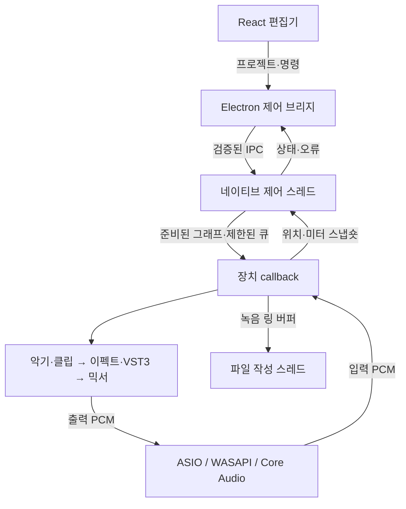

# 네이티브 오디오 엔진

2026-11-04 · 구현 및 검증 상태

데스크톱은 **자체 C++20 오디오 엔진**을 별도 `garak-audio-host` 프로세스로 실행합니다. Windows는 **ASIO 또는 WASAPI**, Apple Silicon macOS는 **Core Audio**를 사용합니다. 내장 악기, 오디오 리전, 기타 앰프와 이펙트, VST3, 입력 모니터링, 녹음과 WAV 출력이 이 엔진에 연결됩니다. Electron/React는 편집과 제어를 맡습니다. [C++ 엔진](../native/include/garak/engine.hpp) · [장치 어댑터](../native/src/device.cpp) · [렌더러 연결](../src/audio/native/NativeAudioEngine.ts)

이 문서의 구현 여부와 실제 하드웨어 검증은 구분합니다. **Linux의 실제 VST3 SDK 빌드·실행 검사와 Windows MSVC·macOS arm64의 설치물 CI가 통과**했습니다. CI에서 실제 네이티브 호스트와 VST3 테스트 모듈을 검사하고, Windows 설치 파일과 Mac DMG를 설치한 뒤 앱 화면의 네이티브 연결을 검사했습니다. CI는 명시적인 테스트 클록을 사용하므로 실제 인터페이스의 입출력·왕복 지연·타사 플러그인 창은 별도 실기 확인 대상입니다. [Windows CI](https://github.com/songchez/garak-ieum/actions/runs/41785545281) · [macOS CI](https://github.com/songchez/garak-ieum/actions/runs/41785545268) — 검사 대상 PR head `3075f9993ba3dcdf7e6d1f6872d7cf3e670e19ce`.

## 1. 오디오가 흐르는 경로



프로젝트 타임라인은 미리 샘플 프레임으로 변환합니다. 네이티브 장치 시계가 음표·리전과 처리 블록 안의 이벤트 위치를 결정합니다. 오디오 버퍼마다 Electron IPC나 JavaScript 응답을 기다리지 않습니다. IPC에는 재생·정지·탐색·파라미터 명령, 준비된 프로젝트와 자산 등록, 저빈도 상태 정보가 지나갑니다. 파일 등록·디코딩·플러그인 생성·상태 직렬화·그래프 준비는 callback 밖에서 실행합니다. [타임라인 변환](../src/audio/native/timeline.ts) · [제어 서비스](../desktop/native-audio.ts) · [호스트 프로토콜](../native/src/host.cpp)

호스트가 소유한 callback 자료구조는 미리 할당하며 파일 I/O, JSON 파싱, 블로킹 잠금과 그래프 파괴를 callback에서 하지 않습니다. 외부 VST3의 내부 구현까지 실시간 안전하다고 보증하지는 않습니다. 화면의 버튼 입력과 파라미터 명령에는 UI/IPC 전달 시간이 있을 수 있지만, 이미 재생 중인 오디오와 소프트웨어 모니터링의 매 버퍼가 그 시간을 추가로 거치지는 않습니다.

## 2. 남아 있는 Web Audio의 용도

브라우저 데모는 `WebAudioEngine`을 유지합니다. 데스크톱의 `NativeAudioEngine`은 `OfflineAudioContext`를 **압축 파일의 일회성 디코딩 도구**로 사용하며, 만든 Float32 PCM 자산을 네이티브 엔진에 등록합니다. 파형·피치 분석과 기존 Signalsmith WASM 피치 편집은 비실시간 작업으로 유지하고 결과 PCM을 같은 네이티브 그래프에서 재생합니다. 데스크톱 실시간 출력·녹음·모니터링·WAV 렌더링을 Web Audio에 넘기는 경로는 사용하지 않습니다. 네이티브 호스트가 없거나 실패하면 오류를 보여 주며 브라우저 엔진으로 조용히 전환하지 않습니다.

이는 Opus/WebM·AAC/M4A 샘플을 miniaudio가 직접 디코딩한다고 가정하지 않는 구성입니다. 원본 Blob, 자산 ID, 샘플레이트, 채널 수, 길이와 소스 오프셋을 보존합니다. `.garak`와 피치 편집 문서의 원본·렌더 자산도 유지합니다. 브라우저 DSP와 C++ DSP의 출력이 비트 단위로 같다는 뜻은 아닙니다. [피치 편집기](PITCH_EDITOR.md) · [샘플 규격](SAMPLES.md)

## 3. 장치 설정과 지연

| 대상 | 구현 | 실제 값과 실패 처리 |
| --- | --- | --- |
| Windows ASIO | Steinberg ASIO SDK의 `IASIO`로 드라이버 생성, rate/buffer/channel 설정, 두 버퍼 callback, PCM 변환과 teardown | 입력·출력은 같은 ASIO 드라이버와 시계를 사용. 지원하지 않는 레이트·블록은 거절. reset·clock change·resync 요청은 출력을 멈추고 재설정 요구 |
| Windows WASAPI | miniaudio의 WASAPI backend만 명시적으로 초기화 | 기본 장치 또는 선택한 endpoint 사용. 공유 모드 등에서 실제 블록과 물리 장치 레이트가 요청과 다르면 실제 값·리샘플링 여부 보고 |
| Apple Silicon Core Audio | miniaudio의 Core Audio backend만 명시적으로 초기화 | 선택한 장치와 입력 채널을 사용. 중단·경로 변경 시 명시적 재설정 요구 |

입력은 끔 또는 선택한 1/2채널, 출력은 선택한 스테레오 쌍입니다. 채널 오프셋은 0부터 시작하며 장치의 실제 채널 수를 확인한 뒤 적용합니다. `DeviceState.inputChannels`는 선택된 채널 수이고 `inputChannelOffset`은 시작 채널입니다. 장치 목록의 채널 수는 장치 용량입니다. ASIO 목록을 만들 때 모든 드라이버를 임의로 열지 않으므로, 선택 전에는 채널·레이트·버퍼 목록을 알 수 없을 수 있습니다.

선택한 드라이버나 장치가 실패했을 때 다른 backend나 장치로 자동 대체하지 않습니다. ASIO control panel도 호스트에서 열 수 있습니다. WASAPI/Core Audio는 요청 버퍼 크기가 실제 callback 크기와 다를 수 있으므로 상태에는 실제 관찰값을 표시합니다. [장치 계약](../native/include/garak/device.hpp)

지연 정보는 다음처럼 나눕니다.

- **플러그인 지연:** `getLatencySamples()`와 내장 DSP의 처리 지연으로 트랙별 보상량을 계산합니다. 오프라인 출력은 보상용 앞부분을 제거합니다. 낮은 지연 입력 모니터링 모드는 녹음 중인 입력에 다른 트랙을 맞추기 위한 추가 보상을 넣지 않는 정책입니다.
- **드라이버 지연:** ASIO의 입력·출력 지연 보고값을 각각 표시합니다. miniaudio의 공통 API에서 정확한 별도 값을 얻을 수 없는 WASAPI/Core Audio 항목은 미보고로 둡니다. 블록 크기의 두 배를 임의의 왕복 지연으로 표시하지 않습니다.
- **실측 왕복 지연:** `latency.measure { inputChannel, outputChannelOffset? }`가 재생이 멈춘 상태에서 현재 출력 쌍으로 4 ms 처프를 5번 내보내고 고른 입력에서 상호상관으로 찾습니다(케이블 루프백 필요). 결과는 `roundTripFrames`, 드라이버 보고 합 `reportedFrames`, 차이 `extraFrames`, `confidence`(0~1), `attempts`입니다. 측정 중에는 다른 출력을 끕니다. 녹음 위치에는 보고된 입력/출력 지연과 그래프 지연을 보정하고 원시 시작 frame과 보정 frame, 보고값의 완전성(`compensationKnown`)을 별도로 전달합니다. 미보고 값은 측정한 0으로 표시하지 않습니다. 수동 녹음 위치 보정은 자동 왕복 지연 측정과 별개입니다.

프리앰프 게인, 팬텀 파워, 외부 클럭 설정, 인터페이스 자체 직접 모니터링, 다중 트랙 동시 입력 녹음은 이 장치 API가 제공하지 않습니다.

## 4. DSP, 녹음과 오프라인 출력

`native/src/engine.cpp`가 준비된 타임라인, 음표의 샘플 offset, 루프·탐색, 샘플 존·벨로시티·choke, 믹서와 트랙별 지연 보상을 처리합니다. `native/src/dsp.cpp`가 내장 합성 악기와 EQ·필터·컴프레서·드라이브·딜레이·리버브·기타 앰프를 처리합니다. 녹음은 장치 입력을 한정된 링 버퍼에 넣고 별도 스레드가 Float32 WAV를 작성합니다. 트랙은 물리 입력 채널(`input.channels`, 모노 또는 쌍)을 가지며 호스트가 열린 채널 목록으로 콜백의 인터리브 위치를 찾습니다. 열리지 않은 채널을 고른 트랙은 무음이고 `tracksMissingInput`에 표시됩니다. `record.start { takes }`는 최대 64개 트랙을 같은 프레임에서 함께 시작하고 트랙마다 1·2채널 파일을 씁니다. 콜백 처리 시간이 버퍼 시간의 90%를 넘거나 드라이버가 overload를 알리면 `device.overloads`가 늘고, 최근 비율은 `device.lastCallbackLoad`입니다. 디스크/큐 오류와 실제 시작 프레임은 제어 응답으로 전달합니다. [엔진](../native/src/engine.cpp) · [DSP](../native/src/dsp.cpp) · [녹음 연결](../src/audio/native/NativeRecording.ts)

WAV 내보내기는 같은 C++ 그래프와 **새 플러그인 인스턴스**를 오프라인 모드로 실행합니다. 실시간 플러그인 상태를 읽을 때는 callback을 정지시켜 경쟁을 피합니다. VST3와 내장 효과의 tail을 포함하되 전체 tail은 30초로 제한합니다. 출력은 프로젝트 레이트의 스테레오 PCM 16-bit WAV이며, 처리는 블록 단위로 파일에 기록합니다. 피치 렌더 자산도 이 출력에 포함됩니다.

## 5. VST3 지원 범위

`native/src/vst3.cpp`는 SDK의 실제 module factory와 component/processor/controller 인터페이스를 사용합니다. 탐색은 시간 제한이 있는 별도 호스트 프로세스에서 실행합니다. 승인한 경로는 Electron의 로컬 카탈로그에 두고, 프로젝트에는 불투명한 `pluginId`와 `classId`를 저장합니다. 가져온 프로젝트의 임의 파일 경로를 플러그인으로 실행하지 않습니다. [VST3 호스트](../native/src/vst3.cpp) · [프로젝트 계약](../src/core/nativePlugins.ts)

| 기능 | 현재 처리 |
| --- | --- |
| 악기·이펙트 | float32 mono/stereo main bus 협상, 보조 audio bus 비활성화. 악기는 event input 필요. 선택적 edit controller와 processor-only 플러그인 처리 |
| 이벤트·시간 | note ID, channel, velocity, note on/off 및 parameter sample offset; tempo, 박자, project/continuous frame, 재생·녹음·cycle context |
| 파라미터 | controller 정보·정규화 0–1 값, 제한된 큐로 processor 전달, processor 출력값을 제어 스레드에서 controller에 반영 |
| 상태 | component/controller 별도 바이트를 프로젝트에 base64 저장. 각 상태 최대 16 MiB. callback을 정지한 뒤 저장·복원 |
| 자체 편집 창 | Windows HWND 및 macOS NSView 창의 attach/resize/remove. 일반 파라미터 UI도 제공. 플러그인 자체 editor가 없으면 명시적 오류 |
| 재시작·오류 | 처리 실패·유효하지 않은 출력·큐 한도 초과를 보고. bus/latency/reload 변경은 callback 안에서 재생성하지 않고 정지·재로드 요구 |
| 격리 | 탐색 오류는 탐색 자식 프로세스에 한정. 실행 중 타사 native crash는 오디오 호스트 전체를 종료할 수 있으며 Electron 편집기는 별도 프로세스에 유지 |

Windows x64 플러그인은 Windows에서, macOS arm64 플러그인은 Apple Silicon에서 사용합니다. 타 OS의 바이너리를 로드하거나 Intel 플러그인을 Rosetta로 연결하는 bridge는 없습니다. AU·CLAP·VST2, 플러그인의 MIDI output 라우팅, sidechain UI, 모든 타사 제품의 호환성을 제공한다고 주장하지 않습니다. 타사 플러그인 바이너리는 배포물에 넣지 않습니다.

## 6. 정확히 고정한 의존성

다운로드 URL, archive 이름, 전체 SHA-256, 추출 경로와 고지 파일의 단일 기준은 [native/dependencies.lock.json](../native/dependencies.lock.json)입니다. 네이티브 빌드는 해시가 다른 archive를 사용하지 않습니다.

| 소스 패키지 | 버전 / commit | 선택한 라이선스 |
| --- | --- | --- |
| Steinberg ASIO SDK | 2.3.4, `ASIO-SDK_2.3.4_2025-10-15.zip` | SDK 이중 라이선스 중 GPLv3 |
| miniaudio | 0.11.26, `877ea4a7c2601c7b0f2a44e83dfac42e6470fea6` | MIT-0 |
| nlohmann/json | 3.11.3, `9cca280a4d0ccf0c08f47a99aa71d1b0e52f8d03` | MIT |
| VST3 SDK | 3.8.1, `3cdf9ca5d1f5b1b21e0a86832aa4abe55607bd96` | MIT |
| VST3 base | `fcf9da0bd27a16f7f03773a3a39822f28f5c8477` | MIT |
| VST3 pluginterfaces | `4f547e8e102b47de4a8b8aaf343c73b700786372` | MIT |
| VST3 public.sdk | `586dc5e6c8012c3e4b01c79389375cbe96bdb1da` | MIT |
| VST3 cmake | `054c9143cbb8d47fc4694e473f2ee3b4d951a8f5` | MIT |

ASIO 공식 archive의 SHA-256은 `d5ebf0c20dd2c5f43771fd0c1418f4b361bf52434ee670097cfa6b3a335e2eca`입니다. [공식 ASIO 배포](https://download.steinberg.net/sdk_downloads/ASIO-SDK_2.3.4_2025-10-15.zip) · [고정 VST3 MIT 원문](https://github.com/steinbergmedia/vst3sdk/blob/3cdf9ca5d1f5b1b21e0a86832aa4abe55607bd96/LICENSE.txt) · [고정 miniaudio 고지](https://github.com/mackron/miniaudio/blob/877ea4a7c2601c7b0f2a44e83dfac42e6470fea6/LICENSE)

사용자가 선택한 앱 코드의 **GPL-3.0-only**와 ASIO SDK의 **GPLv3 경로**를 유지합니다. JUCE는 사용하지 않습니다. 대응 소스 ZIP은 앱 소스·스크립트뿐 아니라 위 8개 원본 archive를 `native/dependency-sources/`에 포함합니다. Windows와 macOS 소스 ZIP에는 같은 archive 바이트가 들어가며, macOS에서 컴파일하지 않는 ASIO archive도 포함합니다. 설치물의 고지는 `resources/native/licenses/`에 배치합니다. 기존 MIT 고지와 음원·글꼴·아이콘의 원래 조건은 유지합니다. [배포 정책](LICENSING.md) · [제3자 고지](../THIRD_PARTY_NOTICES.md)

## 7. 빌드와 검사

Node.js 24, pnpm 11.25.0, CMake 3.25 이상과 C++20 컴파일러를 준비합니다. Windows는 Visual Studio 2022 C++/Windows SDK, Mac은 Apple Silicon의 Xcode Command Line Tools가 필요합니다. 설치물을 받는 사용자에게 이 개발 도구는 필요하지 않습니다.

```sh
pnpm install --frozen-lockfile
pnpm native:build
pnpm native:test
```

`native:build`는 고정 archive를 검증·추출하고, 실제 SDK로 helper와 테스트 모듈을 빌드한 뒤 CTest와 설치 단계를 실행합니다. 빌드 작업 폴더는 `build/native-work/`, 배포용 helper와 고지는 `build/native-audio/`입니다. `native:test`는 별도 프로세스 제어·자산·실제 fixture VST3·녹음·WAV 경로를 검사합니다. `desktop:prepare`에도 네이티브 빌드가 포함되며 설치물에는 테스트 플러그인을 넣지 않습니다. [빌드 스크립트](../scripts/build-native-audio.mjs) · [검사 스크립트](../scripts/native-test.mjs)

Linux의 `pnpm native:build`는 장치 없이 실제 VST3/오프라인 엔진을 빌드하는 개발 검사입니다. `pnpm native:build --core-only`는 VST3·장치 지원을 끈 핵심 DSP 검사 용도이며 배포 엔진으로 사용하지 않습니다. Windows/macOS 배포 빌드는 VST3와 플랫폼 장치 지원을 요구하고 Windows는 ASIO를 필수로 요구합니다.

| 검증 | 확인한 결과 / 남은 확인 |
| --- | --- |
| CMake 전체 Linux 빌드 | 실제 고정 SDK 사용, 성공 |
| CTest `native-engine` | 프레임·믹싱·DSP·입력·지연 보상 등 코어 회귀 통과 |
| CTest `native-asio-formats` | 모든 지원 PCM endian/유효 비트·clipping·비정상 값 변환 통과 |
| CTest `native-vst3` | 실제 모듈 탐색, effect/instrument/processor-only, 이벤트 offset, 겹친 note ID/reset, 260개 초기 parameter, 상태 왕복·크기 한도 통과 |
| CMake install | helper 및 8개 패키지의 고지·manifest 설치 확인 |
| Windows 문법 검사 | 실제 miniaudio/ASIO/VST3 헤더를 사용한 MinGW 검사 통과 |
| Windows x64 CI | MSVC 빌드·실제 VST3 검사·설치 파일 생성·설치·`.garak` 연결·설치된 앱 스모크·대응 소스와 아티팩트 업로드 통과. 위 Windows CI 참조 |
| macOS arm64 CI | 네이티브 빌드·실제 VST3 검사·ad-hoc 서명 DMG 생성·설치·설치된 앱 스모크·대응 소스와 아티팩트 업로드 통과. 위 macOS CI 참조 |
| 실제 장치·타사 플러그인 | 이 환경에서 미검증. 장치·드라이버·OS·플러그인 버전과 레이트·블록·조건을 기록하여 실기 확인 필요 |

장치 검증에서는 재생/정지/탐색, 마이크 채널·기타 모니터링·녹음 위치, buffer/rate 변경, 장치 분리·재연결, 장시간 부하, 플러그인 창·저장·복원과 물리 루프백 지연을 따로 확인합니다. CI 통과나 ASIO 드라이버 목록 표시만으로 이 검증이 끝난 것으로 기록하지 않습니다.
