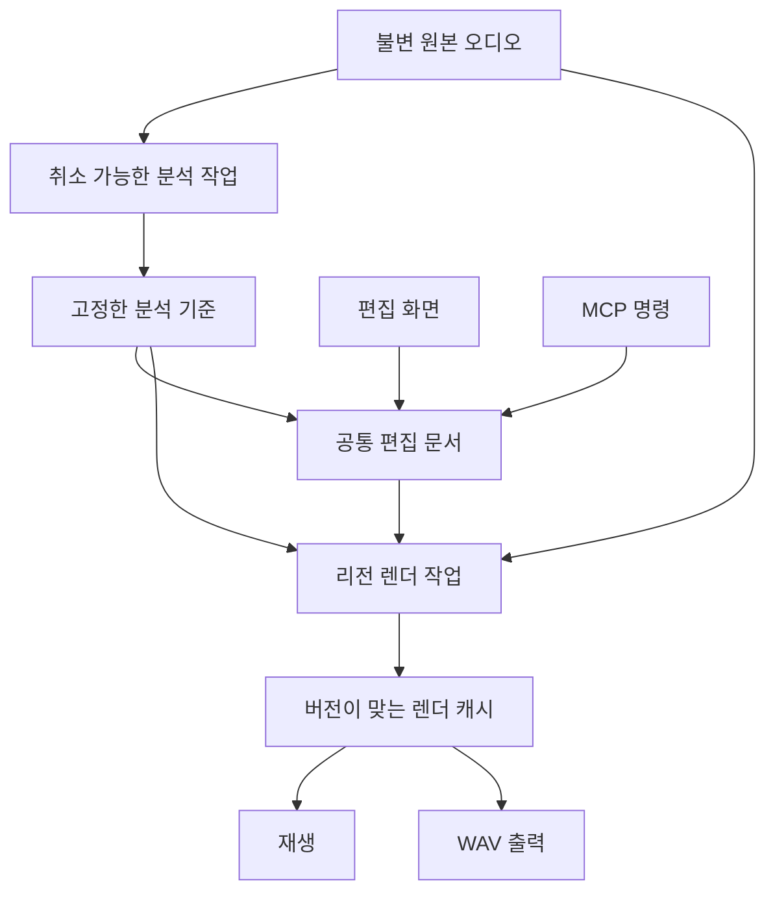

# 음표 단위 오디오 피치 편집 디바이스 설계

2026-11-02 · 기준 코드 `0b49a2bb22df1f775993fa75a848175282d573be`

**상태: 첫 구현을 추가한 확장 설계.** 여섯 이펙트 모듈 분리와 단선율 피치 분석·편집 UI·Worker 재합성·원본 보존·프로젝트 Undo/저장/출력 경로를 구현했습니다. 실제 지원 범위와 사용법은 [PITCH_EDITOR](PITCH_EDITOR.md), 현재 모듈 구조는 [ARCHITECTURE](ARCHITECTURE.md), 실행한 검증은 [IMPLEMENTATION_STATUS](IMPLEMENTATION_STATUS.md)를 기준으로 합니다.

이 문서의 §1은 위 기준 커밋에서 수행한 **착수 전 구조 감사**입니다. 나머지 기능 비교·목표 계약·단계별 완료 조건에는 아직 구현하지 않은 확장 기능이 포함됩니다. 범용 악기/리전 프로세서 플러그인 등록, 피치 MCP, 타이밍·정밀 보컬·다성음 편집과 Melodyne 수준의 음질을 완료했다는 뜻은 아닙니다.

## 1. 착수 전 디바이스 구조 감사 (0b49a2b)

현재는 **공통 랙을 사용하는 내장 디바이스 구조**입니다. 인스턴스·파라미터·노브 UI·오디오 입출력 계약은 공통화되어 있지만, 각 디바이스가 DSP·편집 화면·저장 규칙을 자체 소유하는 독립 모듈은 아닙니다.

| 구분 | 현재 구현 | 코드 근거 |
|---|---|---|
| 인스턴스와 순서 | `id`, `type`, `enabled`, 숫자형 `params`; `Track.devices` 배열 | [`types.ts`](../src/core/types.ts)의 `Device`, `Track` |
| 파라미터 | 범위·단위·기본값·로그 스케일 공통화 | [`devices.ts`](../src/core/devices.ts)의 `ParamDef`, `EFFECT_DEFS` |
| 효과 처리 | 여섯 종류의 factory가 한 파일에 존재 | [`graph.ts`](../src/audio/graph.ts)의 `DEVICE_FACTORIES` |
| 효과 화면 | 모든 효과를 같은 카드·노브로 표시 | [`DeviceChain.tsx`](../src/components/DeviceChain.tsx) |
| 악기 | 카탈로그는 분리되었지만 합성은 중앙 함수에서 분기 | [`instruments.ts`](../src/core/instruments.ts), `graph.ts`의 `scheduleInstrument` |
| 저장과 MCP | 효과 값 저장·검증, 카탈로그 및 편집 명령 제공 | [`project.ts`](../src/core/project.ts), [`commands.ts`](../src/core/commands.ts), [`host.ts`](../src/automation/host.ts) |

현재 `EffectType`과 MCP 명령의 효과 목록은 각각 여섯 종류를 열거합니다. 자체 편집기 등록, 모듈별 상태 버전·마이그레이션, 지연·tail 보고, 리전 처리기 계약은 아직 없습니다. 별도 npm 패키지·동적 플러그인 설치·VST/AU/CLAP 호스트를 제공한다는 뜻도 아닙니다.

가져온 `AudioClip`은 원본 ID·오프셋·길이·게인·페이드 등만 저장합니다. `scheduleAudioClip`은 원본 `AudioBuffer`를 재생하며 오디오 리전용 피치/타임 스트레치 경로가 없습니다. 샘플 **악기**의 음높이별 `playbackRate` 조절과 구분합니다. 현재 `clip.setTranspose`는 MIDI 전용이고 MCP도 오디오 분석·렌더를 미지원으로 선언합니다.

## 2. 제품 목표와 Melodyne 벤치마크

요청한 전체 기능의 장기 비교 기준을 **Melodyne 5 studio**로 잡되, 제공 가능한 기능은 검증한 단계별로 공개합니다. 공식 에디션 표에서 assistant는 정밀 단선율 도구를 포함하고, editor는 DNA 화음 편집, studio는 멀티트랙·Sound Editor까지 확장됩니다. [에디션 비교][editions]

| 기능 묶음 | 목표 동작 | 개발 단계 |
|---|---|---|
| 음표 분석·표시 | 연속 피치 곡선, 음표 블롭, 음이름·cents, 분석 신뢰도, 수동 분석 정정 | 단선율 기본 |
| 기본 피치 편집 | 반음·cents 이동, 스케일 스냅, 명시적인 보정 강도, 원본 복원 | 단선율 기본 |
| 음표 경계 | 분할·합치기·경계 이동, 독립/연결 경계와 이웃 음의 전이 | 기본 → 정밀 |
| 타이밍 | 음표 위치·길이, 퀀타이즈, 내부 시간 핸들·어택 속도 | 기본 → 정밀 |
| 정밀 피치 | 중심·느린 드리프트·빠른 모듈레이션을 독립 조절, 음 사이 전이 | 정밀 단선율 |
| 음색·세기 | 포먼트, 음표별 게인·뮤트·상대 페이드, 치찰음·호흡 밸런스 | 정밀 단선율 |
| 음악 문맥 | 키·스케일·튜닝, 코드 분석과 코드에 맞춘 편집, 매크로, Audio-to-MIDI | 기본 → 확장 |
| 다성 음표 | 피아노·기타 화음 속 개별 음의 검출·정정·변형·재합성 | 별도 다성 단계 |
| 재료별 처리 | 무음정 타악기, 음정 타악기, 복합 루프·믹스 전체의 전조·시간 변환을 각각 구분 | 별도 입력·알고리즘 검증 |
| 멀티트랙 | 여러 트랙 동시 표시·편집·매크로, 기준 트랙에 타이밍 정렬 | 확장 단계 |
| 배음 편집 | 음표의 배음 구조를 다루는 별도 Sound Editor 범위 | 별도 연구 단계 |

이 표는 장기 비교 대상의 기능 묶음이며 완전한 세부 동등성 체크리스트는 아닙니다. 각 단계의 세부 명세에서 도구·매크로·상호작용·입출력 동작을 공식 문서와 대조합니다. 도구의 존재와 음질 동등성을 따로 평가합니다. 블롭을 그리거나 전체 파일의 음높이를 바꾸는 것만으로 이 표의 기능을 구현했다고 보지 않습니다.

### 놓치지 않아야 할 차이

- **피치 중심·드리프트·모듈레이션:** 중심 보정과 비브라토 유지가 함께 가능해야 합니다. 공식 도구도 빠른 변화와 느린 변화를 별도 값으로 취급합니다. [공식 설명][drift]
- **분석 정정과 음악 편집:** 잘못 검출한 음표를 정정하는 명령은 실제 연주 음을 바꾸는 명령과 구분합니다. [분석 모드][assignment]
- **경계의 연결 관계:** 연결된 음표와 독립된 음표는 길이 변경·전이 동작이 다릅니다. [경계 도구][separations]
- **치찰음:** 유성·무성 성분이 동시에 존재할 수도 있으므로 단순한 무음 구간 제외로 대체하지 않습니다. 공식 Sibilant Balance는 Melodic/Percussive Pitched 알고리즘에 한정됩니다. 음표 페이드는 음 길이에 따른 상대 좌표도 필요합니다. [페이드·치찰음][sibilance]
- **다성 편집:** DNA는 단독 녹음된 다성 악기의 음높이별 편집이며 악기별 stem 분리와 같지 않습니다. 복수 악기가 같은 음을 내는 완성 믹스를 임의로 분리하는 기능으로 소개하지 않습니다. [알고리즘][algorithms]

## 3. 디바이스 외형과 실행 계약

사용자는 디바이스 랙에서 **피치 편집**을 열지만, 내부적으로는 `region-processor`에 속하게 합니다. 원본 전체 문맥을 읽고 분석·편집·렌더하는 수명 주기가 실시간 EQ와 다르기 때문입니다.

Melodyne도 편집 전에 오디오를 분석합니다. 일반 플러그인에서는 Transfer를 사용하고 ARA 호스트는 원본과 배치 정보를 제공해 그 단계를 줄입니다. 가락이음은 원본 자산을 이미 소유하므로 먼저 내부 계약으로 같은 정보를 제공합니다. **이 설계가 외부 ARA 지원을 구현했다는 의미는 아닙니다.** [Transfer와 ARA][transfer]

| 실행 종류 | 입력과 역할 | 예시 |
|---|---|---|
| `instrument` | MIDI 이벤트를 받아 오디오 생성 | 신스·샘플 악기 |
| `realtime-effect` | 순서가 있는 오디오 스트림 처리 | EQ·컴프레서·딜레이 |
| `region-processor` | 원본과 편집 문서를 읽어 리전별 결과 생성 | 피치·시간 편집 |

세 종류가 공유할 것은 안정적인 ID, 표시 메타데이터, 상태 버전·검증·이전, 편집기 진입점, 지원 명령과 기능 목록입니다. 실행 계약은 종류별로 나눕니다. 실시간 효과에는 생성·업데이트·정리·지연·tail을, 리전 처리기에는 분석·취소·상태 조회·렌더 결과를 정의합니다. 노드 객체·Worker·Promise를 프로젝트 상태에 저장하지 않습니다.

첫 모듈화는 같은 저장소 안에서 디바이스별 디렉터리로 분리합니다. 별도 배포 패키지나 사용자 임의 코드 로딩은 전제하지 않습니다. 아래 경로는 **예정 구조**이며 현재 존재하는 모듈로 소개하지 않습니다.

| 예정 경로 | 소유 책임 |
|---|---|
| `src/devices/contracts.ts` | 공통 외피와 종류별 실행 계약 |
| `src/devices/registry.ts` | ID 검증·등록, 지원 목록의 단일 출처 |
| `src/devices/eq/` 등 | 각 기존 효과의 정의·DSP·상태·계약 테스트 |
| `src/devices/pitch-editor/manifest.ts` | 이름·지원 입력·실제 구현된 기능 |
| `src/devices/pitch-editor/model.ts` | 분석 기준·수동 정정·비파괴 편집 문서 |
| `src/devices/pitch-editor/analyzer/` | F0·음표 경계·신뢰도 분석과 교체 가능한 백엔드 |
| `src/devices/pitch-editor/renderer/` | 피치·시간·포먼트 변환, 렌더 캐시 |
| `src/devices/pitch-editor/editor/` | 전용 블롭·곡선·도구·검사기 화면 |
| `src/devices/pitch-editor/commands.ts` | UI·MCP 공통 편집 및 검증 |

기존 효과 분리 시 타입 ID·기본값·신호 연결·보간·잔향 길이·구버전 저장 파일 호환성을 보존합니다. 메타데이터와 MCP 목록을 같은 정의에서 만들고, 미구현 기능은 카탈로그에 등록하지 않습니다. 디바이스 전용 화면은 필요할 때 불러올 수 있게 나눕니다.

## 4. 화면과 조작

오디오 리전을 선택하고 디바이스 랙의 **피치 편집 열기**를 누르면 하단 편집 공간을 사용합니다. 기존 48px 한옥 헤더와 테마 토큰을 따르며 별도의 큰 상단 도구막대를 추가하지 않습니다. 첫 버전에서 피치 카드는 소스 처리 영역에 놓고 일반 인서트 사이로 이동시키지 않습니다.

- 세로는 음높이, 가로는 시간입니다. 블롭 안에 원래 피치 곡선을 보여 주고 선택·신뢰도·유성/무성을 색 외에도 모양과 라벨로 구분합니다.
- 위아래 드래그는 피치, 좌우 드래그는 타이밍, 경계 핸들은 길이입니다. 일반 스냅과 정밀 cents 편집을 구분하고 정확한 값은 인스펙터에서도 입력합니다.
- 다중 선택, 범위 선택, 확대·이동, 분할·합치기, 원본 비교, 선택 항목 복원, Undo/Redo를 제공합니다. 한 번의 드래그는 한 번의 Undo입니다.
- 분석 중·취소·실패·검출 불확실·렌더 중을 실제 상태로 표시합니다. 분석 정정 모드와 연주 편집 모드를 눈에 띄게 구분합니다.
- 음이름은 기존 표기 규칙인 **MIDI 60 = C3**와 맞추되 내부 피치 값은 옥타브 표시와 분리합니다. 키보드 조작과 텍스트 입력 예외도 기존 단축키·선택 규칙을 따릅니다.
- 기본값은 원곡의 연속 피치를 보존합니다. 평균율·스케일 스냅은 명시적으로 켜며, 농현·시김새·포르타멘토를 일괄 오류로 처리하지 않습니다.

녹음이 끝난 리전의 편집과 라이브 입력 자동보정은 별개의 기능입니다. 마이크 모니터링 경로에 이 카드를 추가했다고 실시간 보컬 튜닝을 제공하는 것으로 표시하지 않습니다.

## 5. 원본·분석·편집·캐시를 분리

### 저장해야 할 것

1. **원본 식별:** 원본 해시, 디코딩 프로파일·샘플레이트·채널 처리 방식. 원본 `AudioAsset`은 불변입니다.
2. **분석 기준:** 분석기 ID·버전·설정, 음표 ID, 소스 구간, 피치 곡선·신뢰도·유성/무성 정보. 편집이 참조하는 분석 결과는 프로젝트와 함께 고정해 보관합니다.
3. **수동 분석 정정:** 검출 음표의 경계·할당·무성 구간 수정. 자동 분석 캐시와 다르게 사용자의 작업으로 보존합니다.
4. **편집 문서:** 리전별 ID·revision, 기준 분석 ID, 음표별 피치 중심·곡선 변화·포먼트·게인·시간 매핑·경계 연결 등 명시적 편집값.
5. **원본 오디오:** 현재와 같이 프로젝트 파일 안에 보관하고 누락·길이 불일치를 검증합니다.

렌더 PCM과 편집하지 않은 임시 분석 결과는 재생성 가능한 캐시입니다. 그러나 편집이 참조하는 음표 ID와 기준 곡선까지 캐시로 버리면 다음 분석에서 음표가 달라질 수 있으므로 **편집 기준 분석은 저장 대상**입니다. 알고리즘 변경·재분석은 기존 편집을 조용히 재매핑하거나 폐기하지 않고, 별도 문서로 만들거나 명시적인 이전 절차를 거칩니다.

`Project.schemaVersion`, `validateProject`, IndexedDB, `.garak` 가져오기·내보내기를 함께 갱신해야 합니다. 현재 로더는 알려진 필드를 다시 구성하므로 타입에 필드만 추가하면 저장·복원이 완성되지 않습니다. 큰 피치 곡선을 Undo마다 복제하지 않도록 고정 분석 자산과 작은 편집 문서를 분리하고 참조 이력을 보존합니다.

모듈이 없는 환경에서도 저장한 편집 데이터를 삭제하지 않고 읽기 제한 상태와 원본 비교 경로를 제공합니다. 보정된 결과를 재현할 수 없는 상태에서는 원본을 보정 결과인 것처럼 출력하지 않습니다.

### 시간·리전 규칙

| 동작 | 제안하는 규칙 |
|---|---|
| 좌표 | 분석은 명시한 샘플레이트의 소스 프레임, 편집은 리전 로컬 **초**, 배치는 프로젝트 박자. 렌더할 때 출력 레이트의 프레임으로 변환하며 스냅·퀀타이즈의 박자도 템포를 통해 변환 |
| 타임 워프 | 출력 시간에서 소스 시간으로 가는 엄격히 증가하는 구간별 매핑. 반복·복사는 별도 세그먼트로 표현하고 한 맵 안의 역행·중복을 금지 |
| BPM 변경 | 기존의 정상 속도 재생 정책과 명시적인 템포 추종을 구분. 템포 추종 선택 시에만 해당 문서의 매핑·캐시를 갱신 |
| 이동 | 원본·분석은 재사용하고 프로젝트 배치만 변경 |
| 트림·분할 | 소스 참조를 보존하고 로컬 범위/매핑을 나눔. 경계에서 교차하는 음표·페이드·전이의 정책을 테스트 |
| 복제 | 원본·불변 분석을 공유하되 편집 문서와 수정 가능한 식별자는 독립. 한 복제본의 편집이 다른 복제본을 바꾸지 않음 |
| 루프 | 같은 편집 결과를 반복하되 이음새·잔향·끝 경계를 검증 |
| 원본 비교 | 불변 원본을 같은 들리는 구간·타이밍 기준으로 비교할 수 있게 표시 |

리전 처리 결과는 기존 클립 게인·페이드 앞에 넣고, 그 다음 기존 트랙 인서트·팬·페이더·마스터를 통과합니다. 원본을 공유하는 다른 리전까지 바뀌므로 `asset.buffer`를 수정본으로 덮어쓰지 않습니다.

### 작업 취소·오래된 결과·메모리

분석·렌더는 `projectId`, `clipId`, 원본 해시, 분석 기준 ID·버전, 편집 문서 ID·revision, 작업 ID를 함께 받습니다. 삭제·원본 교체·Undo·재분석·프로젝트 전환 후 도착한 응답은 현재 키와 대조해 폐기합니다. Worker/WASM 버퍼의 취소·정리 책임도 명시합니다.

분석 키는 원본·디코딩/채널 프로파일·분석기 ID/버전·설정으로 만듭니다. **렌더 키는 분석 키와 편집 내용에 더해 렌더러 ID/버전·설정·품질 프리셋·출력 샘플레이트/채널 프로파일·실제 적용된 시간 매핑 해시를 포함**합니다. 템포 추종이면 프로젝트 BPM과 향후 템포 맵 revision도 반영합니다. 같은 편집 revision이어도 합성기나 출력 조건이 바뀌면 예전 PCM 캐시를 재사용하지 않습니다.

긴 DSP 계산은 UI 스레드나 오디오 콜백에 넣지 않습니다. 분석은 Worker에서 수행하고 PCM을 전달할 때 재생 중 원본 버퍼를 detach하지 않습니다. 작업 크기·대기열·동시 실행·캐시 메모리 상한을 정하고 실패 시 현재 프로젝트를 유지합니다. 소스 범위를 바꿀 때 필요한 앞뒤 분석 문맥을 확보합니다.

재생은 마지막으로 확정된 결과를 사용하되 UI에 대기 중 편집 상태를 구분합니다. 내보내기는 선택한 프로젝트 스냅숏의 렌더가 완료된 뒤 진행하며, 중간에 실패하면 원본으로 조용히 대체하지 않습니다.

## 6. DSP 선택과 검증할 가정

**초기 후보는 단선율 분석기와 Signalsmith Stretch 재합성기를 분리한 구성**입니다. 채택 확정이나 실제 브라우저 동작·음질 검증을 완료한 상태는 아닙니다.

| 요소 | 조사 결과 | 구현 전에 확인할 것 |
|---|---|---|
| F0 분석 | [YIN을 확장한 pYIN 원논문][pyin]을 참고해 단선율 추정을 비교 대상으로 둠. 피치 검출만으로 음표 분리와 재합성이 완성되지는 않음 | 옥타브 오류·동음 반복·비브라토·무성음·포르타멘토, 구현별 라이선스·속도 |
| Signalsmith Stretch | 공식 WASM/AudioWorklet 웹 배포와 피치·시간·포먼트 API 존재. 저장소 라이선스는 MIT | 경계·지연·스테레오·포먼트·무편집 통과·출력 길이·실제 브라우저 지원 |
| WORLD | F0·스펙트럼 포락선·비주기성 분석과 재합성. 공식 소스는 modified BSD로 표기 | 브라우저 이식·WASM 메모리·보컬 및 악기별 품질. 공식 저장소에 소개된 외부 래퍼도 따로 검증 |

Signalsmith의 문서는 포먼트 보정이 PSOLA 같은 단선율 방식만큼 정밀하지 않다고 설명합니다. 웹 API는 `AudioContext`에서 만드는 **AudioWorklet 노드**이며, 일반 Worker에 바로 넣는 오프라인 렌더 API로 가정하지 않습니다. 먼저 오프라인 WASM 어댑터 또는 검증한 `OfflineAudioContext` 경로를 확보해 동일 편집의 재생·파일 출력 결과를 일치시킵니다. 지연 보정·pre-roll·flush·정확한 출력 프레임 수는 이 검증에 포함합니다. [공식 웹 API][stretch-web] · [원본 라이브러리][stretch] · [MIT 원문][stretch-license]

WORLD는 보컬 계열의 후속 비교 후보이며, 브라우저 호환성을 공식 C++ 소스 존재만으로 보장하지 않습니다. [공식 저장소][world] · [라이선스][world-license]

전체 화음의 피치/시간 변환 기능은 화음 내부 음표 하나를 분리하는 기능과 다릅니다. 다성 편집에는 복수 기본음·배음 귀속·타격음·겹친 성분·잔향을 다루는 별도 분석·재합성과 검출 정정 도구가 필요합니다. 첫 단선율 백엔드에 `polyphonic`이라는 이름을 붙여 해당 기능을 제공하는 것으로 취급하지 않습니다.

## 7. AI와 MCP

목표는 AI에 오디오를 설명한 문장만 주는 것에 더해, **실제 분석된 음높이·시점·길이·신뢰도와 수정 가능한 음표 ID**를 제공하는 것입니다. 이것이 음악의 감정이나 의도를 자동 이해한다는 의미는 아닙니다.

아래는 **설계용 명령 예시이며 현재 MCP에는 등록되어 있지 않습니다.** 비동기 작업 API와 동기식 프로젝트 편집 명령을 나눕니다.

| 종류 | 예정 요청 | 처리 방식 |
|---|---|---|
| 분석 작업 | 분석 시작·진행 조회·취소 | 명시한 원본·범위·알고리즘에 대한 job |
| 조회 | 음표 목록, 피치 곡선 요약, 불확실 구간 | 페이지·시간 범위·응답 크기 제한 |
| 분석 정정 | 경계·검출 할당 정정 | 분석 기준 revision 검사, 명시적인 변경 |
| 편집 | 지정 음표의 cents·드리프트·모듈레이션·타이밍·포먼트·게인 | UI와 동일한 공통 명령, 원자적 적용·Undo |
| 미리 확인 | 변경 요약 및 실제 렌더 미리듣기 요청 | 구조적 diff와 청취 가능한 결과를 구분 |
| 출력 | 지원하는 범위의 MIDI 변환·렌더 요청 | 검증한 기능만 카탈로그에 표시 |

예: “보컬 5~8마디에서 선택한 음의 중심을 20센트 낮추고 비브라토는 유지”는 명시적인 리전·음표 ID, `pitchDeltaCents`, 모듈레이션 유지값으로 변환합니다. `projectId`, `expectedRevision`, `operationId`에 편집 문서·분석 기준 ID를 더해 다른 분석 결과에 명령이 적용되지 않게 합니다. 신뢰도가 낮거나 유성음이 아닌 구간은 결과에 드러내고 강제 보정을 기본값으로 삼지 않습니다.

## 8. 구현 단계와 완료 기준

| 단계 | 작업 | 완료로 인정할 근거 |
|---|---|---|
| A. 기존 디바이스 모듈화 | 기존 여섯 효과의 정의·DSP·tail·상태를 디바이스별로 분리, 공통 registry 연결 | 기존 프로젝트 왕복·노드 연결·파라미터·바이패스·순서·잔향과 출력 유지 |
| B. 분석·재합성 검증 | 단선율 분석과 실제 오디오 변형을 앱 밖의 작은 실험으로 비교 | 재현 가능한 원본·변경값·출력 파일, 수치·청취 결과, 시간 정렬·품질 범위 기록 |
| C. 첫 사용 가능한 디바이스 | 가져오기 → 분석 → 음표 이동·분할 → 재생 → Undo → 저장·재열기 → WAV 출력 | 모든 경로에서 같은 편집이 들리고 원본 복구 가능, 실제 브라우저 조작 검증 |
| D. 정밀 단선율 | 드리프트·모듈레이션·포먼트·전이·치찰음·시간 핸들, MCP 편집·Audio-to-MIDI | 기능별 회귀와 사람이 듣는 비교 평가, 국악 연속 피치 포함 |
| E. 다성 편집 | 피아노·기타부터 음표별 분리·정정·편집·재합성 | 목표 음의 변화와 비대상 음의 보존을 같은 자료에서 측정·청취 |
| F. 확장 도구 | 멀티트랙·참조 타이밍·고급 스케일/템포·배음 편집 | 기능별 별도 명세·성능·정확도·청취 검증 |

타악기용 처리와 복합 루프·완성 믹스 전체 변형도 장기 비교 범위에 포함하되, C/D의 단선율 음표 편집 지원을 이들 입력까지 확대한 것으로 표시하지 않습니다. 기능 공개 전 재료별 분석·어택 보존·위상·시간 변환을 따로 검증합니다.

외부 상용 Melodyne 플러그인 자체를 실행하는 경로는 [네이티브 호스트 로드맵](ROADMAP.md)의 별도 작업입니다. 위 단계는 가락이음 자체 편집 디바이스 개발입니다.

### 공통 검증 자료

- **분석:** 정현파·배음 음색·결손 기본음·같은 음 반복·비브라토·포르타멘토·무음·숨·치찰음·낮은 신호 대 잡음비. 합성 기준 신호의 cents 오차, 옥타브 오류, 음표 경계 오차와 유성/무성 오검출을 보고합니다.
- **재합성:** 작은 cents 보정과 큰 이동, 피치 변경 중 길이 유지, 시간 변경 중 피치 유지, 클릭·끝 잘림·위상·스테레오 변화. 바이패스/무편집은 가능한 한 원본 경로를 사용하고 필요한 재합성의 변화량은 따로 측정합니다.
- **시간:** 지원 샘플레이트별 프레임 수·시작 위치·pre-roll/flush, 루프·seek·trim·분할·복제·BPM 변경, 미리듣기와 WAV 출력의 일치.
- **작업 보존:** Undo/Redo, 저장·재열기, 취소, 캐시 삭제, 원본 누락, 모듈 버전 변경, 분석 도중 삭제·프로젝트 전환·Undo 후 늦은 응답.
- **청취:** 원본·무편집 통과·편집본을 음량 맞춰 비교합니다. 한국어 보컬의 모음·자음·숨과 가야금·해금 등의 농현·시김새를 포함합니다. 사람이 제공한 권한 있는 원본이나 재배포 가능한 자료를 사용합니다.
- **제품 비교:** Melodyne과 같은 원본·변경값·출력 조건으로 평가하고 기능 일치·분석 정확도·음질을 따로 기록합니다. 자동 테스트 개수만으로 동등 품질을 주장하지 않습니다.

이번 문서 작업에서는 후보 DSP를 설치·빌드·청취하지 않았습니다. 런타임을 변경하지 않았으므로 앱 기능 테스트의 신규 통과 결과도 없습니다. 다음 구현의 첫 완료 단위는 **기존 디바이스 모듈 경계를 실제 코드로 분리하는 A 단계와, 단선율 분석→실제 변형→출력을 입증하는 B 단계**입니다.

## 공식 참고 자료

[editions]: https://www.celemony.com/en/melodyne/melodyne-5-editions
[transfer]: https://helpcenter.celemony.com/M5/doc/melodyneStudio5/en/M5tour_TransferARA?env=live
[algorithms]: https://helpcenter.celemony.com/M5/doc/melodyneStudio5/en/M5tour_AudioAlgorithms?env=logic
[drift]: https://helpcenter.celemony.com/M5/doc/melodyneStudio5/en/M5tour_ToolModulationDrift_2?env=standAlone
[separations]: https://helpcenter.celemony.com/M5/doc/melodyneStudio5/en/M5tour_ToolSeparations_2?env=live
[assignment]: https://helpcenter.celemony.com/M5/doc/melodyneStudio5/en/M5tour_NA_Mode_Tools?env=standAlone
[sibilance]: https://helpcenter.celemony.com/M5/doc/melodyneStudio5/en/M5tour_ToolAmplitude_Fade_Sibilance?env=cubase
[stretch-web]: https://github.com/Signalsmith-Audio/signalsmith-stretch/blob/main/web/release/README.md
[stretch]: https://github.com/Signalsmith-Audio/signalsmith-stretch
[stretch-license]: https://github.com/Signalsmith-Audio/signalsmith-stretch/blob/main/LICENSE.txt
[world]: https://github.com/mmorise/World
[world-license]: https://github.com/mmorise/World/blob/master/LICENSE.txt
[pyin]: https://webspace.eecs.qmul.ac.uk/s.e.dixon/pub/2014/MauchDixon-PYIN-ICASSP2014.pdf

상기 링크는 기능 벤치마크와 후보 검토의 출처이며, 가락이음에 해당 코드가 통합되어 있다는 표시가 아닙니다.
