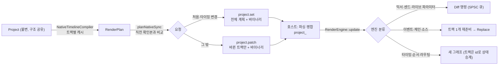

# RenderPlan / Diff 프로토콜 — 편집을 엔진에 전달하는 계약

2026-11-16 · 0.2.0 이후 0단계(아키텍처 리뷰 R1–R4) 구현

- 범위: 렌더러(TS)가 만든 렌더 계획을 네이티브 엔진에 보내고, 편집이 생길 때 **바뀐 만큼만** 적용하는 규칙입니다. 편집 1회마다 프로젝트 전체를 다시 만들던 구조(리뷰 병목 1·2)를 대체합니다.
- 이 문서는 **앞으로 만들 Rust 엔진의 입력 계약**이기도 합니다. Rust 코어는 같은 RenderPlan을 받고 같은 Diff 종류를 같은 규칙으로 적용해야 합니다(8장).
- 구현: [timeline.ts](../src/audio/native/timeline.ts)(계획 컴파일) · [timelineSync.ts](../src/audio/native/timelineSync.ts)(차분 계획·바이너리 인코딩) · [native-audio.ts](../desktop/native-audio.ts)(Electron 전달) · [protocol.hpp](../native/src/protocol.hpp)·[host.cpp](../native/src/host.cpp)(호스트 파싱·병합) · [engine.cpp](../native/src/engine.cpp) `RenderEngine::update`(엔진 적용) · [dsp.cpp](../native/src/dsp.cpp)(임펄스 응답 캐시).

---

## 1. 용어

| 용어 | 뜻 | 현재 타입 |
|---|---|---|
| **RenderPlan** | 엔진이 재생에 필요한 전부: 헤더(샘플레이트, 템포 맵, 길이, 사이클, 마스터 게인)와 트랙 계획의 배열 | TS `NativeProjectTimeline`, C++ `ProjectTimeline` |
| **TrackPlan** | 트랙 하나: 소스(악기), 믹서 값, 인서트 체인, 센드, 라우팅, 그리고 프레임 단위 이벤트(음표·컨트롤러·오디오 윈도·오토메이션) | TS `NativeTrackTimeline`, C++ `TrackTimeline` |
| **Diff** | 실행 중인 그래프를 다음 계획으로 옮기는 최소 작업. 아래 4종류의 명령과 그래프 교체 | C++ `RenderEngine::Impl::Kind::{Mix,Send,Param,Replace,Revision}` |
| **가벼운 필드** | 이벤트 배열을 뺀 트랙 필드(믹서, 인서트, 센드, 소스, 입력, 라우팅) | — |
| **무거운 필드** | `notes`, `controls`, `audio`, `automation` | — |
| **타이밍 헤더** | 모든 트랙의 프레임이 의존하는 헤더 값: 프로젝트 ID, 샘플레이트, 템포·템포 맵, 박자, 길이, 사이클, 저지연 모니터링, 트랙 순서 | — |

## 2. 전체 흐름



1. **렌더러**는 `NativeTimelineCompiler`로 계획을 만듭니다. 트랙의 이벤트 확장(음표 전개)은 `clips`·`kind`·`instrument`·`transpose`·`velocityOffset`·`keyLimit`·`velocityLimit`·`delayTicks`·VST3 악기 여부·프레임 격자(샘플레이트·템포 맵·길이)·PCM 메타데이터가 같으면 이전 배열을 **그대로(같은 객체로)** 재사용합니다. 오토메이션 레인도 같은 방식으로 캐시합니다. 결과는 `compileNativeTimeline()`과 항상 같습니다(테스트로 고정).
2. `planNativeSync(직전 확인본, 새 계획)`이 보낼 요청을 정합니다. 직전 확인본은 **같은 호스트 프로세스 세대와 같은 장치 설정**에서 호스트가 응답한 계획입니다. 장치 재설정·호스트 재시작·요청 실패 뒤에는 없으므로 전체를 보냅니다.
3. **Electron 메인**은 VST3 경로를 승인 목록으로 바꾸고, 바이너리 프레임을 JSON 줄 바로 앞에 씁니다.
4. **호스트**는 `project.set`이면 계획을 그대로, `project.patch`면 자기 사본(`project_`)에 바뀐 트랙을 병합해 다음 계획을 만들고 `RenderEngine::update()`에 넘깁니다. 실패하면 사본과 실행 중 그래프는 바뀌지 않습니다.
5. **엔진**은 마지막으로 제출한 그래프의 기록(control recipe)과 비교해 가장 작은 작업을 고릅니다(4장).

## 3. 메시지

### 3.1 `project.set`

```jsonc
{ "id": 7, "method": "project.set", "params": {
  "timeline": { "version": 1, "projectId": "...", "revision": 12, "sampleRate": 48000, "bpm": 120, "tempoMap": [...],
    "timeSignature": {...}, "beatsPerBar": 4, "lengthFrames": 384000, "cycle": null, "masterGain": 1,
    "lowLatencyMonitoring": true,
    "tracks": [ { "id": "t1", "source": {...}, "gain": 1, ..., "inserts": [...],
                  "notesBinary": { "offset": 0, "count": 2304 },      // 또는 "notes": [...]
                  "controlsBinary": { "offset": 55296, "count": 96 }, // 또는 "controls": [...]
                  "audio": [...], "automation": [...] } ] },
  "awaitApplied": true } }                                           // 선택: 오디오 콜백 적용까지 응답 대기
```

전체 계획입니다. 이벤트 배열은 JSON 배열 또는 바이너리 참조 중 하나로 옵니다. `render.wav`는 지금도 JSON만 씁니다.

### 3.2 `project.patch`

```jsonc
{ "id": 8, "method": "project.patch", "params": {
  "revision": 13,
  "header": { ...타임라인 헤더 전체(tracks 제외)... },
  "order": ["t1", "t2", "t3"],                 // 모든 트랙 id, 계획 순서
  "tracks": [ { "id": "t2", "source": {...}, "gain": 0.4, ..., "inserts": [...] } ] } }  // 바뀐 트랙만
```

- `header`는 매번 전체를 보냅니다(작습니다). 호스트는 프로젝트 ID나 샘플레이트가 다르면 거부합니다.
- `tracks`에 있는 트랙은 **가벼운 필드를 모두** 담습니다. 무거운 필드(`notes`/`notesBinary`, `controls`/`controlsBinary`, `audio`, `automation`)는 **바뀐 것만** 담고, 빠진 필드는 호스트의 이전 값을 유지합니다. 오토메이션을 모두 지웠다면 `"automation": []`을 보냅니다.
- `order`에 없는 트랙 id를 `tracks`에 넣거나, `order`에 처음 보는 트랙이 있는데 `tracks`에 없으면 거부합니다. 새 트랙은 `notes`와 `audio`를 반드시 담아야 합니다.
- 렌더러는 타이밍 헤더나 트랙 순서가 바뀌면, 그리고 IEUM WAVE 소스(패치)가 바뀌면 `project.set`을 보냅니다. 앞의 둘은 모든 트랙의 프레임이 바뀌는 경우이고, WAVE 패치는 엔진이 그래프 교체(테이블 크로스페이드와 `awaitApplied` 확인)로 처리하기 때문입니다.
- 바뀐 것이 없어도 revision을 올리기 위해 빈 `tracks`로 보냅니다.

### 3.3 응답

```json
{ "revision": 13, "applied": "diff", "replacedTracks": 0, "updateMicros": 210, "hostMicros": 1120 }
```

`applied`는 `none`(revision만), `diff`(제자리 명령만), `tracks`(트랙 교체 포함), `full`(새 그래프)입니다. `updateMicros`는 `RenderEngine::update()` 시간, `hostMicros`는 JSON 파싱부터 응답 직전까지의 호스트 처리 시간입니다. `awaitApplied`면 마지막 명령이 오디오 콜백에 적용된 뒤 응답합니다. 엔진 스냅숏의 `revision`도 같은 시점에 바뀝니다.

### 3.4 바이너리 프레임

```
#<바이트 수>\n
<원시 바이트>
{"id":8,"method":"project.patch",...}\n
```

- 프레임은 바로 다음 JSON 요청에 붙습니다. JSON은 `#`로 시작하지 않으므로 줄 단위 프로토콜과 섞이지 않습니다. 최대 64 MiB입니다.
- 렌더러에서 메인까지는 `params.binary`(Uint8Array)로 구조화 복제되고, 메인은 `project.set`/`project.patch`에만 허용합니다.
- 레코드(리틀 엔디언, 4바이트 정렬):

| 종류 | 크기 | 필드 |
|---|---|---|
| 음표 | 24 B | int32 `id`, int32 `onFrame`, int32 `offFrame`, int32 `limitFrame`, int32 `pitch`, float32 `velocity` |
| 컨트롤러 | 12 B | int32 `frame`, int32 `controller`, int32 `value` |

- 프레임은 int32에 들어갑니다(3600초 × 192 kHz = 691,200,000). 벨로시티는 float32로 보내며, 엔진도 원래 float로 저장하므로 값이 같습니다.
- 참조는 `{ "offset": 바이트, "count": 레코드 }`입니다. 64개 미만의 배열은 JSON으로 둡니다(작은 명령은 읽을 수 있는 JSON 유지).
- 호스트는 JSON과 똑같은 범위 검사(음표 구간, 컨트롤러 값, 정렬)를 바이너리 값에 적용하고, 프레임을 넘는 참조는 거부합니다.

## 4. 엔진의 Diff 분류 (`RenderEngine::update`)

엔진은 마지막으로 제출한 그래프와 그 뒤에 적용한 Diff를 반영한 **control recipe**(제어 스레드 전용)와 새 계획을 트랙마다 비교합니다. 위에서 아래로 처음 맞는 규칙을 씁니다.

| 바뀐 것 | 처리 | 콜백 비용 |
|---|---|---|
| 프로젝트 ID·샘플레이트, 타이밍 헤더, 트랙 수·순서·id, 라우트, 센드 구조(대상·프리/포스트·센드 레인 위치), 저지연 모니터링 | **새 그래프** (4.3) | 그래프 포인터 교체 |
| 트랙의 지연(PDC)이 달라지는 재준비, IEUM WAVE 패치 변경, 처리 중인 교체가 너무 많음 | **새 그래프** | 〃 |
| 음표·컨트롤러·오디오 윈도·오토메이션, 인서트 추가·삭제·이동·바이패스, 트랙 켜기/끄기, 입력, 소스(악기 파라미터 포함), 라이브가 아닌 인서트 파라미터, 같은 id로 다시 등록된 PCM·샘플 세트 | **Replace**: 그 트랙만 제어 스레드에서 다시 준비해 블록 경계에서 교체 | 포인터 교체 + 상태 이전 |
| 내장 인서트의 라이브 파라미터 | **Param**: `EffectControl` 값을 바꾸고 `automate()`로 제자리 반영(필터 계수는 약 12 ms 글라이드) | 수 µs |
| VST3 파라미터(악기·인서트) | 호스트 resolver가 캐시된 인스턴스에 `setParameter` | 없음 |
| 트랙 gain·pan·mute·solo·soloSafe·audible·unmutedAudible | **Mix**: 런타임 값 교체, 기존 페이더 스무딩으로 이동 | 수 µs |
| 센드 레벨 | **Send**: 리턴 트랙 feed의 목표값 교체(스무딩 유지) | 수 µs |
| 마스터 게인 | **Master** | 수 µs |
| 그 밖(같음) | 없음. 마지막에 **Revision** 명령 하나 | — |

라이브 파라미터는 `dsp::liveEffectParameter()`가 정합니다. 다음은 준비된 버퍼·구조를 바꾸므로 Replace입니다: 리버브 `size`·`type`·`predelay`, 딜레이 `mode`(스테레오 경로), 기타 리그 `rackSlot*`·`reverbDecay*`·`reverbEnabled*`. 나머지 파라미터는 모두 오토메이션과 같은 `automate()` 경로를 씁니다.

### 4.1 실시간 규칙

- 모든 Diff는 기존 SPSC 명령 큐(1024칸)로 들어가 다음 `render()` 시작에서 한꺼번에 적용됩니다. 콜백은 할당·해제·잠금을 하지 않습니다(테스트가 모든 렌더 호출에서 확인).
- Replace로 빠진 트랙과 교체된 그래프는 반환 큐로 제어 스레드에 돌아가 `collectRetired()`에서 파괴됩니다. 트랙은 `unique_ptr` 목록에 있어 교체가 포인터 교환입니다(MSVC에서 `std::map` 이동은 할당하므로 트랙 객체를 옮기지 않습니다).
- **render-ahead 트랙**: Mix·Param·Replace 대상이 미리 렌더 중이면 그 링을 먼저 비우고(명령은 그동안 대기) 콜백 소유가 된 뒤 적용합니다. Mix·Param은 적용 후 2초 동안 그 트랙을 콜백에 두어 페이더 드래그의 다음 틱이 다시 기다리지 않게 합니다. Replace 전에는 작업자가 트랙 목록에 들어오지 않게 막습니다(`quiesce`).
- 큐가 가득 차면 `update()`는 오류를 던지고 recipe를 버려 다음 업데이트를 새 그래프로 만듭니다.

### 4.2 Replace의 상태 이전 (`TrackRuntime::adopt`)

새 트랙은 블록 경계에서 이전 트랙의 재생 상태를 그대로 이어받습니다. **재생 중 편집이 음성이나 꼬리를 리셋하지 않습니다.**

- 악기 정체성(종류, 악기 id, 샘플 세트와 그 PCM 객체, VST3 인스턴스 정체성)이 같으면 음성·샘플·컨트롤러(벤드·모듈레이션·CC7/11·서스테인 페달)·라이브 노트·대기 이벤트·악기 인스턴스를 옮깁니다. 같은 IEUM WAVE 패치는 인스턴스를 새로 만들지 않고 넘겨받습니다.
- 인서트는 **id와 종류가 같은 것끼리** 상태를 옮깁니다(리버브 꼬리, 딜레이 버퍼, 필터 히스토리). 순서가 바뀌거나 앞에 인서트가 추가돼도 남은 인서트는 계속 울립니다.
- PDC 지연선, 출력 지연, 페이더·팬·뮤트 스무딩, 미터, 라우팅·센드 탭과 리턴 feed(그래프에서 계산된 값)를 옮깁니다.
- 이벤트 커서는 재생 위치에서 다시 찾습니다. 재생 위치 이전에 시작해 아직 울리는 새 음표는 다시 치지 않습니다(다음 반복부터 들립니다).
- **음표 id 재부여**: 엔진은 새 음표 중 이전 음표와 프레임·피치·벨로시티가 같은 것에 이전 id를 주고, 나머지에 이전 최댓값보다 큰 새 id를 줍니다. 그래서 바뀌지 않은 음표의 음성과 VST3/WAVE 노트 오프 id가 그대로 맞습니다. 짝이 없는 이전 음표(지웠거나 바꾼 음표)는 울리고 있으면 놓습니다(내장 악기는 릴리스, 플러그인 악기는 노트 오프).

### 4.3 새 그래프도 트랙 id로 이어집니다

새 그래프가 필요할 때도 같은 프로젝트라면 실행 중 그래프를 **이어받습니다**(이전에는 구조가 같을 때만 이어받고, 다르면 모든 음성·꼬리를 리셋했습니다). 제출 시 각 트랙을 같은 id의 이전 트랙과 연결하고 4.2와 같은 규칙으로 상태를 옮깁니다. 트랙을 추가·삭제·재배치해도 나머지 트랙은 계속 울리고, 새 트랙은 탐색 직후처럼 재생 위치에서 길게 걸친 음을 이어 시작합니다. 이벤트가 같은 트랙은 커서와 render-ahead 링까지 그대로 옮기고, 이벤트가 바뀐 트랙은 링을 먼저 비운 뒤 교체합니다(교체 명령 대기). 템포·길이·사이클이 바뀌면 모든 트랙을 비운 뒤 교체합니다.

## 5. 메모리와 임펄스 응답 캐시 (R1)

- 리버브와 기타 리그 리버브의 임펄스 응답은 원래 리버브마다 `std::pow`로 샘플마다 만들고(약 43 ms) 분할 컨볼버의 FFT 스펙트럼을 인스턴스마다 따로 가졌습니다.
- 이제 원시 잡음 임펄스는 `(샘플레이트, 길이, 시드, 공간)`마다 한 번 만들고, 크기를 섞은 뒤의 분할 스펙트럼은 `(샘플레이트, 공간, 크기)`마다 **불변 객체 하나를 공유**합니다(`shared_ptr<const ConvolverKernel>`). 인스턴스는 입력 스펙트럼 기록과 출력 링만 가집니다. 섞는 식과 FFT 순서는 그대로라 출력은 비트 단위로 같습니다(기타 리그 골든 해시 통과).
- FFT와 컨볼루션의 복소수 곱은 `std::complex` 연산자와 같은 식·같은 피연산자 순서로 직접 계산합니다(GCC의 NaN 복구 호출 제거, 결과 동일). 임펄스를 새로 만들 때도, 실시간 컨볼루션도 빨라집니다.
- 메모리 예산은 인스턴스 상태(리버브 하나 약 8 MB)와 **공유 스펙트럼을 한 번만** 셉니다(`StereoProcessor::sharedResources`). 같은 리버브 32개는 임펄스 응답을 한 번 만들고, 크기가 모두 다른 리버브 32개도 512 MB 상한 안에 들어갑니다.

## 6. 렌더러 쪽 규칙

- 음표와 오디오 윈도 id는 **트랙마다 0부터** 셉니다. 한 트랙을 편집해도 다른 트랙의 id가 바뀌지 않습니다.
- 이벤트 배열은 재사용될 때 같은 객체이므로, 차분 계획은 무거운 필드를 객체 비교로, 가벼운 필드를 JSON 비교로 판단합니다. 페이더 1틱은 트랙 하나의 가벼운 필드(약 2 KB)만 보냅니다.
- 캐시 키에 들어가지 않는 트랙 필드(이름, 색, 볼륨, 장치, 센드, 악기 파라미터 등)는 이벤트 확장에 쓰이지 않습니다. `core/playback.ts`가 새 트랙 필드를 읽게 되면 `EVENT_FIELDS`에 추가해야 합니다.

## 7. 측정 (2026-11-16, 이 PC, MinGW Release, `--test-clock`, 48 kHz/128)

프로젝트는 아키텍처 리뷰와 같은 방식으로 만들었습니다(데모 프로젝트 복제, 트랙마다 EQ+컴프+리버브).

| 항목 | 이전 | 이후 |
|---|---|---|
| 페이더 1틱, 호스트 처리 (16트랙, EQ+컴프+리버브, 재생 중) | `project.set` 왕복 838–892 ms | **0.12–0.43 ms** (중앙값 0.18, `project.patch`, `hostMicros`) |
| 페이더 1틱, 호스트 처리 (6트랙, EQ+컴프+리버브) | 254–272 ms | **0.06–0.13 ms** |
| 페이더 1틱, 호스트 처리 (32트랙 66,560음, EQ+컴프+리버브) | 거부 | **0.49–1.7 ms** |
| 리버브 노브 1틱 (라이브 파라미터) | 전체 재빌드 | Diff 명령, 임펄스 응답 재생성 없음 |
| 음표 편집, 호스트 처리 (32트랙 66,560음, EQ+컴프+리버브, 재생 중) | `project.set` 360–440 ms (이펙트 없음), EQ+컴프+리버브는 거부 | **최대 3.0 ms** (중앙값 2.4, 트랙 1개 교체, `hostMicros`) |
| 음표 편집, 렌더러 메인 스레드 (66,560음) | 92 ms (컴파일 + IPC 복제 + 직렬화) | **1.2 ms** |
| 페이더 1틱, 렌더러 메인 스레드 (66,560음) | 88 ms | **1.7 ms** |
| 32트랙 × 리버브 프로젝트 | "exceeds bounded memory"로 **거부** | 로드 61–71 ms(바이너리 포함 전체 `project.set`) |
| 16트랙 × EQ+컴프+리버브 `project.set` (JSON 그대로) | 838–892 ms | 91–121 ms (리버브 캐시 + 엔진 diff; 남은 시간은 JSON 파싱) |
| 전체 계획 메시지 (66,560음) | JSON 12.1 MB | JSON 43 KB + 바이너리 1.6 MB |

- 왕복 시간에는 Windows 파이프 폴링과 테스트 클록의 오디오 렌더(같은 스레드)가 섞여 있어, 호스트 처리량은 `hostMicros`로 비교했습니다. 입력 읽기 스레드는 1 ms 타이머 해상도(`timeBeginPeriod(1)`)로 대기해, 요청을 집어 오는 지연을 기본 15.6 ms 틱에서 줄였습니다.
- 재현: 측정 스크립트는 저장소 밖에서 실행했습니다(`perf2/before.mjs`, `after.mjs`, 렌더러 벤치). 방법은 아키텍처 리뷰 부록 A와 같습니다.

## 8. Rust 엔진이 지켜야 할 계약

Rust 코어(`garak-engine`)는 이 프로토콜의 엔진 쪽 절반을 그대로 구현합니다.

1. **입력**: `apply_plan(RenderPlan)`(= 4.3의 새 그래프)과 `push_diff`(Mix, Send, Param, Replace, Master, Revision). 바이너리 레코드 형식(3.4)은 그대로 씁니다.
2. **분류 규칙**: 4장의 표와 `liveEffectParameter` 예외 목록이 같아야 합니다. 같은 입력이면 같은 경로(`applied`)를 고릅니다.
3. **상태 이전**: 4.2·4.3의 규칙(악기 정체성, 인서트 id 대응, 음표 id 재부여, 지운 음표 릴리스, 새 트랙 추적 시작)을 지킵니다.
4. **실시간성**: Diff 적용은 블록 경계에서, 할당·잠금 없이 합니다. 폐기 객체는 제어 스레드에서 해제합니다.
5. **동등성**: Diff 경로의 출력은 같은 편집을 새 그래프로 적용한 출력과 같아야 합니다. 믹서 Diff와 음표 편집은 1e-6 안, 파라미터 Diff는 글라이드가 끝난 뒤 2e-5 안입니다. C++ 테스트([engine_test.cpp](../native/tests/engine_test.cpp)의 `update:` 항목)를 Rust 패리티 하네스로 옮겨 같은 기준을 씁니다.

## 9. 한계와 다음 단계

- `render.wav`와 WAV 내보내기는 아직 JSON 전체 계획을 보냅니다(한 번만 보내므로 영향이 작습니다).
- 템포·길이·사이클 변경과 트랙 추가·삭제는 새 그래프를 만듭니다. 상태는 이어지지만 큰 프로젝트에서는 준비 비용(전체 트랙 재준비)이 있습니다. 바뀌지 않은 트랙의 프로세서까지 새 그래프로 옮기는 일은 Rust 단계의 과제로 둡니다.
- 재생 위치에 걸친 새 음표는 다음 반복부터 들립니다(DAW 일반 동작). 필요하면 Replace 시 추적(chase)을 선택 사항으로 추가할 수 있습니다.
- PCM 업로드(`asset.put`)는 이 프로토콜 밖입니다(샘플 메모리 작업, `perf/memory-ui`).
