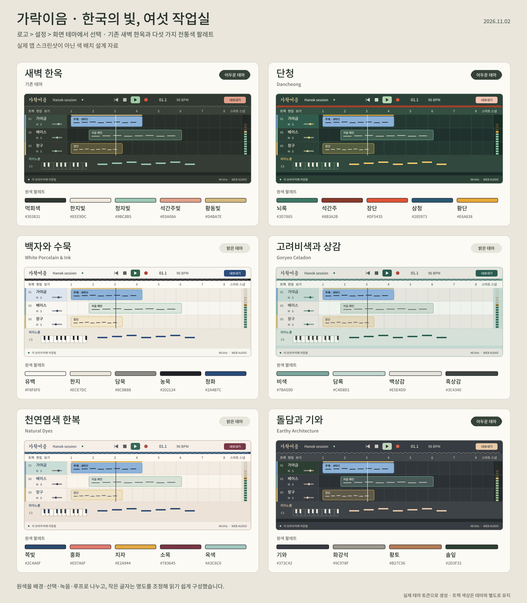

# 한국 전통색 화면 테마

2026-11-02 · 가락이음 0.1.0 개발 프리뷰

**로고 메뉴 → 설정… → 화면 테마**에서 테마를 선택합니다. 요청한 다섯 팔레트와 기존 **새벽 한옥**을 합쳐 여섯 가지를 제공합니다. 저장된 선택이 없거나 읽을 수 없을 때는 기존 새벽 한옥을 사용합니다.



위 그림은 **실제 앱 스크린샷이 아닌 색 배치 설계 자료**입니다. 실제 테마 레지스트리의 색으로 같은 작은 DAW 구성을 반복해 그렸습니다. 레이아웃·텍스트 크기·상태는 비교를 위한 도식이며, 실제 앱 화면이나 포인터·키보드 동작을 검증한 결과가 아닙니다. [원본 SVG](assets/korean-theme-presets.svg)와 [생성 스크립트](../scripts/build-theme-preview.py)를 함께 제공합니다.

## 선택과 저장

설정의 각 카드는 작업 화면 미니어처, 테마 이름, 밝기, 원색 스와치를 보여 줍니다. 카드의 radio를 선택하면 즉시 적용합니다. 선택한 테마의 원색별 배치는 카드 아래에서 확인할 수 있습니다. 네이티브 radio와 키보드 포커스 표시를 사용합니다.

테마는 **이 브라우저의 이 사이트 저장 공간**에 저장합니다. 다른 기기·브라우저·사이트 주소로 동기화하지 않습니다. 저장 키는 `garak-ieum:theme:v1`이며 값은 검증된 테마 ID 하나입니다. 프로젝트 파일이나 편집 Undo 이력에 넣지 않습니다.

저장에 실패해도 선택한 테마는 현재 세션에 적용합니다. 이 경우 저장 실패를 안내하고 **저장 다시 시도** 버튼을 제공합니다. 새로고침하면 이전에 저장한 선택이나 기본 테마로 돌아갈 수 있습니다. 저장된 값이 알 수 없는 ID이거나 저장 공간 접근이 막히면 새벽 한옥으로 시작합니다.

### 오디오 설정과의 구분

테마 선택은 즉시 반영하며, 오디오 장치·샘플레이트 초안은 기존 적용 경로를 사용합니다. 화면 테마 분류의 **닫기**는 적용된 테마를 되돌리지 않습니다. 적용하지 않은 오디오 변경이 함께 있으면 이를 별도로 표시하고 **오디오 설정 확인** 버튼으로 돌아갈 수 있게 합니다. 오디오 설정의 기본값 복원은 테마를 바꾸지 않습니다.

테마를 바꿀 때 곡의 음표, 오디오, 악기, 효과, 트랙·리전의 저장된 색을 바꾸지 않습니다. 트랙 색을 테마 색으로 일괄 교체하지 않고, 그 위의 라벨과 편집 표시는 대비에 맞게 표시합니다.

## 원색을 UI 역할에 배치하는 기준

원색마다 배경·텍스트·선택·녹음·루프 역할을 정했습니다. 같은 HEX를 본문, 배경, 버튼에 모두 적용하면 대비와 의미 구분이 무너지므로 **원색을 유지할 영역과 명도를 조정할 영역을 나눴습니다.** 아래 표의 파생색은 원색을 바탕으로 실제 구현에서 사용한 값입니다.

- 배경과 작업면은 넓은 면적에서 오래 볼 수 있도록 채도와 명도를 조정합니다.
- 본문·보조 글자·눈금은 색 이름의 분위기보다 실제 배경 위에서 읽히는 대비를 우선합니다. 담묵·화강석 원색은 작은 본문 글자에 그대로 쓰지 않습니다.
- 선택·포커스는 테마의 주조색을 사용합니다. 재생은 녹색 계열, 녹음은 빨강 계열이라는 동작 의미를 유지합니다.
- 루프·마커는 읽는 글자색 `--brass`와 채우는 원색 `--loop-fill`을 분리합니다. 밝은 치자색을 흰 배경 위의 작은 글자색으로 사용하지 않습니다.
- 선택된 리전·음표처럼 사용자의 트랙 색이 배경인 경우에는 실제 채움색에 맞춰 검정 또는 흰 전경을 선택합니다. 사용자 색 데이터는 유지합니다.

### 1. 단청 · 어두운 테마

뇌록 계열의 깊은 작업면과 따뜻한 황단 선택으로 구성합니다. 원색의 강도는 녹음·기와·입력·루프처럼 역할이 명확한 곳에 집중합니다.

| 제공된 원색 | 실제 배치 | 명도 조정과 적용값 |
|---|---|---|
| 뇌록 `#3D7865` | 선택 경계 `--accent-border` | 바탕 `#192B28`, 캔버스 `#1F302D`, 패널 `#2B4138` 등 녹청 계열의 어두운 면으로 파생 |
| 석간주 `#8B3A2B` | 기와 바탕 `--giwa` | 장식의 따뜻한 적갈색을 유지 |
| 장단 `#DF5435` | 녹음 표시 `--record`, 기와 경계 | 브랜드의 작은 글자·채워진 내보내기 버튼은 밝은 `#F9C5B3`으로 조정 |
| 삼청 `#285973` | 입력 필드 `--surface-input` | 실제 입력 배경에 원색을 사용하고 밝은 글자를 조합 |
| 황단 `#E6A838` | 루프·마커 채움 `--loop-fill` | 읽는 선택·포커스·금색 글자는 `#F3C86D`로 밝게 조정 |

### 2. 백자와 수묵 · 밝은 테마

유백 작업면과 한지 구획 사이에 농묵 글자를 놓고, 청화색으로 조작 상태를 표시합니다.

| 제공된 원색 | 실제 배치 | 명도 조정과 적용값 |
|---|---|---|
| 유백 `#F8F6F0` | 기본 작업면·패널 | 팝업은 `#FFFEFA`, 입력은 `#FFFDF8`로 미세하게 구분 |
| 한지 `#ECE7DC` | 앱 바탕·부드러운 구획 | 교차 행은 `#F0ECE3`, hover는 `#E4E0D6`으로 구분 |
| 담묵 `#8C8B88` | 강한 경계·비활성 글자 | 읽어야 하는 작은 보조 글자는 더 짙은 `#62625E` |
| 농묵 `#202124` | 본문·기와 바탕 | 보조 글자는 `#46484C`로 단계 구분 |
| 청화 `#2A4B7C` | 선택·포커스·브랜드·재생 커서 | hover는 `#203B63`, 선택 면은 연한 `#DCE5EF` |

### 3. 고려비색과 상감 · 밝은 테마

담록과 백상감의 면을 흑상감 글자로 읽습니다. 원색 비색은 경계와 기와에, 조작 상태의 글자에는 더 짙은 녹청색을 사용합니다.

| 제공된 원색 | 실제 배치 | 명도 조정과 적용값 |
|---|---|---|
| 비색 `#7BA59D` | 선택 경계·기와 바탕 | 읽는 선택·브랜드·포커스는 `#285C50` |
| 담록 `#C4D8D1` | 앱 바탕·선택 면 | hover는 `#CADAD0`, 부드러운 패널은 `#D5E0D8` |
| 백상감 `#E5E4DD` | 패널·교차 작업 구획 | 작업면은 `#EFF3ED`, 높은 면은 `#F1F3EC` |
| 흑상감 `#3C4340` | 본문·기와 경계 | 보조 글자 `#43564D`, 작은 안내 `#4C6056` |

### 4. 천연염색 한복 · 밝은 테마

따뜻한 비단빛 작업면에 쪽빛과 소목을 구분해서 사용합니다. 치자는 루프의 면으로, 옥색은 부드러운 선택과 경계로 배치합니다.

| 제공된 원색 | 실제 배치 | 명도 조정과 적용값 |
|---|---|---|
| 쪽빛 `#2C4A6F` | 선택·포커스·기와 바탕 | 본문은 `#2C3E56`, hover는 `#203B60` |
| 홍화 `#E07A6F` | 녹음 계열의 색 기준·원색 스와치 | 밝은 작업면에서 녹음 표시는 더 짙은 `#B14E45`, 오류 글자는 `#983D39` |
| 치자 `#E2A944` | 루프·마커 채움 | 읽는 금색 글자는 `#7A520F` |
| 소목 `#783645` | 브랜드·내보내기·재생 커서 | hover는 더 짙은 `#642937` |
| 옥색 `#A3C6C0` | 기와 경계·선택 계열의 색 기준 | 선택 면은 `#C9DDD7`, 조작 경계는 `#739F97` |

### 5. 돌담과 기와 · 어두운 테마

기와색 패널과 솔잎색 선택 면에 황토의 온기를 더합니다. 화강석은 경계에 남기고 작은 글자는 밝게 조정했습니다.

| 제공된 원색 | 실제 배치 | 명도 조정과 적용값 |
|---|---|---|
| 기와 `#373C42` | 패널·기와 바탕 | 앱 바탕 `#23282A`, 캔버스 `#2B3034`, 높은 면 `#41474B` |
| 화강석 `#9C978F` | 강한 경계·기와 경계·비활성 글자 | 읽는 작은 글자는 `#CFC7BC`, 본문은 `#F2ECE2` |
| 황토 `#B27C56` | 선택 경계 | 선택·포커스는 밝은 `#E7C9A9`, 브랜드는 `#EACAA8` |
| 솔잎 `#2D3F33` | 선택 면 | 재생·성공 표시는 밝은 녹색 계열로 파생 |

## 밝기 전환과 기존 화면

밝은 테마는 백자와 수묵·고려비색과 상감·천연염색 한복입니다. 단청·돌담과 기와·기존 새벽 한옥은 어두운 테마입니다. 선택에 따라 브라우저의 `color-scheme`도 바꿉니다.

기와가 포함된 48px 통합 헤더와 기존 로고·워드마크 원본을 유지합니다. 밝은 면에서 기존 미색 워드마크가 흐려지지 않도록 같은 SVG 윤곽에 테마 전경색을 입힙니다. 전역 텍스트 선택 제한과 이름·입력·복사 가능한 안내의 예외도 유지합니다.

파형과 레벨 미터는 Canvas에 이미 그린 내용을 자동으로 다시 칠하지 않으므로 테마 변경을 구독해 새 색으로 그립니다. 피아노롤·타임라인·채널 스트립의 고정 전경색도 역할별 토큰 또는 실제 트랙 색에 따른 전경으로 연결합니다.

## 명암비와 검증 범위

아래 값은 실제 레지스트리의 RGB로 계산했습니다. 작은 글자는 본문·보조·muted 색을 캔버스, 패널, 높은 면, 팝업, hover, 선택 면, 입력 면에 모두 조합한 최저값입니다. 채워진 컨트롤은 accent·brand 위 inverse와 play 위 onPlay의 최저값입니다.

| 테마 | 작은 글자 최소 | 포커스 최소 | 채워진 주요 컨트롤 전경 최소 |
|---|---:|---:|---:|
| 새벽 한옥 | 4.601:1 | 4.726:1 | 6.897:1 |
| 단청 | 5.271:1 | 4.691:1 | 8.063:1 |
| 백자와 수묵 | 4.648:1 | 6.650:1 | 6.265:1 |
| 고려비색과 상감 | 4.524:1 | 5.148:1 | 6.990:1 |
| 천연염색 한복 | 4.722:1 | 6.393:1 | 6.203:1 |
| 돌담과 기와 | 4.597:1 | 4.882:1 | 8.492:1 |

신규 다섯 테마는 accent·brand·brass·play·success·danger·warning 계열 글자도 위 면에서 4.5:1 이상으로 검사합니다. 비활성 표시, 장식, 투명 합성, 모든 실시간 상태 조합을 이 표가 보장하지 않습니다. **전체 UI의 접근성 인증이나 실제 화면 실측 결과가 아닙니다.**

[`theme.test.ts`](../src/core/theme.test.ts)의 21개 테스트에서 저장값 복원·손상값 fallback, DOM 반영 뒤 구독 알림, 저장 실패 시 현재 세션 유지, 잔여 토큰 제거, 기존 테마 복원과 위 대비 조건을 확인했습니다. TypeScript 검사와 diff 형식 검사도 통과했습니다. 전체 회귀·빌드의 최종 결과는 [구현 상태](IMPLEMENTATION_STATUS.md)를 따릅니다.

**실제 브라우저의 화면·클릭·키보드 조작은 아직 검증하지 않았습니다.** 최소 620px부터 넓은 화면까지 설정 카드·긴 이름·스크롤·포커스, 여섯 테마 전환 후 미터·파형 다시 그리기, 새로고침 복원, 저장 실패 메시지, 오디오 미적용 초안과 함께 닫는 동작을 확인해야 합니다. 위 PNG를 열어 확인한 것은 설계 자료의 한글·색·겹침이며 실제 앱 QA와 구분합니다.

## 구현 위치

| 파일 | 역할 |
|---|---|
| [`src/core/theme.ts`](../src/core/theme.ts) | 여섯 테마의 원색·역할·실제 값, 저장·복원, CSS 적용과 구독 |
| [`src/styles/themes.css`](../src/styles/themes.css) | 공통 파생 역할과 밝기 모드 |
| [`src/components/AppearanceSettings.tsx`](../src/components/AppearanceSettings.tsx) | 미리보기 카드, 선택, 원색 역할표, 저장 실패 안내 |
| [`src/components/AudioSettingsDialog.tsx`](../src/components/AudioSettingsDialog.tsx) | 화면 테마 분류와 오디오 초안의 분리 |
| [`src/main.tsx`](../src/main.tsx) | React 마운트 전에 저장한 테마 적용 |

`--ink-*`는 호환용 음영 단계입니다. 밝은 테마에서도 낮은 번호를 배경, 높은 번호를 전경 역할로 매핑하며 숫자를 물리적인 명도 백분율로 해석하지 않습니다. 기본 새벽 한옥으로 돌아갈 때는 새 테마의 inline override를 제거해 기존 ramp를 복원합니다.

## 설계 자료 재현

생성기는 실제 `THEMES` 값을 읽고 SVG 도형과 글자 윤곽으로 자료를 만듭니다. PNG는 그 SVG를 렌더한 것입니다. 앱의 npm 의존성이나 배포 번들에 렌더러·추가 글꼴을 넣지 않습니다.

확인한 환경은 Node 24, Python 3.12, fontTools 4.61.1, PyMuPDF 1.26.6입니다. 별도 Python 환경에 필요한 도구를 준비하고 한국어를 지원하는 Noto Sans KR 글꼴 경로를 지정합니다.

```bash
python -m pip install fonttools==4.61.1 PyMuPDF==1.26.6
python scripts/build-theme-preview.py --font /path/to/NotoSansKR.ttf
```

글꼴은 [Google Fonts의 공식 Noto Sans KR 파일](https://github.com/google/fonts/blob/main/ofl/notosanskr/NotoSansKR%5Bwght%5D.ttf)과 [OFL 안내](https://github.com/google/fonts/blob/main/ofl/notosanskr/OFL.txt)를 참고합니다. 이번 자료에 사용한 파일의 SHA-256은 `194018e6b2b293a7964f037b25c0249ce1418bc9ab3c971060a03aa57861e252`입니다. 가변 글꼴의 weight 500을 사용해 필요한 글자만 문서의 윤곽으로 그렸으며 글꼴 파일은 저장소에 추가하지 않았습니다. 덕온공주체 워드마크는 기존 SVG 자산을 사용하며 출처는 [브랜드 문서](BRAND.md)를 따릅니다.

출력은 `docs/assets/korean-theme-presets.svg`와 `.png`입니다. 생성기는 필요한 글자가 글꼴에 없으면 오류를 내고, 완료 시 사용한 윤곽 수와 누락 글자 0을 확인합니다. 글꼴과 라이브러리 버전이 바뀌면 문자 모양·렌더링 결과가 달라질 수 있습니다.
